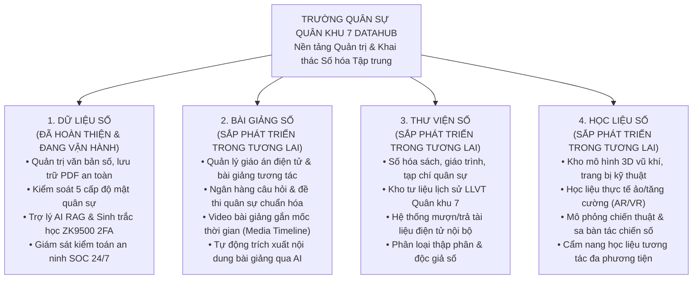
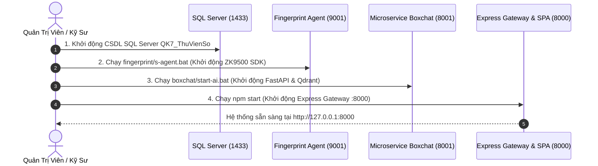

# TRƯỜNG QUÂN SỰ QUÂN KHU 7 DATAHUB — Cổng Quản Lý Dữ Liệu Tập Trung Quân Khu 7

Hệ thống quản lý, lưu trữ số hóa, phân quyền khai thác tài liệu quân sự bảo mật đa cấp độ, tích hợp Trợ lý Trí Tuệ Nhân Tạo (AI RAG) và Xác Thực Sinh Trắc Học Vân Tay (ZKTeco ZK9500) của Trường Quân sự Quân khu 7.

---

## 🏛️ HỆ SINH THÁI 4 TRỤ CỘT CỐT LÕI (QK7 DIGITAL ECOSYSTEM)

Nền tảng QK7 DataHub được quy hoạch theo mô hình hệ sinh thái số hóa quân sự toàn diện gồm 4 phân hệ chuyên biệt:



1. **Dữ liệu số (Đã hoàn thiện & Đang vận hành chính thức):**
   * Quản lý, lưu trữ số hóa công văn, chỉ thị, nghị quyết, kế hoạch quân sự.
   * Kiểm soát độ mật 5 cấp nghiêm ngặt (Cấp 1 - Công khai đến Cấp 5 - Tuyệt mật) với cơ chế bảo vệ 3 tầng (UI $\rightarrow$ Gateway $\rightarrow$ Database).
   * Tích hợp máy quét vân tay quang học ZKTeco ZK9500 2FA bắt buộc cho tài liệu Cấp 3, Cấp 4, Cấp 5 và tài khoản Quản trị viên.
   * Trợ lý AI Boxchat Agentic RAG trả lời câu hỏi kèm trích dẫn số trang chính xác và Smart SQL Fallback.
   * Trung tâm giám sát nhật ký kiểm toán an ninh SOC thời gian thực và xuất báo cáo chuẩn Excel Quân đội.

2. **Bài giảng số (Sắp phát triển trong tương lai):**
   * Kho quản lý bài giảng điện tử tương tác dành cho giảng viên và học viên Trường Quân sự Quân khu 7.
   * Số hóa giáo án, slide bài giảng, ngân hàng đề thi trắc nghiệm và tự luận quân sự theo từng chuyên ngành.
   * Tích hợp AI sinh đề thi tự động từ giáo án và quản lý dòng thời gian video huấn luyện (`MediaTimelineManager`).

3. **Thư viện số (Sắp phát triển trong tương lai):**
   * Số hóa toàn bộ đầu sách, tài liệu nghiên cứu khoa học quân sự, lịch sử truyền thống Quân khu 7.
   * Cung cấp cổng tra cứu thư viện trực tuyến, mượn/trả tài liệu điện tử có bảo vệ bản quyền số (DRM nội bộ).
   * Tự động lập chỉ mục nội dung sách và trích xuất tóm tắt phục vụ công tác nghiên cứu học thuật.

4. **Học liệu số (Sắp phát triển trong tương lai):**
   * Kho học liệu đa phương tiện: bản đồ số hóa tác chiến, sơ đồ bố phòng, mô hình 3D vũ khí trang bị.
   * Tích hợp công nghệ mô phỏng tương tác, bài tập thực hành kỹ chiến thuật trên không gian mạng nội bộ.
   * Cẩm nang học liệu tra cứu nhanh bỏ túi dành cho sĩ quan, hạ sĩ quan và chiến sĩ.

---

## 📌 Danh Mục Tài Liệu Kỹ Thuật Dự Án

* 👉 **[SYSTEM_ARCHITECTURE.md](./SYSTEM_ARCHITECTURE.md)**: Kiến trúc toàn diện 5 tầng, ERD, luồng dữ liệu, phân quyền bảo mật 3 lớp.
* 👉 **[SETUP_SERVER.md](./SETUP_SERVER.md)**: Sổ tay hướng dẫn cài đặt Server, Client, ZKTeco SDK và kết nối phần cứng.
* 👉 **[AGENT_WORKFLOW.md](./AGENT_WORKFLOW.md)**: **Quy trình làm việc bắt buộc với AI Agent (3 bước: Khởi động $\rightarrow$ Thực hiện $\rightarrow$ Cập nhật tài liệu)**.
* 👉 **[TROUBLESHOOTING_HISTORY.md](./TROUBLESHOOTING_HISTORY.md)**: **Sổ tay tổng hợp toàn bộ sự cố kỹ thuật từ trước đến nay và phương án khắc phục dứt điểm**.
* 👉 **[docs/CHANGELOG.md](./docs/CHANGELOG.md)**: Nhật ký thay đổi và các mốc phát hành phiên bản.

---

## 🛡️ TỔNG HỢP CÁC TÍNH NĂNG BẢO MẬT & KỸ THUẬT ĐÃ TRIỂN KHAI

### 1. Dynamic Watermark (Chống chụp màn hình & rò rỉ tài liệu)
* Tự động phủ lớp watermark động lên tài liệu PDF và màn hình hiển thị: hiển thị Họ tên quân nhân, Tên đăng nhập, Địa chỉ IP máy trạm và Dấu thời gian thực (Timestamp).
* Góc nghiêng 45 độ, bố trí trải đều theo lưới ma trận chuẩn, cấm thao tác bôi đen copy hoặc xóa bỏ watermark qua DevTools.
* Đã chuẩn hóa CSS cưỡng chế kiểu chữ bình thường (`font-style: normal !important`), kích thước chữ đồng nhất, không bị in nghiêng (*italic*) làm mất mỹ quan văn bản quân sự.

### 2. Cơ chế bảo mật cứng 3 lớp khi chỉnh sửa/lệch giờ máy trạm và mở file
* **Clock Authority Engine:** Máy chủ Gateway định kỳ đồng bộ mốc thời gian chuẩn từ nguồn tham chiếu uy tín (Google / NTP Time Server), không phụ thuộc vào đồng hồ hệ thống của máy trạm Client.
* **Phát hiện gian lận lệch giờ (Drift Detection):** Tính toán độ lệch thời gian $\Delta t$ giữa máy trạm và máy chủ. Nếu quân nhân cố tình điều chỉnh lùi giờ máy trạm cục bộ để gian lận thời hạn token hoặc lách phiên đăng nhập:
  1. **Lớp 1 (Gateway Middleware):** Lập tức chặn request và từ chối truy cập với mã lỗi `403 TIME_DRIFT_EXCEEDED`.
  2. **Lớp 2 (UI Alert Guard):** Giao diện kích hoạt cảnh báo vi phạm an ninh nghiêm trọng, tạm khóa màn hình thao tác văn bản.
  3. **Lớp 3 (Audit SOC Logging):** Tự động phát sinh bản ghi `ACCESS_LOG` mức độ `CRITICAL` gửi thẳng về màn hình giám sát kíp trực an ninh SOC.
* **Phạm vi bảo vệ:** Kích hoạt chốt chặn cứng trên **toàn bộ các cấp độ tài liệu (từ Cấp 1 Công khai, Cấp 2 Nội bộ, Cấp 3 Mật, Cấp 4 Tối Mật đến Cấp 5 Tuyệt Mật)**.

### 3. Xác thực sinh trắc học vân tay 2FA Admin (ZK9500 Hardware Guard)
* Áp dụng quy chuẩn bảo mật hai lớp bắt buộc đối với tài khoản Quản trị viên tối cao (`USR-001`):
  * **Bước 1:** Xác thực tên đăng nhập và mật khẩu băm bcrypt.
  * **Bước 2:** Hệ thống cấp Vé tạm (`temp_ticket` JWT có hiệu lực 2 phút) và kích hoạt hộp thoại quét vân tay quang học ZKTeco ZK9500.
* **Giao diện Frosted Glass chuẩn mực:** Render modal bằng React Portal trực tiếp vào `document.body`, loại bỏ hoàn toàn lỗi Stacking Context trong Framer Motion, sử dụng lớp phủ kính mờ nhẹ nhàng, không làm đen kịt giao diện đăng nhập.
* **Cơ chế dự phòng an toàn (Fail-Safe Initialization):** Trong trường hợp hệ thống mới khởi tạo hoặc mẫu vân tay vừa bị reset (`active = 0`), backend tạm thời cho phép Admin đăng nhập bằng mật khẩu kèm cảnh báo an ninh `LOGIN_NO_FP_WARNING`, hướng dẫn quản trị viên vào ngay trang Quản lý người dùng để thu thập mẫu vân tay mới.

### 4. Chặn địa chỉ IP ngoài Whitelist cho Quản trị viên (Admin IP Whitelist)
* Cưỡng chế chính sách an ninh mạng: Tài khoản quyền Quản trị tối cao chỉ được phép truy cập từ các dải địa chỉ IP nội bộ đã được phê chuẩn trong Whitelist (Localhost `127.0.0.1`, IP máy chủ trạm kiểm soát).
* Mọi nỗ lực truy cập từ IP lạ ngoài danh mục lập tức bị từ chối `403 FORBIDDEN` và khóa IP nếu cố tình thử lại nhiều lần.

### 5. Chống spam thông báo Toast cảnh báo 403 (2s Throttle / Debounce)
* Tích hợp bộ đệm thời gian (Throttle 2 giây) cho các thông báo Toast lỗi phân quyền `403 Forbidden` trên giao diện người dùng.
* Tránh hiện tượng hàng loạt Toast hiển thị chồng chéo, giật lag giao diện khi nhiều request nền (background API polling) đồng thời bị từ chối truy cập.

### 6. Tối ưu hóa Admin Dashboard & Phân hệ Quản lý Quân nhân (Users)
* Giao diện quản lý quân nhân tối ưu: hiển thị phân trang chuẩn 5 người dùng / trang, nút chuyển trang mượt mà.
* Tích hợp bộ lọc đa tiêu chí: lọc theo Cấp độ bảo mật (Cấp 1 - 5), lọc trạng thái hoạt động (Active/Locked), tìm kiếm tiếng Việt không dấu (Accent-insensitive).
* Tích hợp hộp thoại chỉnh sửa thông tin quân nhân, cấp bậc quân hàm, đơn vị công tác và chức vụ rõ ràng.

### 7. Tự động ẩn Sidebar thông minh khi không có menu
* Component Sidebar tự động tính toán số lượng menu khả dụng theo quyền hạn thực tế của quân nhân đang đăng nhập.
* Nếu quân nhân đang ở các trang không có menu con hoặc không có quyền xem danh mục, Sidebar sẽ tự động ẩn mượt mà, tối ưu 100% diện tích không gian hiển thị tài liệu tác chiến.

### 8. Trang Cấu hình Quyền bảo vệ (Granular RBAC & Permission Protection)
* Bảng ma trận phân quyền nâng cao (`/permissions`): cho phép xem và thiết lập chi tiết từng quyền hạn (Xem, Tải, Thêm, Sửa, Xóa, Phê duyệt, Quét vân tay).
* Cơ chế bảo vệ đặc quyền Admin tối cao: cấm tuyệt đối hành vi vô tình tự hạ quyền hoặc gỡ quyền cốt lõi của tài khoản Quản trị viên.
* Hỗ trợ kéo-thả sắp xếp thứ tự nhóm quyền trực quan bằng Ant Design Drag-and-Drop.

### 9. Quản lý Phiên trực tuyến & Tự động thu hồi phiên (Session Management)
* Trang giám sát phiên làm việc thời gian thực (`/sessions`): theo dõi toàn bộ các phiên đăng nhập đang hoạt động trong toàn Quân khu kèm địa chỉ IP, User-Agent, thời điểm bắt đầu và thời hạn hết hạn.
* Tính năng ngắt phiên cưỡng bức 1-click (`Kill Session`) dành cho kíp trực an ninh SOC.
* Tự động thu hồi phiên làm việc (`Auto-Revoke`): Hủy ngay lập tức toàn bộ phiên hoạt động khi tài khoản bị đổi mật khẩu, bị khóa do vi phạm hoặc phát hiện đăng nhập trái phép.

### 10. Trích xuất nội dung & Kiểm tra chống trùng lặp văn bản PDF
* Tự động tính toán mã băm mật mã học **SHA-256** ngay khi quân nhân tải lên tệp văn kiện.
* Đối chiếu tức thì với kho lưu trữ CSDL SQL Server: nếu phát hiện tài liệu trùng mã băm SHA-256, hệ thống cảnh báo văn bản đã tồn tại, ngăn ngừa lãng phí dung lượng ổ đĩa và sai lệch phiên bản.
* Tự động kích hoạt luồng bóc tách nội dung PDF (`pdf_processor.py`), phân mảnh ngữ nghĩa thông minh và nạp vào cơ sở dữ liệu vector Qdrant.

### 11. Bộ công cụ cứu hộ & Khởi tạo tài khoản Quản trị mặc định
* `backend/setup-passwords.js`: Script khởi tạo tài khoản quản trị mặc định, đồng bộ mật khẩu băm bcrypt an toàn.
* `tools/admin-fingerprint-tool.js`: Công cụ chuyên dụng dòng lệnh dành cho Quản trị viên:
  * `node tools/admin-fingerprint-tool.js status`: Chẩn đoán tính toàn vẹn của tất cả mẫu vân tay trong CSDL.
  * `node tools/admin-fingerprint-tool.js reset <userId>`: Tạm hủy kích hoạt mẫu vân tay hỏng để cứu hộ đăng nhập.
  * `node tools/admin-fingerprint-tool.js delete <userId>`: Xóa triệt để mẫu vân tay cũ để tiến hành đăng ký mới.

---

## 📁 Cấu Trúc Dự Án Toàn Diện

```text
qk7-datahub/
├── package.json                            # Điều phối kịch bản khởi chạy toàn bộ dự án
├── README.md                               # Sổ tay hướng dẫn khởi động nhanh & hệ sinh thái
├── AGENT_WORKFLOW.md                       # Quy trình làm việc bắt buộc với AI Agent (3 bước)
├── TROUBLESHOOTING_HISTORY.md              # Sổ tay cứu hộ, tổng hợp toàn bộ sự cố & giải pháp
├── SETUP_SERVER.md                         # Sổ tay hướng dẫn cài đặt Server & Client chi tiết
├── SYSTEM_ARCHITECTURE.md                  # Tài liệu kiến trúc toàn diện 5 tầng hệ thống
├── tools/                                  # Công cụ CLI quản trị & cứu hộ
│   └── admin-fingerprint-tool.js           # Công cụ chẩn đoán, reset và xóa mẫu vân tay
│
├── backend/                                # 🟢 MÁY CHỦ EXPRESS 5 & WEBSOCKET GATEWAY (:8000)
│   ├── src/
│   │   ├── db.js                           # Kết nối Microsoft SQL Server (QK7_ThuVienSo)
│   │   ├── admin-routes.js                 # API quản trị CRUD (Users, Roles, Units, Permissions...)
│   │   ├── ai-routes.js                    # Cổng giao tiếp AI boxchat (:8001) & Smart SQL Fallback
│   │   └── fingerprint-ws.js               # WebSocket Server (/ws/fingerprint) quản lý ZK9500
│   ├── uploads/                            # Kho lưu trữ tệp PDF thật (theo hash SHA-256)
│   ├── public/                             # Sản phẩm build tĩnh từ Frontend xuất sang
│   ├── server.js                           # Entry point Express API Gateway & Biometrics
│   └── setup-passwords.js                  # Script khởi tạo tài khoản Admin & mật khẩu bcrypt
│
├── boxchat/                                # 🟣 MICROSERVICE TRỢ LÝ AI TÁC CHIẾN (:8001 - FastAPI)
│   ├── main.py                             # Entry point FastAPI: /api/ai/query, /api/ai/study-book...
│   ├── core/
│   │   ├── pdf_processor.py                # Bóc tách văn kiện PDF quân sự theo từng trang
│   │   ├── vector_store.py                 # Hybrid Vector Store (Qdrant Local Engine)
│   │   ├── agent_tutor.py                  # Agent RAG trả lời câu hỏi kèm trích dẫn số trang
│   │   ├── study_book_gen.py               # Biên soạn giáo trình tác chiến & trắc nghiệm nhận thức
│   │   └── media_timeline.py               # Quản lý dòng thời gian sự kiện quân sự
│   ├── local_storage/                      # Kho lưu trữ vector embedding nội bộ bảo mật
│   └── free-port.ps1                       # Script giải phóng cổng 8001 & stale lock an toàn
│
├── fingerprint/                            # 🔴 DỊCH VỤ PHẦN CỨNG MÁY QUÉT VÂN TAY (:9001)
│   ├── agent.py                            # Local HTTP Server (:9001) & WebSocket Client
│   ├── zk_service.py                       # CTypes wrapper SDK ZKTeco ZK9500 (libzkfp.dll)
│   ├── libzkfp.dll                         # Thư viện DLL 64-bit điều khiển cảm biến quang học
│   ├── fpslib.dll                          # Thư viện thuật toán trích xuất đặc trưng vân tay
│   ├── s-agent.bat                         # Script khởi động tự động kill cổng & copy DLL
│   └── device_id.txt                       # Mã định danh máy quét trạm làm việc
│
└── frontend/                               # 🔵 GIAO DIỆN CLIENT REACT 18 + TS (DUAL-PLATFORM)
    ├── src/
    │   ├── components/
    │   │   ├── auth/                       # LoginForm, NotchedInput
    │   │   ├── users/                      # FingerprintScanModal (Portal), FingerprintEnrollModal
    │   │   ├── dashboard/                  # SecurityAuditLog (Trung tâm SOC), UnitTreeTable
    │   │   └── common/                     # Header, Sidebar, Dynamic Watermark
    │   ├── pages/                          # PortalPage, MyUnitPage, AdminDashboardPage, UsersPage...
    │   ├── routes/                         # Auto-Discovery Routing & ProtectedRoute theo Cấp mật
    │   └── services/                       # http.ts, authService, documentService, userService...
```

---

## 🚀 HƯỚNG DẪN KHỞI CHẠY HỆ THỐNG TOÀN DIỆN

Hệ thống bao gồm 4 dịch vụ độc lập cần khởi động theo đúng trình tự:



### 1. Khởi động Cổng phần cứng máy quét vân tay ZK9500 (:9001)
* Nhấp đúp chuột vào tệp `fingerprint/s-agent.bat` (chạy với quyền Administrator).
* Kịch bản sẽ tự động kiểm tra giải phóng cổng 9001, nạp DLL 64-bit và lắng nghe tại `http://127.0.0.1:9001/device-id`.

### 2. Khởi động Microservice Trợ lý AI Boxchat (:8001)
* Mở cửa sổ dòng lệnh tại thư mục `boxchat/` và chạy:
  ```cmd
  cd boxchat
  start-ai.bat
  ```
* Microservice FastAPI sẽ khởi động trên cổng 8001, nạp model `qwen2.5:3b` và engine vector Qdrant.

### 3. Khởi động Máy chủ Gateway Express 5 (:8000)
* Mở cửa sổ dòng lệnh tại thư mục gốc dự án:
  ```cmd
  cd backend
  node server.js
  ```
* Truy cập hệ thống tại trình duyệt: **`http://127.0.0.1:8000`**

---

## 🔐 TÀI KHOẢN MẪU & PHÂN QUYỀN ĐỘ MẬT

| Mã Người Dùng | Họ Và Tên | Cấp Bậc / Chức Vụ | Cấp Độ Bảo Mật | Ghi Chú Phân Quyền |
| :--- | :--- | :--- | :--- | :--- |
| **`USR-001`** | **Nguyễn Mạnh Nam** | Thiếu tá QNCN / Tổ trưởng CNTT | **Cấp 5 (Tuyệt Mật)** | Quản trị viên tối cao, bắt buộc 2FA Vân tay |
| **`USR-002`** | **Lương Nhật Thăng** | Đại tá / Trưởng phòng Tham mưu | **Cấp 5 (Tuyệt Mật)** | Chỉ huy tác chiến, ký duyệt văn bản Tuyệt Mật |
| **`USR-003`** | **Phạm Trường Sơn** | Trung tá QNCN / Cán bộ Cơ yếu | **Cấp 5 (Tuyệt Mật)** | Quản lý mã khóa mật mã và truyền tin |
| **`USR-004`** | **Nguyễn Xuân Thanh**| Trung tá / Trợ lý tác chiến | **Cấp 2 (Nội bộ)** | Khai thác tài liệu thông thường, soạn thảo |
| **`USR-005`** | **Trần Thị Ánh Tuyết**| Trung tá QNCN / Cán bộ Văn thư | **Cấp 3 (Mật)** | Tiếp nhận, đăng ký, số hóa văn kiện Mật |
| **`USR-006`** | **Nguyễn Hải Anh** | Hạ sĩ / Nhân viên Kỹ thuật IT | **Cấp 1 (Công khai)**| Hỗ trợ kỹ thuật phần cứng, trực giám sát |

*Mật khẩu mặc định cho toàn bộ tài khoản thử nghiệm:* **`123456789`**

---
*Bản quyền tài liệu thuộc TRƯỜNG QUÂN SỰ QUÂN KHU 7 DATAHUB — 2026.*
