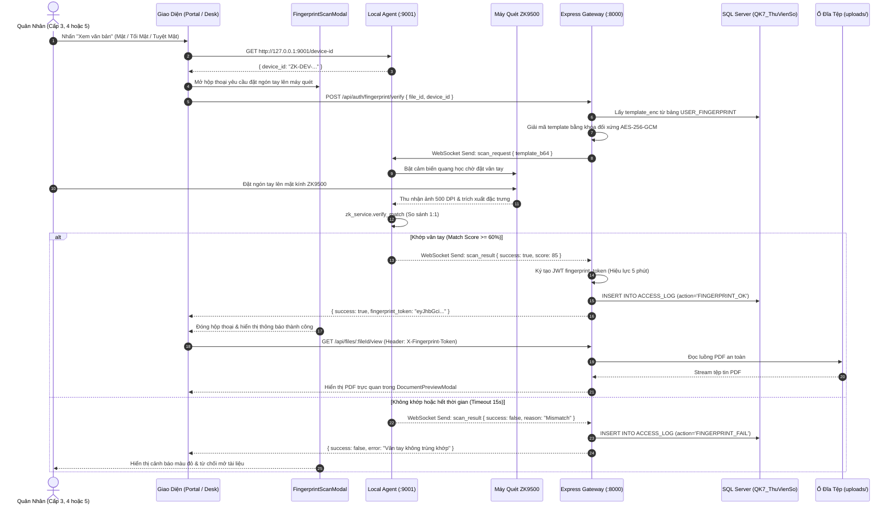
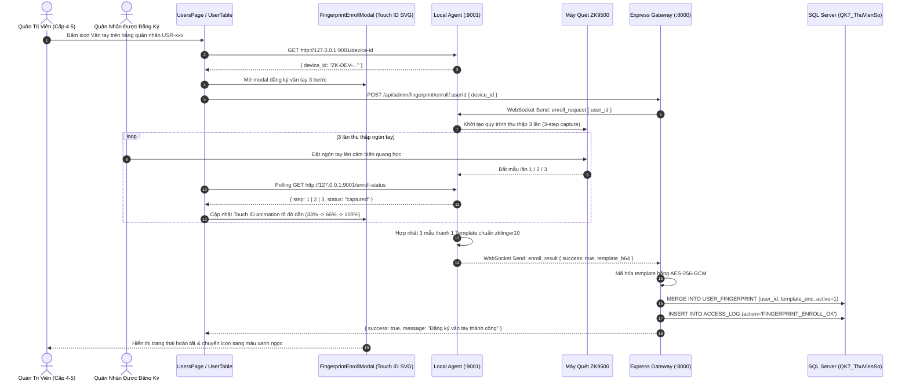
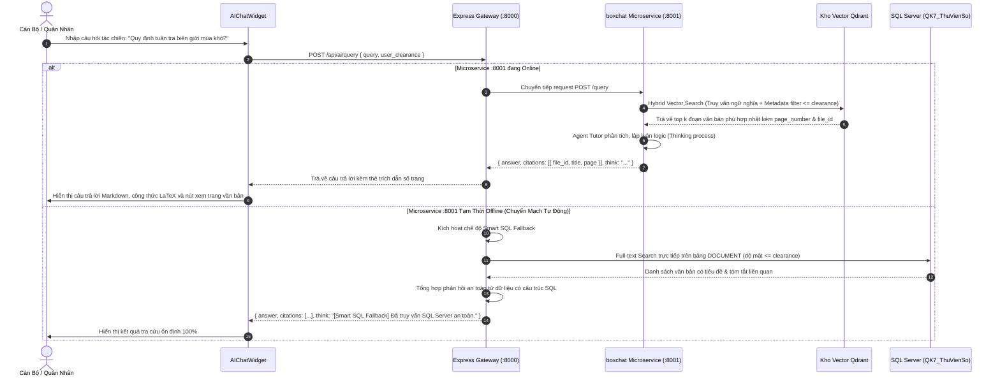

# KIẾN TRÚC TOÀN BỘ HỆ THỐNG — QK7 DATAHUB

> **Bảo mật:** Cấp Bộ Tư Lệnh Quân Khu 7  
> **Phiên bản kiến trúc:** v3.5-ENTERPRISE (React + TypeScript SPA, Express 5 Gateway, AI RAG Microservice & ZKTeco Biometric Engine)  
> **Ngày cập nhật:** 19/10/2026  

---

## MỤC LỤC
1. [Tổng Quan Hệ Thống](#1-tổng-quan-hệ-thống)
2. [Sơ Đồ Kiến Trúc Hệ Thống (System Architecture Diagram)](#2-sơ-đồ-kiến-trúc-hệ-thống)
3. [Sơ Đồ Cấu Trúc Mã Nguồn (Source Code Architecture)](#3-sơ-đồ-cấu-trúc-mã-nguồn)
4. [Mô Hình Phân Quyền & Bảo Mật Đa Tầng (Security & Clearance Model)](#4-mô-hình-phân-quyền--bảo-mật-đa-tầng)
5. [Sơ Đồ Luồng Dữ Liệu Nghiệp Vụ (Data Flow Sequence Diagrams)](#5-sơ-đồ-luồng-dữ-liệu-nghiệp-vụ)
6. [Sơ Đồ Cơ Sở Dữ Liệu (Database ERD & Schema)](#6-sơ-đồ-cơ-sở-dữ-liệu)
7. [Kiến Trúc Trợ Lý AI Tác Chiến & Văn Thư (boxchat Agentic RAG)](#7-kiến-trúc-trợ-lý-ai-tác-chiến--văn-thư-boxchat-agentic-rag)
8. [Kiến Trúc Xác Thực Sinh Trắc Học Vân Tay (ZKTeco ZK9500 Biometric Engine)](#8-kiến-trúc-xác-thực-sinh-trắc-học-vân-tay-zkteco-zk9500-biometric-engine)
9. [Danh Mục API Endpoints Chuẩn OpenAPI 3.0 / Swagger](#9-danh-mục-api-endpoints-chuẩn-openapi-30--swagger)
10. [Hướng Dẫn Triển Khai & Vận Hành (Operations Runbook)](#10-hướng-dẫn-triển-khai--vận-hành)
11. [Kiến Trúc Trung Tâm Kiểm Toán & Giám Sát An Ninh SOC (Security Audit Log Engine)](#11-kiến-trúc-trung-tâm-kiểm-toán--giám-sát-an-ninh-soc)
12. [Kiến Trúc Bảng Phân Cấp Đơn Vị Quân Khu Đa Tầng (Military Unit Hierarchy & Command Tree Engine)](#12-kiến-trúc-bảng-phân-cấp-đơn-vị-quân-khu-đa-tầng)
13. [Đặc Tả Kỹ Thuật Mô-đun Xuất Báo Cáo Kiểm Toán Quân Đội Dạng Excel (Military Audit Reporting Engine)](#13-đặc-tả-kỹ-thuật-mô-đun-xuất-báo-cáo-kiểm-toán-quân-đội-dạng-excel)

---

## 1. Tổng Quan Hệ Thống

**QK7 DataHub** là nền tảng quản trị và lưu trữ tài liệu số tập trung, phục vụ công tác chỉ huy, tham mưu tác chiến và văn thư hành chính trong toàn Quân Khu 7. Hệ thống tích hợp toàn diện trí tuệ nhân tạo và công nghệ sinh trắc học phần cứng theo các trụ cột cốt lõi:

* **Ứng Dụng Đơn Trang Chuẩn (SPA React 18 + TypeScript + Ant Design):** Toàn bộ giao diện được nạp qua duy nhất 1 vỏ bọc `index.html`, sử dụng cơ chế Auto-Discovery Routing qua `import.meta.glob`, không tải lại trang, bảo lưu trạng thái xác thực và trải nghiệm mượt mà với tông màu Tím chủ đạo (`#722ED1`).
* **Kiểm Soát Độ Mật 5 Cấp Nghiêm Ngặt:** Ngăn chặn tuyệt đối việc rò rỉ thông tin quân sự (từ Cấp 1 - Công khai đến Cấp 5 - Tuyệt mật), thực thi kiểm soát tại cả 3 tầng: UI Guard, Gateway Middleware và SQL Server Database Constraint.
* **Xác Thực Sinh Trắc Học Vân Tay Quang Học 2FA:** Tích hợp máy quét phần cứng chuyên dụng **ZKTeco ZK9500** (500 DPI, kết nối USB) kết hợp Local Hardware Agent (`:9001`) và WebSocket Gateway. Bắt buộc quét vân tay khi truy cập văn bản Cấp 3 (Mật), Cấp 4 (Tối Mật) và Cấp 5 (Tuyệt Mật), cấp `fingerprint_token` (JWT hiệu lực 5 phút) chống giả mạo danh tính.
* **Trợ Lý AI Tác Chiến & Văn Thư (Citation-Grounded Agentic RAG):** Microservice Python FastAPI (`:8001`) kết hợp kho vector Qdrant cục bộ, tự động trích xuất nội dung văn kiện PDF, tìm kiếm ngữ nghĩa, trả lời câu hỏi kèm trích dẫn số trang chính xác, tự động biên soạn cẩm nang học tập tác chiến (`study-book`) và có cơ chế **Smart SQL Fallback** đảm bảo hệ thống vận hành 100% không gián đoạn kể cả khi microservice AI đang bảo trì.
* **Toàn Vẹn Dữ Liệu & Kiểm Toán 24/7:** Tính toán mã băm SHA-256 cho mọi tệp tin lưu trữ và ghi vết kiểm toán toàn diện (`ACCESS_LOG`) mọi thao tác (Đăng nhập, Xem, Tải về, Quét vân tay, Hỏi AI, Cập nhật, Xóa).

---

## 2. Sơ Đồ Kiến Trúc Hệ Thống

```mermaid
graph TB
    subgraph CLIENT_TIER ["1. TẦNG NGƯỜI DÙNG & PHẦN CỨNG CLIENT"]
        Officer["Sĩ quan / Cán bộ<br/>(Cấp 1 - 3)"]
        Commander["Chỉ huy / Trưởng phòng<br/>(Cấp 4)"]
        AdminHigh["Thủ trưởng / Quản trị<br/>(Cấp 5)"]
        
        ScannerHardware["Máy quét vân tay quang học<br/>ZKTeco ZK9500 (USB 500 DPI)"]
        LocalAgent["Local Fingerprint Agent<br/>(:9001 HTTP & WS Client)<br/>agent.py + zk_service.py"]
        BrowserApp["Trình Duyệt Web Quân Sự<br/>(React 18 + TS SPA)"]

        Officer & Commander & AdminHigh --> BrowserApp
        ScannerHardware -->|USB Driver| LocalAgent
        BrowserApp <-->|GET /device-id, /enroll-status| LocalAgent
    end

    subgraph PRESENTATION_TIER ["2. TẦNG GIAO DIỆN REACT 18 + ANT DESIGN"]
        SingleHTML["index.html<br/>(Vỏ nạp duy nhất)"]
        AppRouter["React Router (useRoutes)<br/>Auto-Discovery Routing"]
        LoginPage["/login (Xác thực quân nhân)"]
        PortalPage["/portal (Cổng tra cứu tài liệu)"]
        DeskPage["/document-desk (Bàn làm việc văn thư)"]
        AdminDashboard["/admin-dashboard (Bảng điều khiển QTV)"]
        UsersPage["/users (Quản lý quân nhân & cấp bậc)"]
        
        AIChatWidgetComp["AIChatWidget<br/>(Trợ lý AI nổi, Markdown, LaTeX, Citations)"]
        FpModals["FingerprintScanModal & FingerprintEnrollModal<br/>(Animation Touch ID 3 bước)"]
        SecurityAuditLogComp["SecurityAuditLog (Trung Tâm SOC)<br/>(Live Monitor, 4 KPI, Filter Pills, Deep JSON Drawer)"]
        UnitTreeComp["UnitTreeTable (Cây Đơn Vị)<br/>(Command Hierarchy, 6 Tiers, Orphan Safe)"]
        ExcelExportTool["exportAuditReportExcel<br/>(ExcelJS Báo Cáo Quân Đội .xlsx)"]

        BrowserApp --> SingleHTML
        SingleHTML --> AppRouter
        AppRouter --> LoginPage & PortalPage & DeskPage & AdminDashboard & UsersPage
        PortalPage & DeskPage & AdminDashboard -.-> AIChatWidgetComp
        PortalPage & DeskPage & UsersPage -.-> FpModals
        AdminDashboard -.-> SecurityAuditLogComp & UnitTreeComp
        SecurityAuditLogComp -.-> ExcelExportTool
    end

    subgraph GATEWAY_TIER ["3. TẦNG MÁY CHỦ EXPRESS GATEWAY (:8000)"]
        ExpressStatic["Static Server & SPA Fallback<br/>(public/index.html & assets/)"]
        AuthSecMiddleware["Auth & Clearance Middleware<br/>(JWT Bearer, X-User-Id, X-Clearance)"]
        BiometricBridge["WebSocket Server /ws/fingerprint<br/>(Quản lý pool ZK9500 Agents)"]
        AIRouterProxy["AI Gateway Router (/api/ai/*)<br/>(Proxy sang :8001 + Smart SQL Fallback)"]
        CoreAPIRouter["Core API Router<br/>(/api/documents, /api/admin, /api/auth)"]
        AuditLoggingEngine["Audit Logging Engine<br/>(Ghi vết ACCESS_LOG)"]

        AppRouter -->|REST Calls| AuthSecMiddleware
        LocalAgent <-->|WebSocket Connection| BiometricBridge
        AuthSecMiddleware --> CoreAPIRouter
        AuthSecMiddleware --> AIRouterProxy
        CoreAPIRouter --> AuditLoggingEngine
    end

    subgraph AI_MICROSERVICE_TIER ["4. TẦNG TRỢ LÝ AI TÁC CHIẾN (:8001 - FastAPI)"]
        FastAPIServer["FastAPI Server (:8001)<br/>boxchat/main.py"]
        AgentTutor["Agent Tutor<br/>(RAG Agentic Logic & Think Process)"]
        PDFProcessor["PDF Processor<br/>(Trích xuất text & metadata trang)"]
        StudyBookGen["Study Book Generator<br/>(Biên soạn giáo trình & trắc nghiệm)"]
        MediaTimeline["Media Timeline Manager<br/>(Dòng thời gian sự kiện quân sự)"]
        HybridVectorStore["Hybrid Vector Store<br/>(Qdrant Local Engine)"]

        AIRouterProxy -->|HTTP POST/GET| FastAPIServer
        FastAPIServer --> AgentTutor & StudyBookGen & MediaTimeline
        AgentTutor & StudyBookGen --> HybridVectorStore
        PDFProcessor -->|Nạp chunk tài liệu| HybridVectorStore
    end

    subgraph STORAGE_TIER ["5. TẦNG LƯU TRỮ VẬT LÝ & DỮ LIỆU"]
        MSSQLDB[("SQL Server: QK7_ThuVienSo<br/>- USER, ROLE, PERMISSION<br/>- USER_FINGERPRINT (Mã hóa AES-256-GCM)<br/>- DOCUMENT, DOCUMENT_TYPE<br/>- UNIT, SECURITY_LEVEL<br/>- ACCESS_LOG")]
        DiskStorage[("Kho Tệp PDF Vật Lý<br/>d:/QK7_DataHub/qk7-datahub/uploads/<br/>(Lưu theo YYYY/MM/ & SHA-256)")]
        VectorStorage[("Kho Vector Embedding Qdrant<br/>boxchat/local_storage/qdrant_data/")]

        CoreAPIRouter -->|Truy vấn & Phân quyền| MSSQLDB
        CoreAPIRouter -->|Lưu & Đọc tệp PDF| DiskStorage
        AIRouterProxy -.->|Smart SQL Fallback khi :8001 offline| MSSQLDB
        AuditLoggingEngine -->|Ghi nhật ký hệ thống| MSSQLDB
        FastAPIServer -->|Đọc file phân tích| DiskStorage
        HybridVectorStore -->|Lưu & Tra cứu vector| VectorStorage
    end

    classDef client fill:#1e293b,stroke:#3b82f6,stroke-width:2px,color:#fff;
    classDef front fill:#0f172a,stroke:#10b981,stroke-width:2px,color:#fff;
    classDef gate fill:#064e3b,stroke:#34d399,stroke-width:2px,color:#fff;
    classDef ai fill:#312e81,stroke:#818cf8,stroke-width:2px,color:#fff;
    classDef store fill:#450a0a,stroke:#f43f5e,stroke-width:2px,color:#fff;

    class Officer,Commander,AdminHigh,ScannerHardware,LocalAgent,BrowserApp client;
    class SingleHTML,AppRouter,LoginPage,PortalPage,DeskPage,AdminDashboard,UsersPage,AIChatWidgetComp,FpModals,SecurityAuditLogComp,UnitTreeComp,ExcelExportTool front;
    class ExpressStatic,AuthSecMiddleware,BiometricBridge,AIRouterProxy,CoreAPIRouter,AuditLoggingEngine gate;
    class FastAPIServer,AgentTutor,PDFProcessor,StudyBookGen,MediaTimeline,HybridVectorStore ai;
    class MSSQLDB,DiskStorage,VectorStorage store;
```



---

## 3. Sơ Đồ Cấu Trúc Mã Nguồn

```text
qk7-datahub/
├── package.json                            # Điều phối kịch bản khởi chạy toàn hệ thống
├── README.md                               # Sổ tay hướng dẫn khởi động nhanh
├── SETUP_SERVER.md                         # Sổ tay hướng dẫn cài đặt Server & Client chi tiết
├── SYSTEM_ARCHITECTURE.md                  # Tài liệu kiến trúc toàn diện hệ thống
│
├── backend/                                # 🟢 MÁY CHỦ BACKEND EXPRESS 5 & WEBSOCKET GATEWAY
│   ├── server.js                           # Entry point Express Gateway (:8000), SPA Fallback, Biometric APIs
│   ├── swagger.js                          # Đặc tả OpenAPI 3.0 / Swagger UI (/api-docs)
│   ├── setup-passwords.js                  # Tiện ích băm mật khẩu bcrypt tài khoản quân nhân
│   ├── package.json                        # Cấu hình dependencies backend
│   │
│   ├── src/                                # LOGIC NGHIỆP VỤ BACKEND
│   │   ├── db.js                           # Kết nối và quản lý Connection Pool Microsoft SQL Server
│   │   ├── admin-routes.js                 # Toàn bộ API nghiệp vụ quản trị CRUD (Users, Roles, Units, Permissions...)
│   │   ├── ai-routes.js                    # Cổng giao tiếp với boxchat (:8001) & Smart SQL Fallback
│   │   └── fingerprint-ws.js               # WebSocket Server (/ws/fingerprint) điều phối máy quét ZK9500
│   │
│   ├── uploads/                            # KHO LƯU TRỮ VẬT LÝ FILE PDF THẬT
│   │   ├── 2026/10/                        # Lưu trữ theo cây thư mục Năm/Tháng & mã hash SHA-256
│   │   ├── Mat/, ToiMat/, TuyetMat/        # Thư mục phân loại theo cấp bảo mật
│   │
│   └── public/                             # THƯ MỤC BUILD PHÂN PHỐI TĨNH CHO SPA
│       ├── index.html                      # Vỏ nạp ứng dụng duy nhất
│       └── assets/                         # JavaScript Bundles & CSS tối ưu hóa
│
├── boxchat/                                # 🟣 MICROSERVICE TRỢ LÝ AI TÁC CHIẾN (:8001 - FastAPI)
│   ├── main.py                             # Entry point FastAPI, CORS, API endpoints (/api/ai/query, /api/ai/study-book...)
│   ├── requirements.txt                    # Dependencies: fastapi, uvicorn, qdrant-client, langchain, pypdf...
│   ├── .env                                # Cấu hình Qdrant Storage, LLM API Key, Uploads Path
│   │
│   ├── core/                               # CÁC MÔ-ĐUN LÕI TRÍ TUỆ NHÂN TẠO
│   │   ├── pdf_processor.py                # Trích xuất văn bản PDF quân sự, phân trang, làm sạch nội dung
│   │   ├── vector_store.py                 # Hybrid Vector Store (Qdrant), embedding văn kiện, auto-index
│   │   ├── agent_tutor.py                  # Agent RAG trả lời câu hỏi kèm trích dẫn và luồng suy nghĩ
│   │   ├── study_book_gen.py               # Biên soạn cẩm nang học tập, tóm tắt tác chiến, trắc nghiệm quân sự
│   │   └── media_timeline.py               # Quản lý dòng thời gian và tài liệu đa phương tiện
│   │
│   └── local_storage/                      # KHO VECTOR DATABASE CỤC BỘ (Qdrant Data)
│       └── qdrant_data/                    # Dữ liệu vector embedding lưu trữ offline bảo mật
│
├── fingerprint/                            # 🔴 DỊCH VỤ PHẦN CỨNG MÁY QUÉT VÂN TAY (:9001 - Python)
│   ├── agent.py                            # Local HTTP Server (:9001) & WebSocket Client kết nối Gateway
│   ├── zk_service.py                       # CTypes wrapper kết nối trực tiếp SDK ZKTeco ZK9500 (libzkfp.dll)
│   ├── libzkfp.dll                         # Thư viện liên kết động C++ điều khiển cảm biến quang học ZKTeco
│   ├── device_id.txt                       # Mã định danh thiết bị máy quét gắn với trạm làm việc
│   └── requirements.txt                    # Dependencies: websockets, aiohttp...
│
└── frontend/                               # 🔵 GIAO DIỆN CLIENT REACT 18 + TYPESCRIPT + ANT DESIGN
    ├── index.html                          # DUY NHẤT 1 file HTML vỏ bọc cho toàn ứng dụng
    ├── vite.config.ts                      # Cấu hình Vite build xuất sang ../backend/public, proxy :8000
    ├── tsconfig.json                       # Cấu hình TypeScript compiler
    ├── tailwind.config.js                  # Cấu hình TailwindCSS
    │
    └── src/
        ├── App.tsx                         # Khởi tạo Ant Design ConfigProvider (Màu Tím #722ED1), Auth, Theme
        ├── main.tsx                        # Gắn kết React createRoot
        ├── index.css                       # Design System CSS, biến màu quân sự, hiệu ứng glassmorphism
        │
        ├── routes/                         # HỆ THỐNG AUTO-DISCOVERY ROUTING & GÁC CỔNG
        │   ├── routePaths.ts               # Danh mục URL tập trung (/login, /portal, /document-desk...)
        │   ├── routeAccess.ts              # Ma trận phân quyền kiểm soát Clearance Level & Login Guard
        │   ├── getAppRoutes.ts             # Tự động quét modules/*.routes.tsx qua import.meta.glob
        │   ├── RouterProvider.tsx          # Component điều hướng useRoutes hook
        │   └── modules/                    # Định nghĩa tuyến đường theo từng module nghiệp vụ
        │
        ├── pages/                          # CÁC MÀN HÌNH CHỨC NĂNG CHÍNH
        │   ├── LoginPage.tsx               # Màn hình đăng nhập quân nhân
        │   ├── PortalPage.tsx              # Cổng tra cứu tài liệu quân sự
        │   ├── DocumentDeskPage.tsx        # Bàn làm việc số hóa văn thư
        │   ├── AdminDashboardPage.tsx      # Bảng điều khiển quản trị trung tâm
        │   ├── UsersPage.tsx               # Quản lý tài khoản quân nhân & cấp bậc
        │   └── HttpErrorPage.tsx           # Trang mã trạng thái HTTP chuẩn Ant Design Result
        │
        ├── components/                     # THÀNH PHẦN GIAO DIỆN TÁI SỬ DỤNG
        │   ├── common/                     # Header, Sidebar, Layout, ProtectedRoute, TouchIDFingerprint...
        │   ├── ai-chat/                    # AIChatWidget (Cửa sổ trợ lý AI nổi, Markdown, LaTeX, Citations)
        │   ├── document-desk/              # FingerprintScanModal (Hộp thoại quét vân tay xác thực xem PDF)
        │   ├── users/                      # UserTable, UserFormModal, FingerprintEnrollModal (Đăng ký vân tay)
        │   ├── auth/                       # LoginForm
        │   ├── portal/                     # SecurityBanner, DocumentCard, PortalDocumentList
        │   └── dashboard/                  # PHÂN HỆ QUẢN TRỊ & TRUNG TÂM KIỂM TOÁN SOC
        │       ├── SecurityAuditLog.tsx    # Trung tâm SOC, Live Monitor, 4 KPI, Filter Pills, Raw JSON Drawer
        │       ├── UnitTreeTable.tsx       # Bảng cây đơn vị 6 cấp bậc, bảo vệ mồ côi, tìm kiếm không dấu
        │       ├── StatCard.tsx            # Thẻ thống kê chỉ số nghiệp vụ
        │       └── DistributionChart.tsx   # Biểu đồ phân bổ loại văn bản & an ninh
        │
        ├── utils/                          # TIỆN ÍCH HỆ THỐNG
        │   └── exportAuditReportExcel.ts   # Xuất file Excel (.xlsx) chuẩn biểu mẫu báo cáo Quân đội
        │
        ├── services/                       # TẦNG DỊCH VỤ MẠNG & INTEGRATION
        │   ├── http.ts                     # HTTP Client Wrapper với HttpError & Event phát lỗi toàn cục
        │   ├── authService.ts              # Xác thực đăng nhập & quản lý phiên làm việc
        │   ├── documentService.ts          # Nghiệp vụ tìm kiếm, tải lên, xem, sửa, xóa văn bản
        │   ├── userService.ts              # Nghiệp vụ quản lý người dùng & phân quyền quân nhân
        │   ├── fingerprintService.ts       # Giao tiếp với Local Agent (:9001) & Backend Biometric APIs
        │   ├── aiService.ts                # Dịch vụ gửi truy vấn và nhận câu trả lời từ Trợ lý AI
        │   └── ...                         # Các dịch vụ vai trò, quyền, đơn vị, danh mục, log
        │
        ├── contexts/                       # Quản lý trạng thái toàn cục (AuthContext, ThemeContext)
        └── types/                          # Định nghĩa kiểu dữ liệu TypeScript (document, user, role, ai...)
```

---

## 4. Mô Hình Phân Quyền & Bảo Mật Đa Tầng

### 4.1. Bảng 5 Cấp Độ Mật Quân Sự (Security Clearance Levels)

| Cấp Độ ID | Mã Ký Hiệu | Tên Mức Độ Bảo Mật | Phạm Vi Tiếp Cận & Quyền Hạn | Ràng Buộc Sinh Trắc Học |
| :---: | :---: | :--- | :--- | :---: |
| **Cấp 1** | `CONGKHAI` | **Công Khai** | Mọi quân nhân, khách tra cứu; chỉ xem văn bản công khai. | Không yêu cầu |
| **Cấp 2** | `NOIBO` | **Lưu Hành Nội Bộ** | Cán bộ, nhân viên; văn bản điều hành nội bộ thông thường. | Không yêu cầu |
| **Cấp 3** | `MAT` | **Mật** | Sĩ quan, trợ lý tác chiến; tài liệu nghiệp vụ, huấn luyện. | **Bắt buộc quét vân tay ZK9500** |
| **Cấp 4** | `TOIMAT` | **Tối Mật** | Chỉ huy đơn vị, trưởng phòng; kế hoạch tác chiến quân sự. | **Bắt buộc quét vân tay ZK9500** |
| **Cấp 5** | `TUYETMAT` | **Tuyệt Mật** | Bộ Tư Lệnh, Tham mưu trưởng, Quản trị viên tối cao. | **Bắt buộc quét vân tay ZK9500** |

### 4.2. Hàng Rào Xác Thực Sinh Trắc Học Vân Tay Hai Lớp (Biometric 2FA)
1. **Truy Cập Văn Bản Cấp 3, 4 & 5 (Mật, Tối Mật, Tuyệt Mật):** Khi quân nhân yêu cầu xem hoặc tải tệp PDF có độ mật cao (`security_level_id >= 3`, bao gồm Cấp 3 - Mật, Cấp 4 - Tối Mật và Cấp 5 - Tuyệt Mật), Gateway yêu cầu kèm theo HTTP Header:
   > `X-Fingerprint-Token: <token_jwt>`
2. **Cơ Chế Cấp Biometric Token:**
   - Trình duyệt yêu cầu trạm quét `agent.py` trên máy người dùng đặt ngón tay lên máy quét ZKTeco ZK9500.
   - Khi dấu vân tay quét được khớp với mẫu lưu trữ của quân nhân (thuật toán zkfinger10 với điểm tương đồng ≥ 60%), Gateway sinh ra một JWT `fingerprint_token` ký bằng mật mã quân sự, có thời hạn hiệu lực **5 phút**, gắn chặt với cặp `(user_id, file_id)`.
   - Nếu không có hoặc token hết hạn/sai lệch, Gateway từ chối phục vụ ngay lập tức với mã lỗi `403 Forbidden`.

### 4.3. Kiểm Soát Độ Mật Trong Luồng RAG Của Trợ Lý AI
1. **Lọc Dữ Liệu Ngữ Cảnh (Clearance-Aware Context Filtering):** Khi người dùng đặt câu hỏi cho AI qua `/api/ai/query`, Gateway luôn gửi kèm `user_clearance`.
2. **Áp bộ lọc Metadata an toàn:** Kho vector Qdrant và RAG Agent tự động áp điều kiện lọc dữ liệu:
   > `doc.security_level_id <= user_clearance`

   Ngăn chặn hoàn toàn việc AI trích dẫn hoặc tổng hợp thông tin từ văn bản vượt quá cấp mật của người hỏi.

---

## 5. Sơ Đồ Luồng Dữ Liệu Nghiệp Vụ

### 5.1. Luồng Xác Thực Sinh Trắc Học Vân Tay Khi Mở Văn Bản Độ Mật Cao (Cấp 3, 4, 5)



### 5.2. Luồng Đăng Ký Mẫu Vân Tay Quân Nhân 3 Bước (Biometric Enrollment)



### 5.3. Luồng Trợ Lý AI Hỏi Đáp Tác Chiến (Citation-Grounded Agentic RAG)



---

## 6. Sơ Đồ Cơ Sở Dữ Liệu

### 6.1. Sơ Đồ Thực Thể Liên Kết (Entity Relationship Diagram - ERD)


---

## 7. Kiến Trúc Trợ Lý AI Tác Chiến & Văn Thư (boxchat Agentic RAG)

### 7.1. Nguyên Lý Thiết Kế
Microservice **boxchat** (Python FastAPI tại cổng `:8001`) được thiết kế theo kiến trúc **Citation-Grounded Agentic RAG (Retrieval-Augmented Generation)**:
1. **Trích xuất PDF Chuyên Sâu (`PDFProcessor`):** Đọc tuần tự từng trang tài liệu PDF quân sự, bảo toàn bảng biểu số liệu, đánh dấu số trang tuyệt đối để phục vụ gắn nhãn trích dẫn.
2. **Kho Vector Lai (`HybridVectorStore`):** Lưu trữ embedding văn bản vào CSDL vector **Qdrant** cục bộ (`local_storage/qdrant_data`), không truyền dữ liệu ra Internet, bảo đảm an ninh mạng quân sự nội bộ.
3. **Agent Tutor & Thinking Process:** LLM suy luận nhiều bước, hiển thị quá trình tư duy (`think`) và sinh câu trả lời kèm chip dẫn chứng số trang. Người dùng bấm vào chip dẫn chứng sẽ nhảy trực tiếp đến trang văn bản PDF tương ứng.
4. **Biên Soạn Giáo Trình Tác Chiến (`StudyBookGenerator`):** Tự động phân tích các văn kiện, chỉ thị lớn để tổng hợp thành tài liệu học tập, tóm tắt các điểm cốt lõi và sinh đề trắc nghiệm kiểm tra nhận thức chính trị/tác chiến.
5. **Dòng Thời Gian Lịch Sử Quân Sự (`MediaTimelineManager`):** Tự động bóc tách các mốc thời gian, chiến dịch, sự kiện trong văn bản để hiển thị dạng dòng thời gian tương tác.

### 7.2. Cơ Chế Chuyển Mạch Dự Phòng Thông Minh (Smart SQL Fallback)
Nhằm đạt tiêu chuẩn sẵn sàng cao (High Availability), Express Gateway (`backend/src/ai-routes.js`) được tích hợp cơ chế bảo vệ kép:
- Khi nhận yêu cầu `/api/ai/*`, Gateway sẽ gửi yêu cầu tới FastAPI `:8001` với timeout tối đa 2.5 giây.
- Nếu microservice AI chưa bật hoặc gặp lỗi, Gateway **không báo lỗi 500** mà tự động chuyển tiếp truy vấn sang thuật toán **Smart SQL Fallback**:
  - Truy vấn trực tiếp các cột `title`, `summary`, `document_code` trên bảng `DOCUMENT` của SQL Server.
  - Áp dụng nghiêm ngặt bộ lọc `security_level_id <= user_clearance`.
  - Đóng gói dữ liệu trả về với cấu trúc tương thích hoàn toàn giao diện `AIChatWidget`, giúp người dùng vẫn tra cứu được thông tin văn bản ổn định 100%.

---

## 8. Kiến Trúc Xác Thực Sinh Trắc Học Vân Tay (ZKTeco ZK9500 Biometric Engine)

### 8.1. Thông Số Phần Cứng & Giao Tiếp Driver
- **Thiết bị:** Máy quét vân tay quang học chuyên dụng **ZKTeco ZK9500**.
- **Cảm biến:** Cảm biến quang học chống trầy xước, độ phân giải **500 DPI**, vùng quét 16.5 × 24 mm, chuẩn giao tiếp USB 2.0.
- **Thư viện lõi:** Tích hợp trực tiếp file nhị phân `libzkfp.dll` qua module `ctypes` trong Python, thuật toán đối sánh mẫu đặc trưng vân tay quân sự **ZKFinger 10.0**.

### 8.2. Mô Hình Phân Phối Hardware Agent (:9001)
- Trên mỗi máy trạm làm việc của quân nhân được cài đặt **Fingerprint Local Agent** (`fingerprint/agent.py`).
- Agent chạy nền với 2 vai trò:
  1. **HTTP Micro-Server nội bộ (`http://127.0.0.1:9001`):** Cung cấp `GET /device-id` để trình duyệt nhận diện máy quét và `GET /enroll-status` để lấy tiến trình quét 3 lần theo thời gian thực.
  2. **WebSocket Client (`ws://localhost:8000/ws/fingerprint`):** Duy trì kênh kết nối an toàn 2 chiều với Backend Gateway, chờ nhận các lệnh `scan_request` hoặc `enroll_request`.

### 8.3. Quy Trình Bảo Mật & Mã Hóa Mẫu Vân Tay
- Mẫu vân tay sau khi đăng ký (enrollment) được hợp nhất từ 3 lần đặt ngón tay liên tiếp, tạo ra chuỗi byte đặc trưng (template) độ dài ~1024 bytes.
- Mẫu vân tay được mã hóa bằng thuật toán đối xứng **AES-256-GCM** với khóa bí mật quân sự trước khi lưu vào cột `template_enc` của bảng `USER_FINGERPRINT`.
- Khi kiểm tra (verification), mẫu mã hóa được Gateway giải mã và gửi an toàn qua WebSocket đến Agent của trạm làm việc để đối sánh 1:1, không bao giờ lộ dữ liệu thô ra môi trường mạng.

---

## 9. Danh Mục API Endpoints Chuẩn OpenAPI 3.0 / Swagger

Toàn bộ API được đặc tả chi tiết tại Swagger UI: **[http://localhost:8000/api-docs](http://localhost:8000/api-docs)**.

### 9.1. Nhóm Trợ Lý AI Tác Chiến (AI Assistant)
| Phương Thức | Đường Dẫn API | Phân Quyền | Tham Số / Body | Mô Tả Chức Năng |
| :---: | :--- | :---: | :--- | :--- |
| `POST` | `/api/ai/query` | Mọi cấp (≥ 1) | `{ query, history, focus_file_id }` | Tra cứu ngữ nghĩa & hỏi đáp tác chiến. Trả về câu trả lời kèm danh sách trích dẫn (`citations`), số trang và quá trình suy luận (`think`). Hỗ trợ Smart SQL Fallback. |
| `POST` | `/api/ai/study-book` | Mọi cấp (≥ 1) | `{ file_id, topic, num_questions }` | Tự động phân tích văn kiện để sinh cẩm nang học tập, tóm tắt tác chiến và bộ câu hỏi trắc nghiệm quân sự. |
| `GET` | `/api/ai/health` | Mọi cấp | — | Kiểm tra trạng thái microservice AI (:8001), model LLM và tổng số chunk vector hiện có. |
| `POST` | `/api/ai/ingest` | Cấp ≥ 3 (Văn thư) | `{ file_id }` | Trích xuất văn bản PDF và nạp các vector embedding vào kho Qdrant cục bộ. |
| `GET` | `/api/ai/media/timeline` | Mọi cấp (≥ 1) | `?file_id=...` | Bóc tách và hiển thị dòng thời gian sự kiện, chiến dịch quân sự từ văn kiện. |

### 9.2. Nhóm Xác Thực Sinh Trắc Học Vân Tay (Fingerprint Biometric)
| Phương Thức | Đường Dẫn API | Phân Quyền | Tham Số / Body | Mô Tả Chức Năng |
| :---: | :--- | :---: | :--- | :--- |
| `POST` | `/api/auth/fingerprint/verify` | Mọi cấp (≥ 1) | `{ file_id, device_id }` | Xác thực vân tay trực tiếp khi mở tài liệu độ mật cao (Cấp 3 - Mật, Cấp 4 - Tối Mật, Cấp 5 - Tuyệt Mật). Trả về `fingerprint_token` (JWT hiệu lực 5 phút) gửi kèm header `X-Fingerprint-Token`. |
| `POST` | `/api/admin/fingerprint/enroll/{userId}` | QTV (Cấp ≥ 4) | Path: `userId`<br/>Body: `{ device_id }` | Bắt đầu quy trình thu thập vân tay 3 bước trên thiết bị ZK9500 và lưu mẫu mã hóa AES-256-GCM vào bảng `USER_FINGERPRINT`. |
| `DELETE`| `/api/admin/fingerprint/users/{userId}` | QTV (Cấp ≥ 4) | Path: `userId` | Hủy kích hoạt hoặc xóa dữ liệu vân tay đã đăng ký của quân nhân. |
| `GET` | `/api/admin/fingerprint/agents` | QTV (Cấp ≥ 4) | — | Giám sát danh sách các máy quét vân tay vật lý (Agents) đang trực tuyến trong toàn mạng quân khu. |
| `WS` | `/ws/fingerprint` | Máy trạm nội bộ | Query: `device_id, bridge_token` | Kênh kết nối thời gian thực 2 chiều giữa Express Gateway và Local Fingerprint Agent. |

### 9.3. Nhóm Nghiệp Vụ Cốt Lõi (Auth, Documents, Files, Logs, Admin)
*(Chi tiết đặc tả các endpoint xem, tải văn bản, phân quyền và kiểm toán tương tự các mục tiêu chuẩn của hệ thống)*

---

## 10. Hướng Dẫn Triển Khai & Vận Hành (Operations Runbook)

### 10.1. Thiết Lập Máy Chủ Server (192.168.1.xxx)
*(Thay `192.168.1.xxx` bằng địa chỉ IP server thực tế trong mạng nội bộ)*

#### 1. Kiểm tra môi trường hệ thống
Mở PowerShell và kiểm tra phiên bản:
```powershell
node --version        # Yêu cầu >= 22.13 (https://nodejs.org/)
npm --version
python --version      # Yêu cầu >= 3.10  (https://www.python.org/downloads/)
```

#### 2. Kiểm tra dịch vụ Microsoft SQL Server
```powershell
Get-Service | Where-Object {$_.Name -like "MSSQL*"}
```
> **Yêu cầu:** Phải có ít nhất 1 service trạng thái **Running** (ví dụ: `MSSQLSERVER` hoặc `MSSQL$SQLEXPRESS`).

#### 3. Cấu hình biến môi trường Backend (`backend/.env`)
Tạo hoặc chỉnh sửa tệp `backend/.env`:
```env
# ─── Server ───
PORT=8000
NODE_ENV=production

# ─── SQL Server ───
# localhost nếu cùng máy. IP máy khác nếu SQL Server ở máy khác.
DB_SERVER=localhost
DB_PORT=1433
DB_DATABASE=QK7_ThuVienSo
DB_USER=sa
DB_PASSWORD=<mật_khẩu_SQL_Server_thật_của_bạn>
DB_ENCRYPT=false
DB_TRUST_CERT=true

# ─── Bảo vệ đăng nhập ───
LOCKOUT_MAX_ATTEMPTS=6
LOCKOUT_WINDOW_MINUTES=15
IPBLOCK_MAX_ATTEMPTS=6
IPBLOCK_WRONG_PASSWORD_MAX_ATTEMPTS=15
IPBLOCK_WINDOW_MINUTES=15
IPBLOCK_DURATION_MINUTES=30

# ─── Swagger ───
ENABLE_SWAGGER=false

# ─── Parser ───
PARSER_STRICT_MODE=false

# ─── JWT ───
JWT_SECRET=<sinh_ngay_bên_dưới>
JWT_EXPIRES_IN=8h

# ─── Fingerprint ───
FP_ENC_KEY=k42yVJ1TDdgCiNX+gIFRDvddfvihwjvREJcBSPbpJkw=
FINGERPRINT_BRIDGE_TOKEN=qk7_bridge_2026_secret_xyz9876543210abcdef
```

* **Sinh `JWT_SECRET` mới:** Chạy lệnh PowerShell và dán chuỗi sinh được vào `JWT_SECRET`:
```powershell
[Convert]::ToBase64String([System.Security.Cryptography.RandomNumberGenerator]::GetBytes(48))
```

#### 4. Cấu hình biến môi trường AI boxchat (`boxchat/.env`)
Tạo hoặc chỉnh sửa tệp `boxchat/.env`:
```env
BACKEND_UPLOADS_DIR=../backend/uploads
QDRANT_STORAGE_PATH=./local_storage/qdrant_data
OLLAMA_BASE_URL=http://localhost:11434
OLLAMA_MODEL=qwen2.5:7b
```

#### 5. Cài đặt dependencies (Chỉ chạy lần đầu)
Mở CMD thực thi lần lượt:
```cmd
cd /d D:\QK7_DataHub\qk7-datahub\backend
npm install

cd /d D:\QK7_DataHub\qk7-datahub\frontend
npm install

cd /d D:\QK7_DataHub\qk7-datahub\boxchat
pip install -r requirements.txt
```

#### 6. Đóng gói giao diện Frontend (Production Build)
```cmd
cd /d D:\QK7_DataHub\qk7-datahub\frontend
npm run build
```
Kiểm tra file build đã tự động xuất sang `backend/public/`:
```cmd
dir D:\QK7_DataHub\qk7-datahub\backend\public\index.html
```

#### 7. Khởi tạo tài khoản quản trị viên
Tại thư mục `backend`, chạy:
```cmd
cd /d D:\QK7_DataHub\qk7-datahub\backend
node setup-passwords.js
```
*(Thiết lập tài khoản: Mã `USR-001`, Mật khẩu `123456789`, Vai trò `ADMIN`)*

#### 8. Mở cổng tường lửa Windows Firewall (Server)
Chạy lệnh PowerShell (Run as Administrator) mở port 8000:
```powershell
New-NetFirewallRule -DisplayName "QK7 Backend 8000" -Direction Inbound -LocalPort 8000 -Protocol TCP -Action Allow
```

---

### 10.2. Quy Trình Khởi Động Server Hàng Ngày

1. **Khởi động hệ thống máy chủ (Backend + AI boxchat):**
   - Click đúp vào tệp `s.bat` tại thư mục gốc `D:\QK7_DataHub\qk7-datahub\s.bat`.
2. **Khởi động trạm quét vân tay trên server (nếu máy server có gắn ZK9500):**
   ```cmd
   cd /d D:\QK7_DataHub\qk7-datahub\fingerprint
   python agent.py
   ```

---

### 10.3. Thiết Lập Máy Trạm Client Quét Vân Tay (192.168.1.X)

#### 1. Cài đặt driver ZK9500 & Python
- Cài driver ZK9500 trên máy client và kiểm tra:
  ```cmd
  dir C:\Windows\System32\libzkfp.dll
  ```
- Kiểm tra Python (yêu cầu >= 3.10):
  ```cmd
  python --version
  ```

#### 2. Cài chứng chỉ rootCA vào Windows Root Store
Mở PowerShell (Run as Administrator) trên máy Client:
```powershell
# Copy rootCA.pem từ thư mục chia sẻ LAN về client
Copy-Item "\\192.168.1.229\QK7Share\rootCA.pem" "C:\QK7Agent\rootCA.pem" -Force

# Cài chứng chỉ vào Windows Root Store
Import-Certificate -FilePath "C:\QK7Agent\rootCA.pem" -CertStoreLocation Cert:\LocalMachine\Root
```

#### 3. Tạo thư mục trạm máy quét `C:\QK7Agent\`
```text
C:\QK7Agent\
├── agent.py
├── libzkfp.dll
├── requirements.txt
├── s-agent.bat
├── .env                    ← sửa ở bước 4
└── (chưa có device_id.txt — sẽ tự sinh khi chạy lần đầu)
```

#### 4. Cấu hình file `C:\QK7Agent\.env`
Tạo/sửa file `.env` trên máy Client (thay IP bằng IP máy server thực tế):
```env
# Cấu hình cho MÁY CLIENT — KHÔNG dùng localhost
BACKEND_WS_URL=ws://192.168.1.229:8000/ws/fingerprint
BRIDGE_TOKEN=qk7_bridge_2026_secret_xyz9876543210abcdef
DEVICE_SERVER_HOST=127.0.0.1
DEVICE_SERVER_PORT=9001
MATCH_SCORE_THRESHOLD=45
```

#### 5. Cài đặt Python dependencies
```cmd
cd /d C:\QK7Agent
pip install -r requirements.txt
```

#### 6. Chạy thử nghiệm Fingerprint Agent
```cmd
cd /d C:\QK7Agent
python agent.py
```
*(Hoặc click đúp file `s-agent.bat`)*

#### 7. Đăng ký tự động chạy khi Login (Startup)
1. Nhấn **Win + R**, nhập `shell:startup`, bấm **Enter**.
2. Trong thư mục vừa mở, click chuột phải → **New** → **Shortcut**.
3. Trong ô *"Type the location of the item"*, nhập:
   ```text
   C:\QK7Agent\s-agent.bat
   ```
4. Bấm **Next** → đặt tên `QK7 Fingerprint Agent` → bấm **Finish**.

---

### 10.4. Kiểm Tra & Giám Sát Truy Cập Toàn Mạng
* **Cổng giao diện người dùng:** `http://192.168.1.229:8000` *(hoặc IP máy server)*
* **Tài liệu Swagger API:** `http://192.168.1.229:8000/api-docs`
* **API Trợ lý AI boxchat:** `http://192.168.1.229:8001/docs`
* **Trạm kiểm soát vân tay nội bộ:** `http://127.0.0.1:9001/device-id`

---

## 11. Kiến Trúc Trung Tâm Kiểm Toán & Giám Sát An Ninh SOC

### 11.1. Triết Lý Thiết Kế SOC (Security Operations Center Dual-Theme)
Phân hệ **SecurityAuditLog** (`frontend/src/components/dashboard/SecurityAuditLog.tsx`) được thiết kế nhằm phục vụ kíp trực ban an ninh mạng, cán bộ giám sát tác chiến của Bộ Tư Lệnh 24/7 với 2 chế độ hiển thị chuyên biệt:
- **Dark Mode (Night Ops / Phòng tác chiến đêm):**
  - Nền phân lớp thị giác: Nền gốc `bg-slate-950` / `bg-[#0b0f19]`, thẻ card thống kê & toolbar `bg-slate-900/80` phủ hiệu ứng kính mờ `backdrop-blur-md`.
  - Đường viền và phân cách: `border-slate-800/80` kèm hiệu ứng phát sáng nhẹ (subtle glow), giảm thiểu tối đa hiện tượng lóa và mỏi mắt khi trực ca đêm kéo dài.
- **Light Mode (Day Ops / Văn phòng ban ngày):**
  - Nền `bg-slate-50`, card `bg-white/90`, viền `border-slate-200/90`, văn bản tương phản rõ ràng, bảo đảm khả năng đọc văn bản dưới ánh sáng mạnh.
- **Màu sắc hành động chủ đạo:** Tông màu tím Ant Design (`#722ED1`, `bg-purple-600`) đồng nhất toàn hệ thống.

### 11.2. Bốn Thẻ Chỉ Số KPI Tác Chiến Thời Gian Thực (Tactical KPI Cards)
Hệ thống tự động phân loại và tính toán 4 chỉ số KPI ngay trên dữ liệu nhật ký kiểm toán:
1. **Tổng Hoạt Động (Total Activities):** Thống kê tổng số lượng bản ghi kiểm toán trong hệ thống kèm tỷ lệ phát sinh trong 24 giờ qua.
2. **Cảnh Báo An Ninh & Vi Phạm Chính Sách (Security Alerts):** Tự động lọc và đếm các hành vi nguy cơ cao:
   > `Security Alert Actions`: `FINGERPRINT_FAIL`, `ACCESS_DENIED`, `CLEARANCE_VIOLATION`, `SUSPICIOUS_LOGIN`
3. **Thay Đổi Vai Trò & Đặc Quyền (Privilege Mutations):** Giám sát các can thiệp nhạy cảm về phân quyền quân nhân:
   > `Privilege Actions`: `ASSIGN_ROLE`, `ENROLL_FINGERPRINT`, `REVOKE_PERMISSION`, `UPDATE_USER`
4. **Truy Xuất Văn Bản Mật (Document Access Events):** Theo dõi lưu lượng xem và tải các tài liệu quân sự cấp độ Mật, Tối Mật và Tuyệt Mật.

### 11.3. Cơ Chế Giám Sát Trực Tuyến & Tự Động Làm Mới (Live SOC Monitor)
- **Tín hiệu trực tuyến Live Pulse:** Hiển thị huy hiệu `🟢 Hệ thống Trực tuyến` với hiệu ứng xung nhịp (pulse animation), cho phép kíp trực bấm nút Tạm dừng (Pause) hoặc Tiếp tục (Resume) giám sát bất cứ lúc nào.
- **Bộ đếm ngược làm mới (Auto-Refresh Countdown):**
  - Hỗ trợ các chu kỳ: **10 giây**, **30 giây**, hoặc **Tắt**.
  - Thanh tiến trình đếm ngược trực quan (Progress Bar) hiển thị thời gian còn lại trước khi tự động nạp dữ liệu mới nhất từ máy chủ, ngăn chặn việc gián đoạn thao tác của người dùng.

### 11.4. Bảng Nhật Ký SOC Thông Minh & Trích Xuất Thực Thể Mục Tiêu
- **Thời gian Monospace:** Định dạng `YYYY-MM-DD HH:mm:ss` với font chữ đơn cách, bảo đảm tính thẳng hàng và chính xác đến từng giây.
- **Quân nhân & Đơn vị:** Hiển thị Avatar dạng chữ viết tắt với màu sắc quân hàm, tên đầy đủ, chức vụ và đơn vị, cấu hình không ngắt dòng (`whitespace-nowrap`).
- **Phân loại mức độ nghiêm trọng (Severity Pills):**
  - **Critical (Cực kỳ nghiêm trọng):** Vi phạm sinh trắc học vân tay, từ chối cấp quyền, cố ý vượt cấp mật (Màu đỏ).
  - **Warning (Cảnh báo):** Thay đổi vai trò, xóa tệp, khóa tài khoản (Màu cam vàng).
  - **Info (Thông tin):** Đăng nhập thành công, xem văn bản, tải tệp thông thường (Màu xanh dương / xanh lục).
- **Smart Target Entity Extraction:** Tự động dùng biểu thức chính quy (Regex) quét trường ghi chú `note` để nhận diện các mã thực thể mục tiêu và hiển thị thành Tag nổi bật:
  - Mã quân nhân: `USR-[A-Za-z0-9_-]+` (Badge Tím)
  - Mã thiết bị: `DEV-[A-Za-z0-9_-]+` (Badge Cam)
  - Mã vai trò: `ROL-[A-Za-z0-9_-]+` (Badge Xanh lam)
  - Mã văn bản: `DOC-[A-Za-z0-9_-]+` (Badge Xanh ngọc)
- **Nhãn IP Thông Minh:** Tự động phát hiện và đánh dấu các kết nối nội bộ hoặc trạm làm việc cục bộ (`::1`, `127.0.0.1` -> Tag `Localhost`).

### 11.5. Hộp Thoại Điều Tra Sự Cố Chuyên Sâu (Deep Security Incident Inspection Drawer)
- Khi chọn bất kỳ sự kiện nào trên bảng, Drawer/Modal trượt mở từ cạnh phải, cung cấp hồ sơ toàn diện:
  - Thông tin định danh: Log ID, Unix Timestamp, ISO 8601 Timestamp.
  - Chủ thể thực hiện: Mã quân nhân, Họ tên, Đơn vị trực thuộc, Cấp bậc, Địa chỉ IP nguồn.
  - Hành động & Phân loại an ninh: Action code, Severity status, Ghi chú nguyên văn.
  - **Raw JSON Payload:** Trình diễn toàn bộ gói dữ liệu JSON thô với định dạng thụt dòng chuẩn cú pháp, kèm nút bấm **1-click sao chép Clipboard (`navigator.clipboard.writeText`)** để lập báo cáo điều tra sự cố an ninh mạng.

---

## 12. Kiến Trúc Bảng Phân Cấp Đơn Vị Quân Khu Đa Tầng

### 12.1. Thuật Toán Dựng Cây Chỉ Huy & Bảo Vệ Đơn Vị Mồ Côi (Orphan Safeguarding)
Phân hệ **UnitTreeTable** (`frontend/src/components/dashboard/UnitTreeTable.tsx`) giải quyết bài toán biểu diễn cơ cấu tổ chức lực lượng vũ trang quân khu từ bảng quan hệ phẳng `UNIT (unit_id, name, parent_id)`:
1. **Dựng cây thứ bậc đệ quy:**
   - Khởi tạo bảng tra cứu nhanh `Map<string, UnitNode>`.
   - Lặp qua danh sách đơn vị, xác định các nút Gốc (Root) có `parent_id == null` hoặc rỗng.
   - Gắn các nút con vào danh sách `children` của nút cha tương ứng và tự động tính toán tổng số đơn vị con trực thuộc (`childrenCount`).
2. **Cơ chế bảo vệ đơn vị "mồ côi" (Orphan Unit Safeguarding):**
   - Trong môi trường quân đội, khi một cơ quan cấp trên được điều động, giải thể hoặc mã cha chưa kịp đồng bộ, các đơn vị cấp dưới có nguy cơ biến mất khỏi cây thứ bậc.
   - Thuật toán tự động phát hiện những đơn vị có `parent_id` không tồn tại trong tập dữ liệu và chủ động gắn chúng vào cấp Gốc (Root) kèm nhãn chú thích, bảo toàn 100% dữ liệu hiển thị.

### 12.2. Mô Hình Phân Loại Cấp Bậc Tự Động 6 Tầng Quân Sự
Hệ thống sử dụng bộ phân loại từ khóa và biểu thức chính quy để phân loại đơn vị thành 6 cấp hành chính quân đội:

| Phân Cấp | Tiêu Chí Nhận Diện Tên Đơn Vị | Màu Sắc / Badge |
| :--- | :--- | :---: |
| **Cấp Quân Khu** | `Bộ Tư Lệnh`, `Quân Khu`, `BTL` | Tím Đậm (`#722ED1`) |
| **Cấp Sư Đoàn** | `Sư đoàn`, `Lữ đoàn`, `F[0-9]+`, `Lữ` | Xanh Lam Đậm |
| **Cấp Trung Đoàn** | `Trung đoàn`, `E[0-9]+` | Xanh Dương |
| **Cấp Tiểu Đoàn** | `Tiểu đoàn`, `Đại đội`, `D[0-9]+`, `C[0-9]+` | Xanh Lá Cây |
| **Nhà Trường / Học Viện** | `Trường`, `Học viện`, `Trung tâm Đào tạo` | Cam Vàng |
| **Cơ Quan / Phòng Ban** | `Phòng`, `Ban`, `Trợ lý`, `Bộ phận` | Xám Tro |

### 12.3. Thanh Thống Kê Tương Tác & Tìm Kiếm Tiếng Việt Thông Minh
- **Mini KPI Stat Pills:** Thanh chỉ số tương tác nhanh hiển thị tổng số đơn vị theo từng nhóm cấp bậc. Click vào pill sẽ kích hoạt lọc nhanh và tô sáng các đơn vị thuộc nhóm đó.
- **Tìm kiếm tiếng Việt không dấu (Accent-Insensitive Search):**
  - Tự động chuẩn hóa chuỗi Unicode (NFD normalization) để loại bỏ dấu thanh, cho phép gõ "su doan" vẫn khớp "Sư đoàn".
  - **Tự động mở rộng (Auto-Expand):** Khi tìm thấy kết quả ở tầng con sâu, hệ thống tự động xác định đường dẫn ngược lên gốc và mở rộng tất cả các nút cha, giúp người chỉ huy định vị vị trí đơn vị tức thì.

---

## 13. Đặc Tả Kỹ Thuật Mô-đun Xuất Báo Cáo Kiểm Toán Quân Đội Dạng Excel

### 13.1. Động Cơ Xuất Báo Cáo Phía Client (ExcelJS Engine)
Mô-đun **exportAuditReportExcel** (`frontend/src/utils/exportAuditReportExcel.ts`) thay thế cơ chế xuất CSV giản lược bằng định dạng bảng tính nhị phân Microsoft Excel (`.xlsx`) tiêu chuẩn, tuân thủ 100% biểu mẫu công văn quy chuẩn Quân đội (`Xuất báo cáo mẫu.xlsx`).
- Biên dịch trực tiếp trên trình duyệt bằng thư viện `exceljs`, không cần tải qua trung gian máy chủ.
- Xuất file nhị phân qua `Blob` kiểu MIME:
  `application/vnd.openxmlformats-officedocument.spreadsheetml.sheet`

### 13.2. Cấu Trúc Biểu Mẫu Công Văn Hành Chính Quân Sự Chuẩn Mực

```text
Row 1:  [A1:D1] PHÒNG THAM MƯU HÀNH CHÍNH      [E1:I1] CỘNG HÒA XÃ HỘI CHỦ NGHĨA VIỆT NAM
Row 2:  [A2:D2] TỔ CÔNG NGHỆ THÔNG TIN         [E2:I2] Độc lập - Tự do - Hạnh phúc
Row 3:  [A3:D3] Số: ....../BC-CNTT             [E3:I3] TP. Hồ Chí Minh, ngày DD tháng MM năm YYYY
Row 4:  (Dòng trống)
Row 5:  [A5:I5] NHẬT KÝ HOẠT ĐỘNG - THƯ VIỆN SỐ (14pt BOLD, MERGE CENTER, HEIGHT 28)
Row 6:  [A6:I6] TIÊU ĐỀ 9 CỘT DỮ LIỆU (FILL #FFC000, 11pt BOLD, THIN BORDER)
Row 7+: DỮ LIỆU NHẬT KÝ (Times New Roman 11pt, Thin Border các ô)
Row N+2:                                       [H:I]   NGƯỜI LẬP (11pt BOLD)
Row N+6:                                       [H:I]   Thiếu tá QNCN Nguyễn Mạnh Nam (12pt BOLD)
```

### 13.3. Đặc Tả Kỹ Thuật 9 Cột Dữ Liệu Bảng Tính

| STT | Tên Cột | Chiều Rộng (Width) | Kiểu Dữ Liệu | Định Dạng Căn Lề | Ghi Chú |
| :---: | :--- | :---: | :---: | :---: | :--- |
| **A** | **Mã Log** | 14 | Chuỗi | Căn giữa | `LOG-xxx` hoặc mã tự tăng |
| **B** | **Thời Gian** | 22 | Thời gian | Căn giữa | Định dạng `YYYY-MM-DD HH:mm:ss` |
| **C** | **Mã Quân Nhân** | 16 | Chuỗi | Căn giữa | `USR-xxx` |
| **D** | **Họ Tên Quân Nhân** | 25 | Chuỗi | Căn trái | Tên đầy đủ quân nhân |
| **E** | **Hành Động** | 22 | Chuỗi | Căn giữa | Mã hành vi kiểm toán (`LOGIN`, `VIEW`...) |
| **F** | **Nhóm Phân Loại** | 20 | Chuỗi | Căn giữa | Xác thực, Tài liệu, An ninh, Hệ thống |
| **G** | **Đối Tượng / Văn Bản** | 22 | Chuỗi | Căn giữa | Mã tài liệu, mã quân nhân tác động |
| **H** | **Địa Chỉ IP** | 18 | Chuỗi | Căn giữa | Địa chỉ IP máy trạm phát sinh |
| **I** | **Ghi Chú** | 35 | Chuỗi | Căn trái | Nội dung diễn giải chi tiết |

- **Quy chuẩn Font & Đường viền:** Toàn bộ bảng tính sử dụng duy nhất phông chữ **Times New Roman** kích thước 11pt (riêng tiêu đề 14pt, tên người ký 12pt). Toàn bộ tiêu đề cột được đổ màu nền vàng cam **`#FFC000`**. Mọi ô dữ liệu đều áp dụng khung viền mảnh chuẩn mực (`border: { top, left, bottom, right: { style: 'thin' } }`).
- **Khối ký duyệt báo cáo:** Đặt tại cột H và I, cách 2 dòng sau bảng dữ liệu với tiêu đề `NGƯỜI LẬP` và chức danh quân nhân ký duyệt `Thiếu tá QNCN Nguyễn Mạnh Nam`.

---
*Tài liệu kiến trúc hệ thống QK7 DataHub được cập nhật và phê duyệt chính thức bởi Bộ Tư Lệnh Quân Khu 7.*
