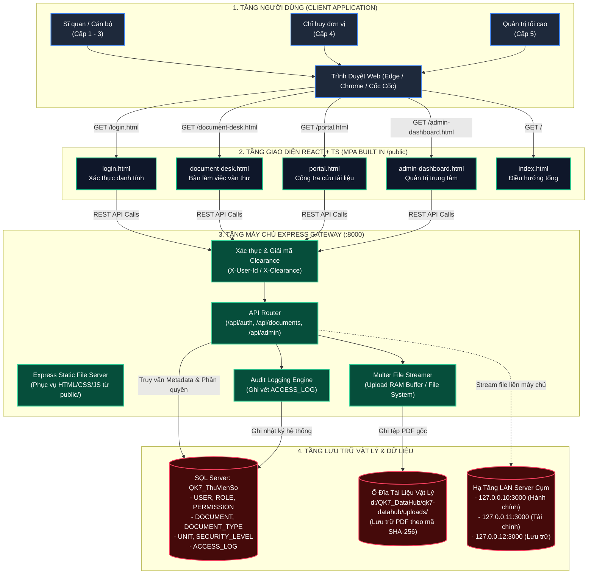
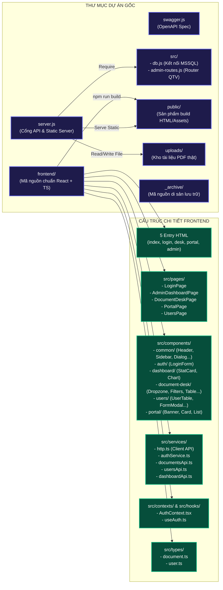
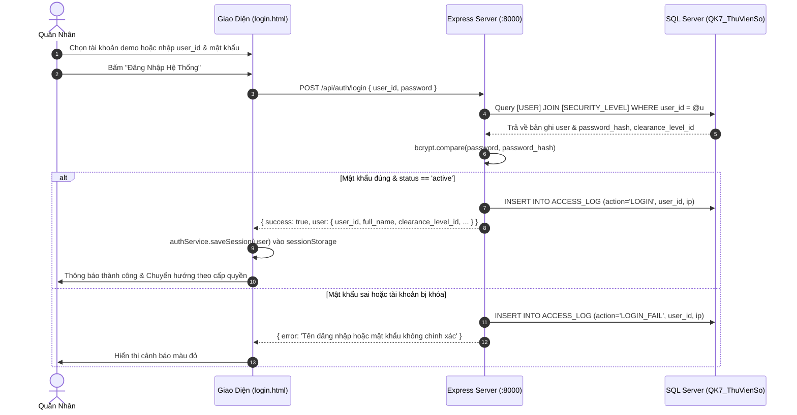
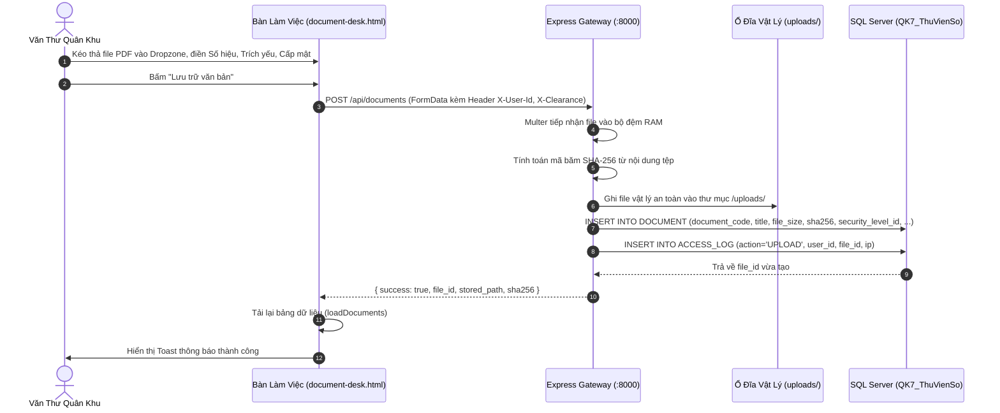
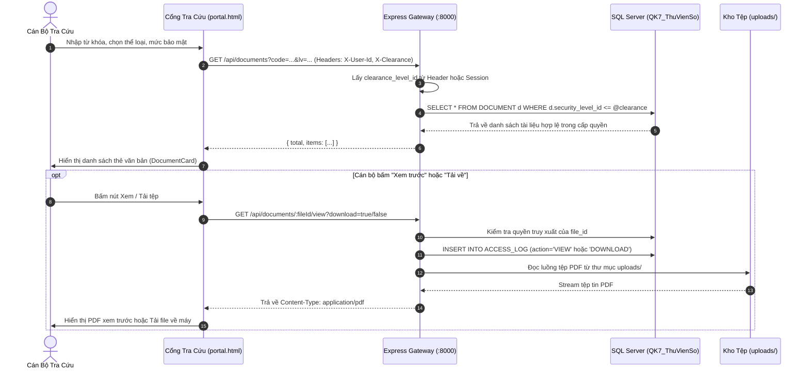
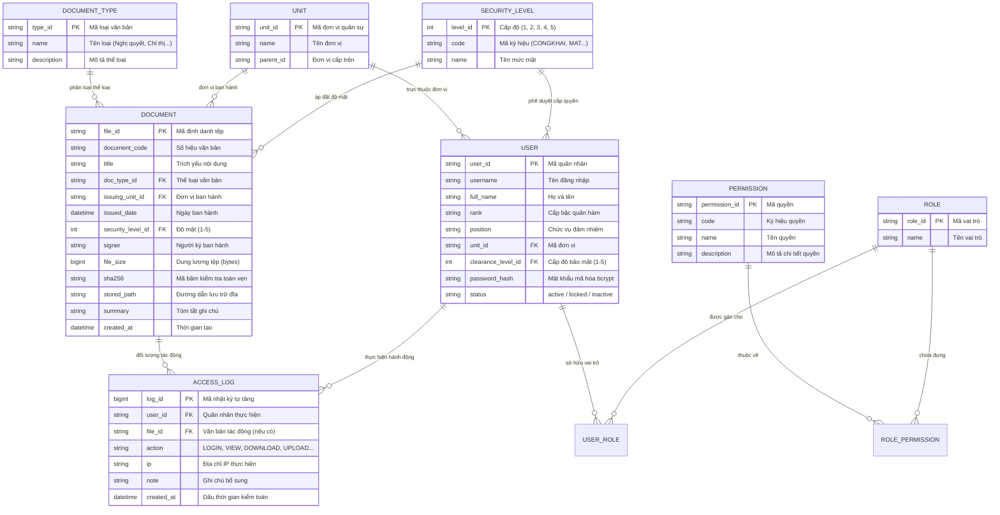

# KIẾN TRÚC TOÀN BỘ HỆ THỐNG — QK7 DATAHUB

> **Bảo mật:** Cấp Bộ Tư Lệnh Quân Khu 7  
> **Phiên bản kiến trúc:** v2.5-PROD (React + TypeScript MPA & Express + SQL Server)  
> **Ngày cập nhật:** 13/10/2026  

---

## MỤC LỤC
1. [Tổng Quan Hệ Thống](#1-tổng-quan-hệ-thống)
2. [Sơ Đồ Kiến Trúc Hệ Thống (System Architecture Diagram)](#2-sơ-đồ-kiến-trúc-hệ-thống)
3. [Sơ Đồ Cấu Trúc Mã Nguồn (Source Code Architecture)](#3-sơ-đồ-cấu-trúc-mã-nguồn)
4. [Mô Hình Phân Quyền & Bảo Mật (Security & Clearance Model)](#4-mô-hình-phân-quyền--bảo-mật)
5. [Sơ Đồ Luồng Dữ Liệu Nghiệp Vụ (Data Flow Sequence Diagrams)](#5-sơ-đồ-luồng-dữ-liệu-nghiệp-vụ)
6. [Sơ Đồ Cơ Sở Dữ Liệu (Database ERD & Schema)](#6-sơ-đồ-cơ-sở-dữ-liệu)
7. [Danh Mục API Endpoints (API Specification Map)](#7-danh-mục-api-endpoints)
8. [Hướng Dẫn Triển Khai & Vận Hành (Operations Runbook)](#8-hướng-dẫn-triển-khai--vận-hành)

---

## 1. Tổng Quan Hệ Thống

**QK7 DataHub** là nền tảng quản trị và lưu trữ tài liệu số tập trung, phục vụ công tác chỉ huy, tham mưu và văn thư hành chính trong toàn Quân Khu 7. Hệ thống được thiết kế theo các nguyên tắc cốt lõi:

* **Mô hình đa trang (Multi-Page Application - MPA):** Phân tách rạch ròi 5 không gian làm việc độc lập (Đăng nhập, Bàn làm việc văn thư, Cổng tra cứu cán bộ, Quản trị hệ thống, Trang điều hướng trung tâm).
* **Kiểm soát độ mật 5 cấp nghiêm ngặt:** Ngăn chặn tuyệt đối việc rò rỉ văn bản vượt cấp bảo mật (từ Cấp 1 - Công khai đến Cấp 5 - Tuyệt mật).
* **Toàn vẹn tệp & vân tay số:** Mọi tài liệu PDF/văn bản tải lên đều được tính toán mã băm SHA-256 lưu trữ song song với ổ đĩa vật lý an toàn.
* **Kiểm toán an ninh 24/7:** Ghi vết đầy đủ mọi hành động truy xuất (Đăng nhập, Xem, Tải về, Sửa, Xóa) kèm địa chỉ IP quân sự và dấu thời gian.

---

## 2. Sơ Đồ Kiến Trúc Hệ Thống



---

## 3. Sơ Đồ Cấu Trúc Mã Nguồn

### 3.1. Sơ Đồ Khối Tổ Chức Mã Nguồn (Source Architecture Map)



### 3.2. Cây Thư Mục Chi Tiết Toàn Bộ Hệ Thống

```
d:/QK7_DataHub/qk7-datahub/
│
├── .env                                    # Biến môi trường (DB_SERVER, DB_DATABASE, DB_USER, PORT...)
├── server.js                               # Máy chủ Express: API Gateway, xác thực, upload, tải tệp
├── swagger.js                              # Cấu hình tài liệu giao diện Swagger API (/api-docs)
├── setup-passwords.js                      # Tiện ích mã hóa bcrypt mật khẩu tài khoản mẫu
├── package.json                            # Scripts vận hành gốc (start, dev, build)
├── package-lock.json                       # Lockfile dependencies của backend
│
├── uploads/                                # KHO LƯU TRỮ VẬT LÝ (Dữ liệu văn bản PDF quân sự thật)
│   ├── Mat/                                # Tài liệu cấp Mật
│   ├── ToiMat/                             # Tài liệu cấp Tối Mật
│   └── TuyetMat/                           # Tài liệu cấp Tuyệt Mật
│
├── src/                                    # LOGIC MÁY CHỦ BACKEND
│   ├── db.js                               # Quản lý Connection Pool kết nối Microsoft SQL Server
│   └── admin-routes.js                     # Toàn bộ API nghiệp vụ quản trị CRUD (Users, Roles, Units...)
│
├── public/                                 # THƯ MỤC PHÂN PHỐI TĨNH (Sản phẩm build của Vite)
│   ├── index.html                          # Trang chuyển hướng trung tâm
│   ├── login.html                          # Trang đăng nhập xác thực
│   ├── admin-dashboard.html                # Trang quản trị hệ thống
│   ├── document-desk.html                  # Trang bàn làm việc văn thư
│   ├── portal.html                         # Trang cổng tra cứu văn bản
│   ├── qk7_datahub_login_page.html         # Trang login tương thích ngược
│   ├── qk7_datahub_admin_dashboard.html    # Trang admin tương thích ngược
│   ├── qk7_datahub_portal.html             # Trang portal tương thích ngược
│   └── assets/                             # JS Bundles, CSS tailwind tối ưu hóa & code-splitting
│
├── _archive/                               # THƯ MỤC LƯU TRỮ AN TOÀN (Mã nguồn cũ không xóa)
│   ├── public_app.js                       # Logic JS thuần cũ
│   ├── public_index.legacy.html            # Giao diện HTML cũ
│   ├── public_qk7_users.js                 # Dữ liệu người dùng mock cũ
│   ├── public_style.css                    # CSS thuần cũ
│   └── src_index.js.bak                    # Bản backup index.js cũ
│
└── frontend/                               # MÃ NGUỒN FRONTEND HIỆN ĐẠI (React 18 + TS + Vite + Tailwind)
    ├── index.html                          # Entry HTML cho trang chủ
    ├── login.html                          # Entry HTML cho trang đăng nhập
    ├── admin-dashboard.html                # Entry HTML cho trang quản trị
    ├── document-desk.html                  # Entry HTML cho trang văn thư
    ├── portal.html                         # Entry HTML cho trang tra cứu
    ├── package.json                        # Cấu hình dependencies Frontend
    ├── tsconfig.json                       # Cấu hình TypeScript compiler
    ├── tailwind.config.js                  # Cấu hình giao diện TailwindCSS
    ├── vite.config.ts                      # Cấu hình Rollup 5 MPA inputs & Proxy sang cổng 8000
    │
    └── src/
        ├── index.css                       # Design System, biến màu quân sự, glass-panel
        ├── main-index.tsx                  # Mount script cho index.html
        ├── main-login.tsx                  # Mount script cho login.html
        ├── main-dashboard.tsx              # Mount script cho admin-dashboard.html
        ├── main-document-desk.tsx          # Mount script cho document-desk.html
        ├── main-portal.tsx                 # Mount script cho portal.html
        │
        ├── constants/                      # HẰNG SỐ HỆ THỐNG
        │   └── apiEndpoints.ts             # Danh bạ toàn bộ URL API backend
        │
        ├── types/                          # ĐỊNH NGHĨA KIỂU DỮ LIỆU TYPESCRIPT
        │   ├── document.ts                 # DocumentItem, DocumentType, SecurityLevel, MetaData
        │   ├── user.ts                     # User, Unit, Role, Permission, AccessLog, AdminStats
        │   └── index.ts                    # Export tập trung
        │
        ├── utils/                          # CÔNG CỤ TIỆN ÍCH DÙNG CHUNG
        │   ├── dateUtils.ts                # Định dạng ngày giờ chuẩn VN (DD/MM/YYYY, HH:mm:ss)
        │   └── formatFileSize.ts           # Chuyển đổi byte sang B, KB, MB, GB chuẩn xác
        │
        ├── services/                       # TẦNG DỊCH VỤ MẠNG & GỌI API (HTTP)
        │   ├── http.ts                     # Fetch client chuẩn hóa lỗi & tự động thêm Token/Clearance
        │   ├── authService.ts              # Đăng nhập, lưu/xóa/đọc Session Storage
        │   ├── documentsApi.ts             # Danh sách, chi tiết, upload, update, delete văn bản
        │   ├── usersApi.ts                 # Quản trị tài khoản quân nhân & đổi mật khẩu
        │   ├── dashboardApi.ts             # Thống kê KPI, danh mục, vai trò, kiểm toán an ninh
        │   └── index.ts                    # Export tập trung
        │
        ├── contexts/                       # QUẢN LÝ TRẠNG THÁI TOÀN CỤC (STATE)
        │   └── AuthContext.tsx             # Cung cấp User session, isAdmin, isStaff, login, logout
        │
        ├── hooks/                          # CUSTOM HOOKS TIỆN ÍCH
        │   └── useAuth.ts                  # Hook truy xuất dữ liệu từ AuthContext
        │
        ├── components/                     # CÁC THÀNH PHẦN GIAO DIỆN (COMPONENTS)
        │   ├── common/                     # Component dùng chung toàn hệ thống
        │   │   ├── Header.tsx              # Thanh tiêu đề, đồng hồ trực tiếp, menu người dùng
        │   │   ├── Sidebar.tsx             # Thanh điều hướng quản trị có đo lường Backend Status
        │   │   ├── Layout.tsx              # Khung bố cục chuẩn mực
        │   │   ├── DataTable.tsx           # Bảng dữ liệu hỗ trợ tìm kiếm, loading, phân trang
        │   │   ├── ConfirmDialog.tsx       # Hộp thoại xác nhận thao tác nguy hiểm
        │   │   └── Toast.tsx               # Thông báo nổi (success, error, info)
        │   │
        │   ├── auth/                       # Phục vụ xác thực đăng nhập
        │   │   └── LoginForm.tsx           # Form đăng nhập, chuyển đổi tài khoản demo tự động
        │   │
        │   ├── dashboard/                  # Phục vụ trang quản trị trung tâm
        │   │   ├── StatCard.tsx            # Thẻ KPI 4 chỉ số lớn (Người dùng, Tệp, Dung lượng, Log)
        │   │   └── DistributionChart.tsx   # Biểu đồ thanh ngang phân bố văn bản theo cấp mật/thể loại
        │   │
        │   ├── document-desk/              # Phục vụ bàn làm việc văn thư
        │   │   ├── Dropzone.tsx            # Vùng kéo thả tệp văn bản đính kèm
        │   │   ├── DocumentFilters.tsx     # Bộ lọc đa điều kiện (Loại, Đơn vị, Mức mật, Ngày)
        │   │   ├── DocumentTable.tsx       # Bảng văn bản hỗ trợ xem, tải về, sửa, xóa
        │   │   ├── DocumentUploadModal.tsx # Hộp thoại tiếp nhận & cập nhật văn bản
        │   │   └── DocumentPreviewModal.tsx# Hộp thoại nhúng PDF viewer trực quan
        │   │
        │   ├── users/                      # Phục vụ quản trị quân nhân
        │   │   ├── UserTable.tsx           # Bảng danh sách quân nhân & cấp bậc
        │   │   ├── UserFormModal.tsx       # Hộp thoại tạo mới & cập nhật thông tin quân nhân
        │   │   └── UserCredentialsModal.tsx# Hộp thoại sinh mật khẩu ngẫu nhiên & đổi mật khẩu
        │   │
        │   └── portal/                     # Phục vụ cổng tra cứu cán bộ
        │       ├── SecurityBanner.tsx      # Biểu ngữ cam kết bảo mật & thông báo cấp quyền
        │       ├── DocumentCard.tsx        # Thẻ văn bản hiển thị dạng lưới
        │       └── PortalDocumentList.tsx  # Lưới văn bản kèm kiểm soát khóa quyền truy cập
        │
        └── pages/                          # CÁC TRANG ỨNG DỤNG HOÀN CHỈNH
            ├── LoginPage.tsx               # Trang đăng nhập xác thực quân sự
            ├── AdminDashboardPage.tsx      # Trang quản trị hệ thống trung tâm
            ├── DocumentDeskPage.tsx        # Trang bàn làm việc văn thư
            ├── PortalPage.tsx              # Trang cổng tra cứu cán bộ
            └── UsersPage.tsx               # Trang chuyên biệt quản trị quân nhân
```

---

## 4. Mô Hình Phân Quyền & Bảo Mật

### 4.1. Bảng 5 Cấp Độ Mật Quân Sự (Security Clearance Levels)

| Cấp Độ ID | Mã Ký Hiệu | Tên Mức Độ Bảo Mật | Phạm Vi Tiếp Cận & Quyền Hạn |
| :---: | :---: | :--- | :--- |
| **Cấp 1** | `CONGKHAI` | **Công Khai** | Mọi quân nhân, khách tra cứu; chỉ xem thông báo và chỉ thị phổ biến công khai. |
| **Cấp 2** | `NOIBO` | **Lưu Hành Nội Bộ** | Cán bộ, nhân viên văn phòng quân khu; văn bản điều hành nội bộ thông thường. |
| **Cấp 3** | `MAT` | **Mật** | Sĩ quan, trợ lý tác chiến; tài liệu nghiệp vụ, phương án huấn luyện nội bộ ngành. |
| **Cấp 4** | `TOIMAT` | **Tối Mật** | Chỉ huy đơn vị, trưởng phòng chuyên môn; kế hoạch tác chiến, tổ chức lực lượng. |
| **Cấp 5** | `TUYETMAT` | **Tuyệt Mật** | Bộ Tư Lệnh, Tham mưu trưởng, Quản trị viên tối cao; toàn quyền truy xuất toàn hệ thống. |

### 4.2. Nguyên Tắc Bảo Mật Bắt Buộc
1. **Lọc dữ liệu tại tầng Backend (SQL Constraint):**  
   Mọi truy vấn danh sách tài liệu (`SELECT FROM DOCUMENT`) đều có điều kiện ép buộc:
   $$\text{d.security\_level\_id} \le \text{req.user.clearance\_level\_id}$$
   Người dùng tuyệt đối không thể đọc hay can thiệp vào tài liệu có cấp độ cao hơn cấp mình được phê duyệt.
2. **Khóa mã định danh trên UI:**  
   Mã quân nhân (`user_id`), mã văn bản (`document_code`) sau khi khởi tạo sẽ ở chế độ `readOnly/disabled`, không cho phép tùy tiện sửa đổi trên giao diện.
3. **Mã băm toàn vẹn tệp (SHA-256):**  
   Khi tệp được tải lên, thuật toán `crypto.createHash('sha256')` sẽ tạo mã băm cố định. Nếu tệp trên ổ đĩa bị sửa đổi bất hợp pháp, hệ thống sẽ phát hiện sai lệch ngay lập tức.
4. **Kiểm toán truy vết (Audit Trail):**  
   Bảng `ACCESS_LOG` lưu giữ hành vi truy cập theo công thức:
   $$\text{Log} = \{\text{user\_id}, \text{action (LOGIN/VIEW/DOWNLOAD/UPLOAD/UPDATE/DELETE)}, \text{file\_id}, \text{ip}, \text{timestamp}\}$$

---

## 5. Sơ Đồ Luồng Dữ Liệu Nghiệp Vụ

### 5.1. Luồng Xác Thực Đăng Nhập (Authentication Flow)



### 5.2. Luồng Tiếp Nhận & Tải Lên Văn Bản (Document Upload Flow)



### 5.3. Luồng Tra Cứu & Kiểm Soát Độ Mật (Document Query & Access Enforcement)



---

## 6. Sơ Đồ Cơ Sở Dữ Liệu

### 6.1. Sơ Đồ Thực Thể Liên Kết (Entity Relationship Diagram - ERD)



---

## 7. Danh Mục API Endpoints

| Nhóm Nghiệp Vụ | Phương Thức | Đường Dẫn API | Tham Số / Body | Mô Tả Chức Năng |
| :--- | :---: | :--- | :--- | :--- |
| **Xác thực** | `POST` | `/api/auth/login` | `{ user_id, password }` | Đăng nhập hệ thống, kiểm tra bcrypt & tạo log |
| **Xác thực** | `GET` | `/api/auth/me` | *Header:* `X-User-Id` | Lấy thông tin chi tiết quân nhân đang đăng nhập |
| **Danh mục** | `GET` | `/api/meta` | — | Lấy đồng thời danh mục Types, Units, Security Levels |
| **Trạng thái** | `GET` | `/api/health` | — | Kiểm tra kết nối SQL Server & trạng thái máy chủ |
| **Văn bản** | `GET` | `/api/documents` | `?code=&type=&unit=&lv=&from=&to=` | Lấy danh sách văn bản (lọc theo cấp bảo mật) |
| **Văn bản** | `GET` | `/api/documents/:id` | `id: file_id` | Lấy thông tin chi tiết của một văn bản |
| **Văn bản** | `POST` | `/api/documents` | `multipart/form-data` | Tải lên văn bản mới (tính toán SHA-256) |
| **Văn bản** | `PUT` | `/api/documents/:id` | `multipart/form-data` | Hiệu chỉnh thông tin hoặc thay thế tệp văn bản |
| **Văn bản** | `DELETE` | `/api/documents/:id` | `id: file_id` | Xóa văn bản khỏi cơ sở dữ liệu và lưu log |
| **Xem / Tải** | `GET` | `/api/documents/:id/view` | `?download=true/false` | Stream trực tiếp tệp PDF xem trước hoặc tải về |
| **Quản trị** | `GET` | `/api/admin/stats` | — | Lấy 4 chỉ số KPI lớn & biểu đồ phân bố văn bản |
| **Quản trị** | `GET` | `/api/admin/users` | — | Lấy toàn bộ danh sách quân nhân & quyền hạn |
| **Quản trị** | `POST` | `/api/admin/users` | `{ user_id, full_name, rank_name... }` | Tạo mới tài khoản quân nhân |
| **Quản trị** | `PUT` | `/api/admin/users/:id` | `{ full_name, unit_id, status... }` | Cập nhật hồ sơ thông tin quân nhân |
| **Quản trị** | `PUT` | `/api/admin/users/:id/credentials` | `{ username, password }` | Cập nhật tài khoản đăng nhập & mật khẩu mới |
| **Quản trị** | `DELETE` | `/api/admin/users/:id` | `id: user_id` | Xóa tài khoản quân nhân khỏi hệ thống |
| **Quản trị** | `GET` | `/api/admin/roles` | — | Quản lý danh mục các vai trò (CRUD) |
| **Quản trị** | `GET` | `/api/admin/units` | — | Quản lý danh mục đơn vị quân khu (CRUD) |
| **Quản trị** | `GET` | `/api/admin/document-types` | — | Quản lý danh mục thể loại văn bản (CRUD) |
| **Quản trị** | `GET` | `/api/admin/security-levels`| — | Quản lý định nghĩa 5 mức bảo mật (CRUD) |
| **Kiểm toán** | `GET` | `/api/admin/logs` | `?user=&action=` | Xem nhật ký kiểm toán truy xuất an ninh 24/7 |

---

## 8. Hướng Dẫn Triển Khai & Vận Hành

### 8.1. Các Lệnh Điều Khiển Từ Thư Mục Gốc

```bash
# 1. Khởi động máy chủ chính thức (Express Server :8000 phục vụ cả API và HTML)
npm start

# 2. Khởi động môi trường phát triển Hot-Reload (Vite Dev Server :5173)
npm run dev

# 3. Biên dịch toàn bộ Frontend xuất ra thư mục phân phối tĩnh public/
npm run build
```

### 8.2. Tài Khoản Kiểm Thử Mẫu (Mật khẩu mặc định: `123456789`)

| Đối Tượng Kiểm Thử | Mã Quân Nhân | Cấp Bậc / Chức Vụ | Mức Độ Mật | Phạm Vi Thao Tác |
| :--- | :---: | :--- | :---: | :--- |
| **Cán bộ (Cấp 1)** | `USR-002` | Thiếu tá — Thư ký | **Cấp 3 (Mật)** | Tra cứu tài liệu đến cấp Mật, thao tác văn thư |
| **Trưởng phòng (Cấp 2)** | `USR-001` | Đại tá — Trưởng phòng Tham mưu | **Cấp 4 (Tối Mật)** | Tra cứu văn bản tối mật, quản lý hồ sơ phòng ban |
| **Quản trị viên / Thủ trưởng (Cấp 3)** | `USR-004` | Đại tá — Chính ủy | **Cấp 5 (Tuyệt Mật)** | Toàn quyền quản trị hệ thống, cấp quyền, xem Audit Log |

### 8.3. Địa Chỉ Truy Cập Trực Tiếp Trên Trình Duyệt

* **Cổng xác thực đăng nhập:** [http://localhost:8000/login.html](http://localhost:8000/login.html)
* **Bàn làm việc văn thư:** [http://localhost:8000/document-desk.html](http://localhost:8000/document-desk.html)
* **Cổng tra cứu tài liệu:** [http://localhost:8000/portal.html](http://localhost:8000/portal.html)
* **Trang quản trị hệ thống:** [http://localhost:8000/admin-dashboard.html](http://localhost:8000/admin-dashboard.html)
* **Tài liệu đặc tả API Swagger:** [http://localhost:8000/api-docs](http://localhost:8000/api-docs)

---
*Bản tài liệu kiến trúc này được lưu trữ chính thức tại `SYSTEM_ARCHITECTURE.md` thuộc kho lưu trữ dự án QK7 DataHub.*
