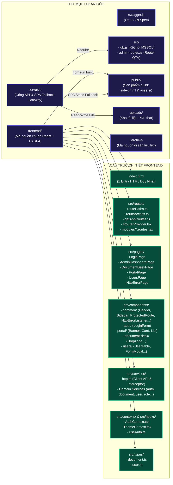
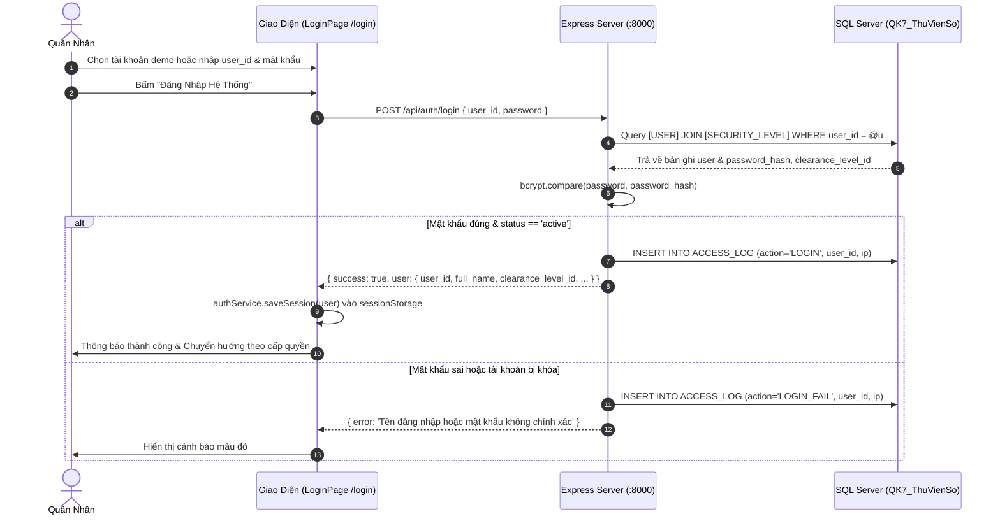
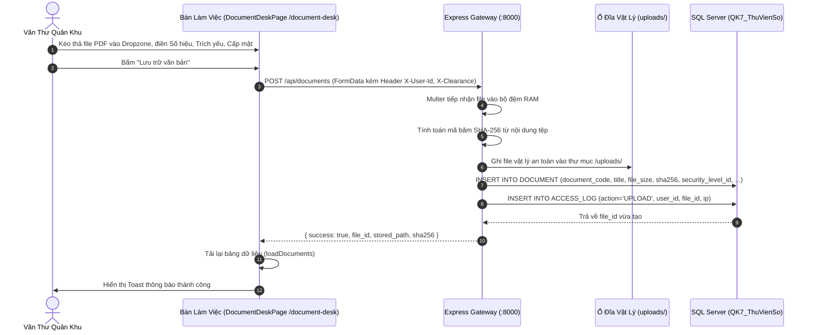
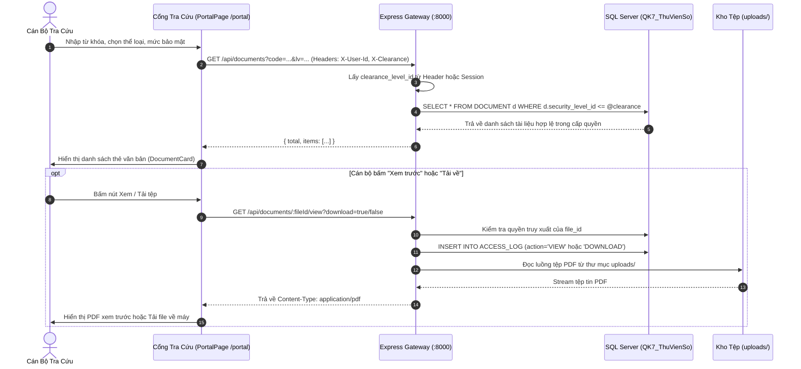
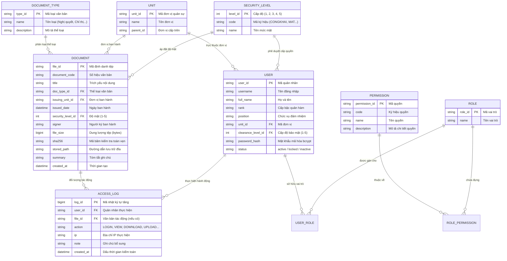

# KIẾN TRÚC TOÀN BỘ HỆ THỐNG — QK7 DATAHUB

> **Bảo mật:** Cấp Bộ Tư Lệnh Quân Khu 7  
> **Phiên bản kiến trúc:** v3.0-PROD (React + TypeScript SPA with React Router & Express 5 + SQL Server)  
> **Ngày cập nhật:** 14/10/2026  

---

## MỤC LỤC
1. [Tổng Quan Hệ Thống](#1-tổng-quan-hệ-thống)
2. [Sơ Đồ Kiến Trúc Hệ Thống (System Architecture Diagram)](#2-sơ-đồ-kiến-trúc-hệ-thống)
3. [Sơ Đồ Cấu Trúc Mã Nguồn (Source Code Architecture)](#3-sơ-đồ-cấu-trúc-mã-nguồn)
4. [Mô Hình Phân Quyền & Bảo Mật (Security & Clearance Model)](#4-mô-hình-phân-quyền--bảo-mật)
5. [Sơ Đồ Luồng Dữ Liệu Nghiệp Vụ (Data Flow Sequence Diagrams)](#5-sơ-đồ-luồng-dữ-liệu-nghiệp-vụ)
6. [Sơ Đồ Cơ Sở Dữ Liệu (Database ERD & Schema)](#6-sơ-đồ-cơ-sở-dữ-liệu)
7. [Danh Mục API Endpoints (API Specification Map)](#7-danh-mục-api-endpoints)
8. [Hướng Dẫn Triển Khai & Vận Hành (Operations Runbook)](#8-hướng-dẫn-triển-khai--vận-hành)

---

## 1. Tổng Quan Hệ Thống

**QK7 DataHub** là nền tảng quản trị và lưu trữ tài liệu số tập trung, phục vụ công tác chỉ huy, tham mưu và văn thư hành chính trong toàn Quân Khu 7. Hệ thống được thiết kế theo các nguyên tắc cốt lõi:

* **Mô hình Ứng dụng đơn trang chuẩn (Single-Page Application - SPA):** Sử dụng React 18, TypeScript và React Router với cơ chế Auto-Discovery Routing qua `import.meta.glob`. Toàn bộ giao diện được nạp qua duy nhất 1 vỏ bọc `index.html`, chuyển trang mượt mà không tải lại trang và giữ nguyên trạng thái xác thực.
* **Kiểm soát độ mật 5 cấp nghiêm ngặt:** Ngăn chặn tuyệt đối việc rò rỉ văn bản vượt cấp bảo mật (từ Cấp 1 - Công khai đến Cấp 5 - Tuyệt mật).
* **Toàn vẹn tệp & vân tay số:** Mọi tài liệu PDF/văn bản tải lên đều được tính toán mã băm SHA-256 lưu trữ song song với ổ đĩa vật lý an toàn.
* **Kiểm toán an ninh 24/7:** Ghi vết đầy đủ mọi hành động truy xuất (Đăng nhập, Xem, Tải về, Sửa, Xóa) kèm địa chỉ IP quân sự và dấu thời gian.

---

## 2. Sơ Đồ Kiến Trúc Hệ Thống

```mermaid
graph TB
    subgraph CLIENT_TIER ["1. TẦNG NGƯỜI DÙNG (CLIENT APPLICATION)"]
        UserOfficer["Sĩ quan / Cán bộ<br/>(Cấp 1 - 3)"]
        UserManager["Chỉ huy đơn vị<br/>(Cấp 4)"]
        UserAdmin["Quản trị tối cao<br/>(Cấp 5)"]

        Browser["Trình Duyệt Web (Edge / Chrome / Cốc Cốc)"]
        UserOfficer --> Browser
        UserManager --> Browser
        UserAdmin --> Browser
    end

    subgraph PRESENTATION_TIER ["2. TẦNG GIAO DIỆN REACT + TS (SPA CLIENT ROUTING)"]
        SingleHTML["index.html<br/>Vỏ nạp duy nhất"]
        AppRouter["React Router (useRoutes)<br/>Auto-Discovery Routing"]
        LoginPage["Route: /login<br/>Xác thực danh tính"]
        DeskPage["Route: /document-desk<br/>Bàn làm việc văn thư"]
        PortalPage["Route: /portal (hoặc /)<br/>Cổng tra cứu tài liệu"]
        AdminPage["Route: /admin-dashboard<br/>Quản trị trung tâm"]
        UsersPage["Route: /users<br/>Quản lý quân nhân"]

        Browser -->|GET / (hoặc bất kỳ URL nào)| SingleHTML
        SingleHTML --> AppRouter
        AppRouter --> LoginPage
        AppRouter --> DeskPage
        AppRouter --> PortalPage
        AppRouter --> AdminPage
        AppRouter --> UsersPage
    end

    subgraph GATEWAY_TIER ["3. TẦNG MÁY CHỦ EXPRESS GATEWAY (:8000)"]
        ExpressStatic["Express Static File Server<br/>(Phục vụ HTML/CSS/JS từ public/)"]
        AuthMiddleware["Xác thực & Giải mã Clearance<br/>(X-User-Id / X-Clearance)"]
        MulterUpload["Multer File Streamer<br/>(Upload RAM Buffer / File System)"]
        APIRouter["API Router<br/>(/api/auth, /api/documents, /api/admin)"]
        AuditLogger["Audit Logging Engine<br/>(Ghi vết ACCESS_LOG)"]

        LoginPage & DeskPage & PortalPage & AdminPage -->|REST API Calls| AuthMiddleware
        AuthMiddleware --> APIRouter
        APIRouter --> MulterUpload
        APIRouter --> AuditLogger
    end

    subgraph STORAGE_TIER ["4. TẦNG LƯU TRỮ VẬT LÝ & DỮ LIỆU"]
        MSSQL[("SQL Server: QK7_ThuVienSo<br/>- USER, ROLE, PERMISSION<br/>- DOCUMENT, DOCUMENT_TYPE<br/>- UNIT, SECURITY_LEVEL<br/>- ACCESS_LOG")]
        DiskStorage[("Ổ Đĩa Tài Liệu Vật Lý<br/>d:/QK7_DataHub/qk7-datahub/uploads/<br/>(Lưu trữ PDF theo mã SHA-256)")]
        LANNodes[("Hạ Tầng LAN Server Cụm<br/>- 127.0.0.10:3000 (Hành chính)<br/>- 127.0.0.11:3000 (Tài chính)<br/>- 127.0.0.12:3000 (Lưu trữ)")]

        APIRouter -->|Truy vấn Metadata & Phân quyền| MSSQL
        AuditLogger -->|Ghi nhật ký hệ thống| MSSQL
        MulterUpload -->|Ghi tệp PDF gốc| DiskStorage
        APIRouter -.->|Stream file liên máy chủ| LANNodes
    end

    classDef client fill:#1e293b,stroke:#3b82f6,stroke-width:2px,color:#fff;
    classDef front fill:#0f172a,stroke:#10b981,stroke-width:2px,color:#fff;
    classDef gate fill:#064e3b,stroke:#34d399,stroke-width:2px,color:#fff;
    classDef store fill:#450a0a,stroke:#f43f5e,stroke-width:2px,color:#fff;

    class UserOfficer,UserManager,UserAdmin,Browser client;
    class LoginPage,DeskPage,PortalPage,AdminPage,IndexPage front;
    class ExpressStatic,AuthMiddleware,MulterUpload,APIRouter,AuditLogger gate;
    class MSSQL,DiskStorage,LANNodes store;
```

---

## 3. Sơ Đồ Cấu Trúc Mã Nguồn

### 3.1. Sơ Đồ Khối Tổ Chức Mã Nguồn (Source Architecture Map)



### 3.2. Cây Thư Mục Chi Tiết Toàn Bộ Hệ Thống

d:/QK7_DataHub/qk7-datahub/
│
├── package.json                            # Scripts tiện ích điều phối toàn bộ dự án
├── .gitignore                              # Cấu hình bỏ qua node_modules, .env, uploads PDF
├── SYSTEM_ARCHITECTURE.md                  # Tài liệu kiến trúc toàn diện hệ thống
├── README.md                               # Hướng dẫn khởi động nhanh
│
├── backend/                                # 🟢 HỆ THỐNG MÁY CHỦ VÀ DỮ LIỆU BACKEND
│   ├── .env                                # Biến môi trường kết nối SQL Server và PORT
│   ├── server.js                           # Máy chủ Express: API Gateway, xác thực, upload, tải tệp, SPA Fallback
│   ├── swagger.js                          # Cấu hình tài liệu giao diện Swagger API (/api-docs)
│   ├── setup-passwords.js                  # Tiện ích mã hóa bcrypt mật khẩu tài khoản mẫu
│   ├── package.json                        # Scripts và dependencies riêng cho backend
│   ├── package-lock.json                   # Lockfile dependencies của backend
│   │
│   ├── src/                                # LOGIC MÁY CHỦ BACKEND
│   │   ├── db.js                           # Quản lý Connection Pool kết nối Microsoft SQL Server
│   │   └── admin-routes.js                 # Toàn bộ API nghiệp vụ quản trị CRUD (Users, Roles, Units...)
│   │
│   ├── uploads/                            # KHO LƯU TRỮ VẬT LÝ (Dữ liệu văn bản PDF quân sự thật)
│   │   ├── 2026/10/                        # Lưu trữ văn bản theo năm/tháng & mã băm SHA-256
│   │   ├── Mat/                            # Thư mục phân loại cấp Mật
│   │   ├── ToiMat/                         # Thư mục phân loại cấp Tối Mật
│   │   └── TuyetMat/                       # Thư mục phân loại cấp Tuyệt Mật
│   │
│   └── public/                             # THƯ MỤC PHÂN PHỐI TĨNH (Sản phẩm build của Vite)
│       ├── index.html                      # Vỏ nạp ứng dụng duy nhất
│       └── assets/                         # JS Bundles, CSS tối ưu hóa & code-splitting
│
├── _archive/                               # THƯ MỤC LƯU TRỮ AN TOÀN (Mã nguồn cũ không xóa)
│   ├── public_app.js                       # Logic JS thuần cũ
│   ├── public_index.legacy.html            # Giao diện HTML cũ
│   ├── public_qk7_users.js                 # Dữ liệu người dùng mock cũ
│   ├── public_style.css                    # CSS thuần cũ
│   └── src_index.js.bak                    # Bản backup index.js cũ
│
└── frontend/                               # 🔵 MÃ NGUỒN FRONTEND (React 18 + TS + Vite + Ant Design + Tailwind)
    ├── index.html                          # DUY NHẤT 1 file HTML vỏ bọc cho toàn ứng dụng
    ├── package.json                        # Cấu hình dependencies Frontend (antd, react-router-dom...)
    ├── tsconfig.json                       # Cấu hình TypeScript compiler
    ├── tailwind.config.js                  # Cấu hình giao diện TailwindCSS
    ├── vite.config.ts                      # Cấu hình Vite SPA build sang ../backend/public & Proxy :8000
    │
    └── src/
        ├── index.css                       # Design System, biến màu quân sự, glass-panel
        ├── App.tsx                         # Khởi tạo Ant Design ConfigProvider (Màu Tím #722ED1), Auth, Theme, Router
        ├── main.tsx                        # Điểm gắn kết ReactDOM createRoot vào #root
        ├── vite-env.d.ts                   # Định nghĩa kiểu Vite Client (import.meta.glob)
        │
        ├── routes/                         # BỘ ĐỊNH TUYẾN TỰ ĐỘNG & BẢO VỆ TUYẾN ĐƯỜNG
        │   ├── routePaths.ts               # Single source of truth cho URL (/login, /portal, /403, /404, /500...)
        │   ├── routeAccess.ts              # Ma trận phân quyền kiểm soát Clearance Level & Login Guard (.ts)
        │   ├── getAppRoutes.ts             # Tự động gom & sort route modules bằng import.meta.glob (.ts)
        │   ├── RouterProvider.tsx          # Render router bằng useRoutes hook (.tsx)
        │   └── modules/                    # Phân module route theo tính năng (.routes.tsx)
        │       ├── auth.routes.tsx         # Route /login + điều hướng tương thích
        │       ├── portal.routes.tsx       # Route / và /portal
        │       ├── desk.routes.tsx         # Route /document-desk (Bảo vệ bởi ProtectedRoute minClearance 3)
        │       ├── admin.routes.tsx        # Route /admin-dashboard và /users (Bảo vệ bởi ProtectedRoute minClearance 4)
        │       ├── error.routes.tsx        # Route các mã lỗi HTTP (/400, /401, /403, /404, /500, /502, /503, /error/:code)
        │       └── fallback.routes.tsx     # Bắt URL không hợp lệ (*) hiển thị HttpErrorPage 404
        │
        ├── pages/                          # CÁC MÀN HÌNH CHỨC NĂNG (TSX)
        │   ├── LoginPage.tsx               # Màn hình đăng nhập xác thực quân nhân
        │   ├── PortalPage.tsx              # Cổng tra cứu tài liệu quân sự
        │   ├── DocumentDeskPage.tsx        # Bàn làm việc số hóa văn thư
        │   ├── AdminDashboardPage.tsx      # Bảng điều khiển quản trị trung tâm
        │   ├── UsersPage.tsx               # Quản lý danh sách quân nhân & phân quyền
        │   └── HttpErrorPage.tsx           # Trang hiển thị mã trạng thái HTTP chuẩn Ant Design
        │
        ├── constants/                      # HẰNG SỐ HỆ THỐNG
        │   └── apiEndpoints.ts             # Danh bạ toàn bộ URL API backend
        │
        ├── types/                          # ĐỊNH NGHĨA KIỂU DỮ LIỆU TYPESCRIPT
        │   ├── document.ts                 # DocumentItem, DocumentType, SecurityLevel, MetaData
        │   ├── user.ts                     # User, Unit, Role, Permission, AccessLog, AdminStats
        │   └── index.ts                    # Export tập trung
        │
        ├── utils/                          # CÔNG CỤ TIỆN ÍCH DÙNG CHUNG
        │   ├── dateUtils.ts                # Định dạng ngày giờ chuẩn VN (DD/MM/YYYY, HH:mm:ss)
        │   └── formatFileSize.ts           # Chuyển đổi byte sang B, KB, MB, GB chuẩn xác
        │
        ├── services/                       # TẦNG DỊCH VỤ MẠNG & DOMAIN SERVICES
        │   ├── http.ts                     # HTTP Client Wrapper (HttpError, bắt lỗi toàn cục 401/403/500)
        │   ├── authService.ts              # Dịch vụ đăng nhập, lấy thông tin cá nhân & session
        │   ├── documentService.ts          # Dịch vụ quản lý tìm kiếm, upload, sửa, xóa văn bản
        │   ├── userService.ts              # Dịch vụ quản lý tài khoản quân nhân
        │   ├── roleService.ts              # Dịch vụ quản lý vai trò người dùng (Roles)
        │   ├── permissionService.ts        # Dịch vụ quản lý phân quyền (Permissions)
        │   ├── unitService.ts              # Dịch vụ quản lý đơn vị quân khu
        │   ├── documentTypeService.ts      # Dịch vụ quản lý danh mục loại văn bản
        │   ├── securityLevelService.ts     # Dịch vụ quản lý 5 cấp độ bảo mật
        │   ├── logService.ts               # Dịch vụ nhật ký kiểm toán an ninh (ACCESS_LOG)
        │   ├── systemService.ts            # Dịch vụ kiểm tra kết nối /api/health và metadata
        │   ├── documentsApi.ts             # Compatibility alias trỏ về documentService
        │   ├── usersApi.ts                 # Compatibility alias trỏ về userService
        │   ├── dashboardApi.ts             # Aggregator Service phục vụ Admin Dashboard
        │   ├── api.ts                      # Legacy Facade hợp nhất tất cả services
        │   └── index.ts                    # Điểm xuất khẩu chung (Barrel export)
        │
        ├── contexts/                       # QUẢN LÝ TRẠNG THÁI TOÀN CỤC (STATE)
        │   ├── AuthContext.tsx             # Cung cấp User session, isAdmin, isStaff, login, logout
        │   └── ThemeContext.tsx            # Đồng bộ Dark/Light theme toàn hệ thống
        │
        ├── hooks/                          # CUSTOM HOOKS TIỆN ÍCH
        │   └── useAuth.ts                  # Hook truy xuất dữ liệu từ AuthContext
        │
        ├── components/                     # CÁC THÀNH PHẦN GIAO DIỆN (COMPONENTS)
        │   ├── common/                     # Component dùng chung toàn hệ thống
        │   │   ├── Header.tsx              # Thanh tiêu đề, đồng hồ trực tiếp, menu người dùng
        │   │   ├── Sidebar.tsx             # Thanh điều hướng quản trị
        │   │   ├── Layout.tsx              # Khung bố cục chuẩn mực
        │   │   ├── ProtectedRoute.tsx      # Bộ gác cổng bảo vệ URL theo Cấp độ mật (.tsx)
        │   │   ├── HttpErrorListener.tsx   # Lắng nghe sự kiện lỗi HTTP và thông báo qua Ant Design
        │   │   ├── ThemeToggle.tsx         # Nút chuyển đổi giao diện sáng/tối
        │   │   ├── DataTable.tsx           # Bảng dữ liệu hỗ trợ tìm kiếm, loading, phân trang
        │   │   ├── ConfirmDialog.tsx       # Hộp thoại xác nhận thao tác nguy hiểm
        │   │   └── Toast.tsx               # Thông báo nổi (success, error, info)
        │   │
        │   ├── auth/                       # Phục vụ xác thực đăng nhập
        │   │   └── LoginForm.tsx           # Form đăng nhập tài khoản quân nhân
        │   │
        │   ├── portal/                     # Phục vụ Cổng tra cứu cán bộ
        │   │   ├── SecurityBanner.tsx      # Biểu ngữ cam kết bảo mật & thông báo cấp quyền
        │   │   ├── DocumentCard.tsx        # Thẻ văn bản hiển thị dạng lưới
        │   │   └── PortalDocumentList.tsx  # Lưới văn bản kèm kiểm soát khóa quyền truy cập
        │   │
        │   ├── document-desk/              # Phục vụ bàn làm việc văn thư
        │   │   ├── Dropzone.tsx            # Vùng kéo thả tệp văn bản đính kèm
        │   │   ├── DocumentFilters.tsx     # Bộ lọc đa điều kiện (Loại, Đơn vị, Mức mật, Ngày)
        │   │   ├── DocumentTable.tsx       # Bảng văn bản hỗ trợ xem, tải về, sửa, xóa
        │   │   ├── DocumentUploadModal.tsx # Hộp thoại tiếp nhận & cập nhật văn bản
        │   │   └── DocumentPreviewModal.tsx# Hộp thoại nhúng PDF viewer trực quan
        │   │
        │   ├── dashboard/                  # Phục vụ trang quản trị trung tâm
        │   │   ├── StatCard.tsx            # Thẻ KPI 4 chỉ số lớn (Người dùng, Tệp, Dung lượng, Log)
        │   │   └── DistributionChart.tsx   # Biểu đồ thanh ngang phân bố văn bản theo cấp mật/thể loại
        │   │
        │   └── users/                      # Phục vụ quản trị quân nhân
        │       ├── UserTable.tsx           # Bảng danh sách quân nhân & cấp bậc
        │       ├── UserFormModal.tsx       # Hộp thoại tạo mới & cập nhật thông tin quân nhân
        │       └── UserCredentialsModal.tsx# Hộp thoại sinh mật khẩu ngẫu nhiên & đổi mật khẩu
```

---

## 4. Mô Hình Phân Quyền & Bảo Mật

### 4.1. Bảng 5 Cấp Độ Mật Quân Sự (Security Clearance Levels)

| Cấp Độ ID | Mã Ký Hiệu | Tên Mức Độ Bảo Mật | Phạm Vi Tiếp Cận & Quyền Hạn |
| :---: | :---: | :--- | :--- |
| **Cấp 1** | `CONGKHAI` | **Công Khai** | Mọi quân nhân, khách tra cứu; chỉ xem thông báo và chỉ thị phổ biến công khai. |
| **Cấp 2** | `NOIBO` | **Lưu Hành Nội Bộ** | Cán bộ, nhân viên văn phòng quân khu; văn bản điều hành nội bộ thông thường. |
| **Cấp 3** | `MAT` | **Mật** | Sĩ quan, trợ lý tác chiến; tài liệu nghiệp vụ, phương án huấn luyện nội bộ ngành. |
| **Cấp 4** | `TOIMAT` | **Tối Mật** | Chỉ huy đơn vị, trưởng phòng chuyên môn; kế hoạch tác chiến, tổ chức lực lượng. |
| **Cấp 5** | `TUYETMAT` | **Tuyệt Mật** | Bộ Tư Lệnh, Tham mưu trưởng, Quản trị viên tối cao; toàn quyền truy xuất toàn hệ thống. |

### 4.2. Nguyên Tắc Bảo Mật Bắt Buộc
1. **Lọc dữ liệu tại tầng Backend (SQL Constraint):**  
   Mọi truy vấn danh sách tài liệu (`SELECT FROM DOCUMENT`) đều có điều kiện ép buộc:
   $$\text{d.security\_level\_id} \le \text{req.user.clearance\_level\_id}$$
   Người dùng tuyệt đối không thể đọc hay can thiệp vào tài liệu có cấp độ cao hơn cấp mình được phê duyệt.
2. **Khóa mã định danh trên UI:**  
   Mã quân nhân (`user_id`), mã văn bản (`document_code`) sau khi khởi tạo sẽ ở chế độ `readOnly/disabled`, không cho phép tùy tiện sửa đổi trên giao diện.
3. **Mã băm toàn vẹn tệp (SHA-256):**  
   Khi tệp được tải lên, thuật toán `crypto.createHash('sha256')` sẽ tạo mã băm cố định. Nếu tệp trên ổ đĩa bị sửa đổi bất hợp pháp, hệ thống sẽ phát hiện sai lệch ngay lập tức.
4. **Kiểm toán truy vết (Audit Trail):**  
   Bảng `ACCESS_LOG` lưu giữ hành vi truy cập theo công thức:
   $$\text{Log} = \{\text{user\_id}, \text{action (LOGIN/VIEW/DOWNLOAD/UPLOAD/UPDATE/DELETE)}, \text{file\_id}, \text{ip}, \text{timestamp}\}$$

---

## 5. Sơ Đồ Luồng Dữ Liệu Nghiệp Vụ

### 5.1. Luồng Xác Thực Đăng Nhập (Authentication Flow)



### 5.2. Luồng Tiếp Nhận & Tải Lên Văn Bản (Document Upload Flow)



### 5.3. Luồng Tra Cứu & Kiểm Soát Độ Mật (Document Query & Access Enforcement)



---

## 6. Sơ Đồ Cơ Sở Dữ Liệu

### 6.1. Sơ Đồ Thực Thể Liên Kết (Entity Relationship Diagram - ERD)



---

## 7. Danh Mục API Endpoints (Chuẩn OpenAPI 3.0 / Swagger)

Hệ thống tích hợp tài liệu đặc tả API chuẩn quốc tế **OpenAPI 3.0 (Swagger)** được khai báo tập trung tại [`backend/swagger.js`](file:///d:/QK7_DataHub/qk7-datahub/backend/swagger.js).

* **Giao diện trực quan Swagger UI:** [http://localhost:8000/api-docs](http://localhost:8000/api-docs)
* **Tệp đặc tả JSON thô:** [http://localhost:8000/api-docs.json](http://localhost:8000/api-docs.json)
* **Kiểm soát bật/tắt:** Cấu hình biến môi trường `ENABLE_SWAGGER=true` (hoặc `false`) trong file `backend/.env`.

### 7.1. Cơ Chế Xác Thực & Phân Quyền (Security Schemes)

Toàn bộ API (ngoại trừ endpoint công khai `/api/auth/login`) yêu cầu gửi kèm các Custom Headers để xác định danh tính và kiểm soát độ mật:
* **`X-User-Id` (String):** Mã quân nhân/người dùng (ví dụ: `USR-001`, `USR-004`).
* **`X-Clearance` (Integer):** Mức độ bảo mật được cấp phép (Giá trị từ `1` đến `5`).

---

### 7.2. Danh Mục Chi Tiết Các Nhóm API

#### 1. Nhóm Xác Thực & Danh Tính (Auth)
| Phương Thức | Đường Dẫn API | Phân Quyền | Tham Số / Body | Mô Tả Chức Năng |
| :---: | :--- | :---: | :--- | :--- |
| `POST` | `/api/auth/login` | Công khai | `{ user_id, password }` | Xác thực đăng nhập bằng `username` hoặc `user_id` + mật khẩu (kiểm tra hash bcrypt). Trả về thông tin quân nhân kèm danh sách vai trò (`UserFull`). |
| `GET` | `/api/auth/me` | Mọi cấp (≥ 1) | Header: `X-User-Id` | Tra cứu hồ sơ thông tin và danh sách quyền của quân nhân đang đăng nhập. |

#### 2. Nhóm Trạng Thái & Danh Mục Hệ Thống (System)
| Phương Thức | Đường Dẫn API | Phân Quyền | Tham Số / Body | Mô Tả Chức Năng |
| :---: | :--- | :---: | :--- | :--- |
| `GET` | `/api/health` | Mọi cấp | — | Kiểm tra trạng thái máy chủ, kết nối cơ sở dữ liệu SQL Server (`db`, `login_name`, `now`). |
| `GET` | `/api/meta` | Mọi cấp (≥ 1) | — | Lấy toàn bộ danh mục tham chiếu: Loại văn bản (`types`), Đơn vị quân sự (`units`), Cấp độ bảo mật (`levels`). |

#### 3. Nhóm Quản Lý Tài Liệu Văn Bản (Documents)
| Phương Thức | Đường Dẫn API | Phân Quyền | Tham Số / Body | Mô Tả Chức Năng |
| :---: | :--- | :---: | :--- | :--- |
| `GET` | `/api/documents` | Theo cấp (1 - 5) | Query: `code`, `title`, `type`, `unit`, `from`, `to`, `lv` | Tra cứu và liệt kê danh sách văn bản. Hệ thống tự động lọc các tài liệu có độ mật $\le$ Clearance của người dùng (ngăn chặn thấy văn bản vượt cấp). |
| `POST` | `/api/documents/upload` | Cán bộ văn thư | `multipart/form-data`: `file`, `document_code`, `title`, `doc_type_id`, `issued_date`, `issuing_unit_id`, `signer`, `summary`, `security_level_id` | Tải lên tệp PDF mới (giới hạn $\le$ 50MB). Tự động sinh mã băm SHA-256, lưu tệp vào `uploads/YYYY/MM/` và ghi nhật ký kiểm toán `UPLOAD`. |
| `GET` | `/api/documents/{fileId}` | Theo cấp mật | Path: `fileId` | Lấy chi tiết thông tin metadata của 1 văn bản cụ thể. |
| `PUT` | `/api/documents/{fileId}` | Cán bộ văn thư | `multipart/form-data`: `file` (tùy chọn), các trường metadata | Cập nhật thông tin văn bản hoặc thay thế bằng file PDF mới. |
| `DELETE` | `/api/documents/{fileId}` | Cán bộ văn thư | Path: `fileId` | Xóa văn bản (xóa cả bản ghi trong SQL Server và file PDF vật lý trên ổ đĩa), ghi nhật ký `DELETE`. |

#### 4. Nhóm Xem & Tải Tệp Tin PDF (Files)
| Phương Thức | Đường Dẫn API | Phân Quyền | Tham Số / Body | Mô Tả Chức Năng |
| :---: | :--- | :---: | :--- | :--- |
| `GET` | `/api/files/{fileId}/view` | Kiểm tra độ mật $\ge$ cấp tài liệu | Path: `fileId`<br/>Query: `download` (`0` = xem inline, `1` = tải về) | Stream trực tiếp tệp PDF an toàn qua giao thức nhị phân. Kiểm tra nghiêm ngặt quyền truy cập và tự động ghi nhật ký `VIEW` hoặc `DOWNLOAD` vào `ACCESS_LOG`. Trả về `403` nếu vi phạm độ mật. |

#### 5. Nhóm Nhật Ký Kiểm Toán An Ninh (Logs)
| Phương Thức | Đường Dẫn API | Phân Quyền | Tham Số / Body | Mô Tả Chức Năng |
| :---: | :--- | :---: | :--- | :--- |
| `GET` | `/api/access-logs` | Mức 4+ (Tối mật / Tuyệt mật) | Query: `user`, `action` (`LOGIN`, `VIEW`, `DOWNLOAD`, `UPLOAD`, `UPDATE`, `DELETE`, `DENIED`, `ERROR`) | Lấy danh sách 200 bản ghi nhật ký kiểm toán gần nhất phục vụ giám sát an ninh mạng quân sự. |

#### 6. Nhóm Quản Trị Hệ Thống Nâng Cao (Admin — Yêu Cầu Cấp Độ Mật $\ge$ 4)
| Phân Nhóm | Phương Thức | Đường Dẫn API | Tham Số / Body | Mô Tả Chức Năng |
| :--- | :---: | :--- | :--- | :--- |
| **Thống kê** | `GET` | `/api/admin/stats` | — | Lấy số liệu 4 thẻ KPI lớn (users, documents, totalSize, logs24h) và phân bố văn bản theo mức mật, thể loại, đơn vị. |
| **Người dùng** | `GET` | `/api/admin/users` | — | Lấy toàn bộ danh sách tài khoản quân nhân và quyền hạn trong đơn vị. |
| **Người dùng** | `POST` | `/api/admin/users` | JSON: `user_id`, `username`, `password`, `full_name`, `rank_name`, `position`, `unit_id`, `status`, `clearance_level_id` | Tạo mới tài khoản quân nhân, tự động hash mật khẩu bcrypt. |
| **Người dùng** | `PUT` | `/api/admin/users/{id}` | JSON: `full_name`, `rank_name`, `position`, `unit_id`, `status`, `clearance_level_id` | Hiệu chỉnh thông tin hồ sơ quân nhân (không đổi username/password). |
| **Người dùng** | `DELETE` | `/api/admin/users/{id}` | Path: `id` | Xóa tài khoản quân nhân (có kiểm tra ràng buộc toàn vẹn dữ liệu). |
| **Bảo mật user**| `PUT` | `/api/admin/users/{id}/credentials` | JSON: `username`, `password` (tùy chọn) | Cập nhật lại tên đăng nhập hoặc đặt lại mật khẩu mới cho quân nhân. |
| **Gán vai trò** | `GET` | `/api/admin/users/{id}/roles` | Path: `id` | Xem danh sách các vai trò đã cấp cho quân nhân. |
| **Gán vai trò** | `POST` | `/api/admin/users/{id}/roles` | JSON: `role_id` | Gán vai trò mới cho quân nhân. |
| **Gán vai trò** | `DELETE`| `/api/admin/users/{id}/roles/{roleId}` | Path: `id`, `roleId` | Thu hồi vai trò đã cấp cho quân nhân. |
| **Vai trò** | `GET` | `/api/admin/roles` | — | Danh sách các vai trò quản trị trong hệ thống. |
| **Vai trò** | `POST` | `/api/admin/roles` | JSON: `role_id`, `name` | Tạo mới vai trò phân quyền. |
| **Vai trò** | `PUT` | `/api/admin/roles/{id}` | JSON: `name` | Đổi tên vai trò. |
| **Vai trò** | `DELETE`| `/api/admin/roles/{id}` | Path: `id` | Xóa vai trò (tự động xóa liên kết USER_ROLE và ROLE_PERMISSION). |
| **Quyền hạn** | `GET` | `/api/admin/permissions` | — | Danh mục các quyền thao tác trong hệ thống. |
| **Quyền hạn** | `POST` | `/api/admin/permissions` | JSON: `permission_id`, `code`, `description` | Khai báo quyền thao tác mới. |
| **Quyền hạn** | `DELETE`| `/api/admin/permissions/{id}` | Path: `id` | Xóa quyền thao tác. |
| **Quyền-Vai trò**| `GET` | `/api/admin/roles/{id}/permissions` | Path: `id` | Xem danh sách quyền gắn liền với vai trò. |
| **Quyền-Vai trò**| `POST` | `/api/admin/roles/{id}/permissions` | JSON: `permission_id` | Gán quyền thao tác vào vai trò. |
| **Quyền-Vai trò**| `DELETE`| `/api/admin/roles/{id}/permissions/{permId}` | Path: `id`, `permId` | Bỏ quyền thao tác khỏi vai trò. |
| **Đơn vị** | `GET` | `/api/admin/units` | — | Danh sách các đơn vị, cơ quan quân khu. |
| **Đơn vị** | `POST` | `/api/admin/units` | JSON: `unit_id`, `name`, `parent_id` | Khai báo cơ quan / đơn vị mới. |
| **Đơn vị** | `PUT` | `/api/admin/units/{id}` | JSON: `name`, `parent_id` | Cập nhật tên đơn vị hoặc đơn vị cấp trên. |
| **Đơn vị** | `DELETE`| `/api/admin/units/{id}` | Path: `id` | Xóa đơn vị khỏi hệ thống (kiểm tra tài liệu/user trực thuộc). |
| **Loại văn bản**| `GET` | `/api/admin/document-types` | — | Danh mục thể loại văn bản (Nghị quyết, Chỉ thị, Quyết định...). |
| **Loại văn bản**| `POST` | `/api/admin/document-types` | JSON: `type_id`, `name`, `description` | Thêm mới loại văn bản. |
| **Loại văn bản**| `PUT` | `/api/admin/document-types/{id}` | JSON: `name`, `description` | Sửa thông tin thể loại văn bản. |
| **Loại văn bản**| `DELETE`| `/api/admin/document-types/{id}` | Path: `id` | Xóa thể loại văn bản khỏi hệ thống. |
| **Độ mật** | `GET` | `/api/admin/security-levels` | — | Danh sách 5 cấp độ bảo mật quân sự. |
| **Độ mật** | `POST` | `/api/admin/security-levels` | JSON: `level_id`, `code`, `name` | Khai báo mức độ bảo mật. |
| **Độ mật** | `PUT` | `/api/admin/security-levels/{id}` | JSON: `code`, `name` | Hiệu chỉnh thông tin độ mật. |
| **Độ mật** | `DELETE`| `/api/admin/security-levels/{id}` | Path: `id` | Xóa cấp độ bảo mật (có kiểm tra ràng buộc). |
| **Dọn dẹp Log** | `DELETE`| `/api/admin/access-logs/clear` | — | Thao tác đặc biệt: Xóa toàn bộ nhật ký truy cập (Yêu cầu mức Tuyệt mật). |

---

## 8. Hướng Dẫn Triển Khai & Vận Hành

### 8.1. Các Lệnh Điều Khiển Từ Thư Mục Gốc

```bash
# 1. Khởi động máy chủ chính thức (Express Server :8000 phục vụ cả API và HTML)
npm start

# 2. Khởi động môi trường phát triển Hot-Reload (Vite Dev Server :5173)
npm run dev

# 3. Biên dịch toàn bộ Frontend xuất ra thư mục phân phối tĩnh public/
npm run build
```

### 8.2. Tài Khoản Kiểm Thử Mẫu (Mật khẩu mặc định: `123456789`)

| Đối Tượng Kiểm Thử | Mã Quân Nhân | Cấp Bậc / Chức Vụ | Mức Độ Mật | Phạm Vi Thao Tác |
| :--- | :---: | :--- | :---: | :--- |
| **Cán bộ (Cấp 1)** | `USR-002` | Thiếu tá — Thư ký | **Cấp 3 (Mật)** | Tra cứu tài liệu đến cấp Mật, thao tác văn thư |
| **Trưởng phòng (Cấp 2)** | `USR-001` | Đại tá — Trưởng phòng Tham mưu | **Cấp 4 (Tối Mật)** | Tra cứu văn bản tối mật, quản lý hồ sơ phòng ban |
| **Quản trị viên / Thủ trưởng (Cấp 3)** | `USR-004` | Đại tá — Chính ủy | **Cấp 5 (Tuyệt Mật)** | Toàn quyền quản trị hệ thống, cấp quyền, xem Audit Log |

### 8.3. Địa Chỉ Truy Cập Trực Tiếp Trên Trình Duyệt

* **Cổng xác thực đăng nhập:** [http://localhost:8000/login](http://localhost:8000/login)
* **Cổng tra cứu tài liệu:** [http://localhost:8000/portal](http://localhost:8000/portal) (hoặc [http://localhost:8000/](http://localhost:8000/))
* **Bàn làm việc văn thư số:** [http://localhost:8000/document-desk](http://localhost:8000/document-desk)
* **Trung tâm quản trị hệ thống:** [http://localhost:8000/admin-dashboard](http://localhost:8000/admin-dashboard)
* **Quản lý quân nhân & tài khoản:** [http://localhost:8000/users](http://localhost:8000/users)
* **Tài liệu Swagger API (OpenAPI 3.0):** [http://localhost:8000/api-docs](http://localhost:8000/api-docs)
* **Đặc tả API JSON:** [http://localhost:8000/api-docs.json](http://localhost:8000/api-docs.json)

---
*Bản tài liệu kiến trúc này được lưu trữ chính thức tại `SYSTEM_ARCHITECTURE.md` thuộc kho lưu trữ dự án QK7 DataHub.*
