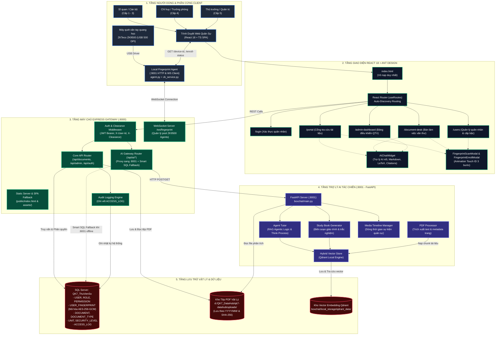
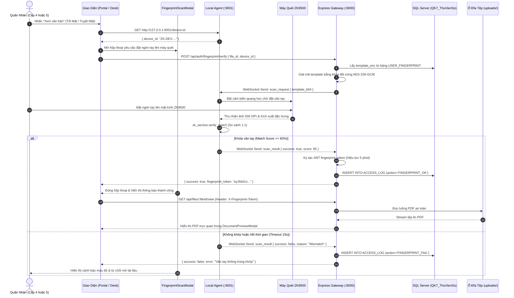
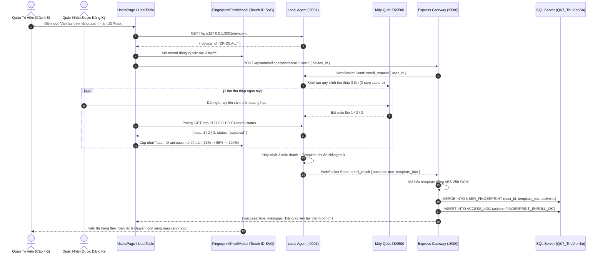
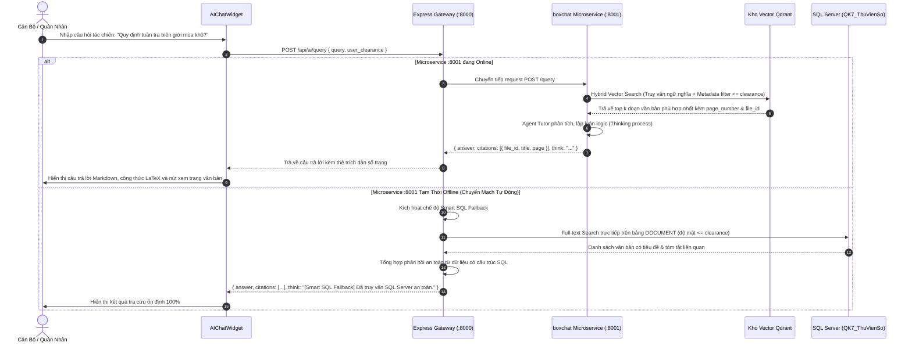
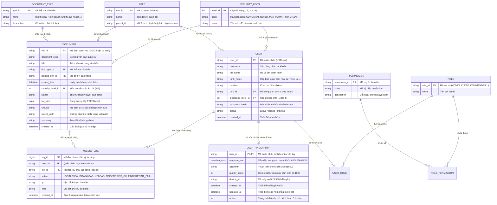

# KIẾN TRÚC TOÀN BỘ HỆ THỐNG — QK7 DATAHUB

> **Bảo mật:** Cấp Bộ Tư Lệnh Quân Khu 7  
> **Phiên bản kiến trúc:** v3.5-ENTERPRISE (React + TypeScript SPA, Express 5 Gateway, AI RAG Microservice & ZKTeco Biometric Engine)  
> **Ngày cập nhật:** 19/10/2026  

---

## MỤC LỤC
1. [Tổng Quan Hệ Thống](#1-tổng-quan-hệ-thống)
2. [Sơ Đồ Kiến Trúc Hệ Thống (System Architecture Diagram)](#2-sơ-đồ-kiến-trúc-hệ-thống)
3. [Sơ Đồ Cấu Trúc Mã Nguồn (Source Code Architecture)](#3-sơ-đồ-cấu-trúc-mã-nguồn)
4. [Mô Hình Phân Quyền & Bảo Mật Đa Tầng (Security & Clearance Model)](#4-mô-hình-phân-quyền--bảo-mật-đa-tầng)
5. [Sơ Đồ Luồng Dữ Liệu Nghiệp Vụ (Data Flow Sequence Diagrams)](#5-sơ-đồ-luồng-dữ-liệu-nghiệp-vụ)
6. [Sơ Đồ Cơ Sở Dữ Liệu (Database ERD & Schema)](#6-sơ-đồ-cơ-sở-dữ-liệu)
7. [Kiến Trúc Trợ Lý AI Tác Chiến & Văn Thư (boxchat Agentic RAG)](#7-kiến-trúc-trợ-lý-ai-tác-chiến--văn-thư-boxchat-agentic-rag)
8. [Kiến Trúc Xác Thực Sinh Trắc Học Vân Tay (ZKTeco ZK9500 Biometric Engine)](#8-kiến-trúc-xác-thực-sinh-trắc-học-vân-tay-zkteco-zk9500-biometric-engine)
9. [Danh Mục API Endpoints Chuẩn OpenAPI 3.0 / Swagger](#9-danh-mục-api-endpoints-chuẩn-openapi-30--swagger)
10. [Hướng Dẫn Triển Khai & Vận Hành (Operations Runbook)](#10-hướng-dẫn-triển-khai--vận-hành)

---

## 1. Tổng Quan Hệ Thống

**QK7 DataHub** là nền tảng quản trị và lưu trữ tài liệu số tập trung, phục vụ công tác chỉ huy, tham mưu tác chiến và văn thư hành chính trong toàn Quân Khu 7. Hệ thống tích hợp toàn diện trí tuệ nhân tạo và công nghệ sinh trắc học phần cứng theo các trụ cột cốt lõi:

* **Ứng Dụng Đơn Trang Chuẩn (SPA React 18 + TypeScript + Ant Design):** Toàn bộ giao diện được nạp qua duy nhất 1 vỏ bọc `index.html`, sử dụng cơ chế Auto-Discovery Routing qua `import.meta.glob`, không tải lại trang, bảo lưu trạng thái xác thực và trải nghiệm mượt mà với tông màu Tím chủ đạo (`#722ED1`).
* **Kiểm Soát Độ Mật 5 Cấp Nghiêm Ngặt:** Ngăn chặn tuyệt đối việc rò rỉ thông tin quân sự (từ Cấp 1 - Công khai đến Cấp 5 - Tuyệt mật), thực thi kiểm soát tại cả 3 tầng: UI Guard, Gateway Middleware và SQL Server Database Constraint.
* **Xác Thực Sinh Trắc Học Vân Tay Quang Học 2FA:** Tích hợp máy quét phần cứng chuyên dụng **ZKTeco ZK9500** (500 DPI, kết nối USB) kết hợp Local Hardware Agent (`:9001`) và WebSocket Gateway. Bắt buộc quét vân tay khi truy cập văn bản Cấp 4 (Tối Mật) và Cấp 5 (Tuyệt Mật), cấp `fingerprint_token` (JWT hiệu lực 5 phút) chống giả mạo danh tính.
* **Trợ Lý AI Tác Chiến & Văn Thư (Citation-Grounded Agentic RAG):** Microservice Python FastAPI (`:8001`) kết hợp kho vector Qdrant cục bộ, tự động trích xuất nội dung văn kiện PDF, tìm kiếm ngữ nghĩa, trả lời câu hỏi kèm trích dẫn số trang chính xác, tự động biên soạn cẩm nang học tập tác chiến (`study-book`) và có cơ chế **Smart SQL Fallback** đảm bảo hệ thống vận hành 100% không gián đoạn kể cả khi microservice AI đang bảo trì.
* **Toàn Vẹn Dữ Liệu & Kiểm Toán 24/7:** Tính toán mã băm SHA-256 cho mọi tệp tin lưu trữ và ghi vết kiểm toán toàn diện (`ACCESS_LOG`) mọi thao tác (Đăng nhập, Xem, Tải về, Quét vân tay, Hỏi AI, Cập nhật, Xóa).

---

## 2. Sơ Đồ Kiến Trúc Hệ Thống



---

## 3. Sơ Đồ Cấu Trúc Mã Nguồn

```text
qk7-datahub/
├── package.json                            # Điều phối kịch bản khởi chạy toàn hệ thống
├── README.md                               # Sổ tay hướng dẫn khởi động nhanh
├── SYSTEM_ARCHITECTURE.md                  # Tài liệu kiến trúc toàn diện hệ thống
│
├── backend/                                # 🟢 MÁY CHỦ BACKEND EXPRESS 5 & WEBSOCKET GATEWAY
│   ├── server.js                           # Entry point Express Gateway (:8000), SPA Fallback, Biometric APIs
│   ├── swagger.js                          # Đặc tả OpenAPI 3.0 / Swagger UI (/api-docs)
│   ├── setup-passwords.js                  # Tiện ích băm mật khẩu bcrypt tài khoản quân nhân
│   ├── package.json                        # Cấu hình dependencies backend
│   │
│   ├── src/                                # LOGIC NGHIỆP VỤ BACKEND
│   │   ├── db.js                           # Kết nối và quản lý Connection Pool Microsoft SQL Server
│   │   ├── admin-routes.js                 # Toàn bộ API nghiệp vụ quản trị CRUD (Users, Roles, Units, Permissions...)
│   │   ├── ai-routes.js                    # Cổng giao tiếp với boxchat (:8001) & Smart SQL Fallback
│   │   └── fingerprint-ws.js               # WebSocket Server (/ws/fingerprint) điều phối máy quét ZK9500
│   │
│   ├── uploads/                            # KHO LƯU TRỮ VẬT LÝ FILE PDF THẬT
│   │   ├── 2026/10/                        # Lưu trữ theo cây thư mục Năm/Tháng & mã hash SHA-256
│   │   ├── Mat/, ToiMat/, TuyetMat/        # Thư mục phân loại theo cấp bảo mật
│   │
│   └── public/                             # THƯ MỤC BUILD PHÂN PHỐI TĨNH CHO SPA
│       ├── index.html                      # Vỏ nạp ứng dụng duy nhất
│       └── assets/                         # JavaScript Bundles & CSS tối ưu hóa
│
├── boxchat/                                # 🟣 MICROSERVICE TRỢ LÝ AI TÁC CHIẾN (:8001 - FastAPI)
│   ├── main.py                             # Entry point FastAPI, CORS, API endpoints (/api/ai/query, /api/ai/study-book...)
│   ├── requirements.txt                    # Dependencies: fastapi, uvicorn, qdrant-client, langchain, pypdf...
│   ├── .env                                # Cấu hình Qdrant Storage, LLM API Key, Uploads Path
│   │
│   ├── core/                               # CÁC MÔ-ĐUN LÕI TRÍ TUỆ NHÂN TẠO
│   │   ├── pdf_processor.py                # Trích xuất văn bản PDF quân sự, phân trang, làm sạch nội dung
│   │   ├── vector_store.py                 # Hybrid Vector Store (Qdrant), embedding văn kiện, auto-index
│   │   ├── agent_tutor.py                  # Agent RAG trả lời câu hỏi kèm trích dẫn và luồng suy nghĩ
│   │   ├── study_book_gen.py               # Biên soạn cẩm nang học tập, tóm tắt tác chiến, trắc nghiệm quân sự
│   │   └── media_timeline.py               # Quản lý dòng thời gian và tài liệu đa phương tiện
│   │
│   └── local_storage/                      # KHO VECTOR DATABASE CỤC BỘ (Qdrant Data)
│       └── qdrant_data/                    # Dữ liệu vector embedding lưu trữ offline bảo mật
│
├── fingerprint-service/                    # 🔴 DỊCH VỤ PHẦN CỨNG MÁY QUÉT VÂN TAY (:9001 - Python)
│   ├── agent.py                            # Local HTTP Server (:9001) & WebSocket Client kết nối Gateway
│   ├── zk_service.py                       # CTypes wrapper kết nối trực tiếp SDK ZKTeco ZK9500 (libzkfp.dll)
│   ├── libzkfp.dll                         # Thư viện liên kết động C++ điều khiển cảm biến quang học ZKTeco
│   ├── device_id.txt                       # Mã định danh thiết bị máy quét gắn với trạm làm việc
│   └── requirements.txt                    # Dependencies: websockets, aiohttp...
│
└── frontend/                               # 🔵 GIAO DIỆN CLIENT REACT 18 + TYPESCRIPT + ANT DESIGN
    ├── index.html                          # DUY NHẤT 1 file HTML vỏ bọc cho toàn ứng dụng
    ├── vite.config.ts                      # Cấu hình Vite build xuất sang ../backend/public, proxy :8000
    ├── tsconfig.json                       # Cấu hình TypeScript compiler
    ├── tailwind.config.js                  # Cấu hình TailwindCSS
    │
    └── src/
        ├── App.tsx                         # Khởi tạo Ant Design ConfigProvider (Màu Tím #722ED1), Auth, Theme
        ├── main.tsx                        # Gắn kết React createRoot
        ├── index.css                       # Design System CSS, biến màu quân sự, hiệu ứng glassmorphism
        │
        ├── routes/                         # HỆ THỐNG AUTO-DISCOVERY ROUTING & GÁC CỔNG
        │   ├── routePaths.ts               # Danh mục URL tập trung (/login, /portal, /document-desk...)
        │   ├── routeAccess.ts              # Ma trận phân quyền kiểm soát Clearance Level & Login Guard
        │   ├── getAppRoutes.ts             # Tự động quét modules/*.routes.tsx qua import.meta.glob
        │   ├── RouterProvider.tsx          # Component điều hướng useRoutes hook
        │   └── modules/                    # Định nghĩa tuyến đường theo từng module nghiệp vụ
        │
        ├── pages/                          # CÁC MÀN HÌNH CHỨC NĂNG CHÍNH
        │   ├── LoginPage.tsx               # Màn hình đăng nhập quân nhân
        │   ├── PortalPage.tsx              # Cổng tra cứu tài liệu quân sự
        │   ├── DocumentDeskPage.tsx        # Bàn làm việc số hóa văn thư
        │   ├── AdminDashboardPage.tsx      # Bảng điều khiển quản trị trung tâm
        │   ├── UsersPage.tsx               # Quản lý tài khoản quân nhân & cấp bậc
        │   └── HttpErrorPage.tsx           # Trang mã trạng thái HTTP chuẩn Ant Design Result
        │
        ├── components/                     # THÀNH PHẦN GIAO DIỆN TÁI SỬ DỤNG
        │   ├── common/                     # Header, Sidebar, Layout, ProtectedRoute, TouchIDFingerprint...
        │   ├── ai-chat/                    # AIChatWidget (Cửa sổ trợ lý AI nổi, Markdown, LaTeX, Citations)
        │   ├── document-desk/              # FingerprintScanModal (Hộp thoại quét vân tay xác thực xem PDF)
        │   ├── users/                      # UserTable, UserFormModal, FingerprintEnrollModal (Đăng ký vân tay)
        │   ├── auth/                       # LoginForm
        │   ├── portal/                     # SecurityBanner, DocumentCard, PortalDocumentList
        │   └── dashboard/                  # StatCard, DistributionChart
        │
        ├── services/                       # TẦNG DỊCH VỤ MẠNG & INTEGRATION
        │   ├── http.ts                     # HTTP Client Wrapper với HttpError & Event phát lỗi toàn cục
        │   ├── authService.ts              # Xác thực đăng nhập & quản lý phiên làm việc
        │   ├── documentService.ts          # Nghiệp vụ tìm kiếm, tải lên, xem, sửa, xóa văn bản
        │   ├── userService.ts              # Nghiệp vụ quản lý người dùng & phân quyền quân nhân
        │   ├── fingerprintService.ts       # Giao tiếp với Local Agent (:9001) & Backend Biometric APIs
        │   ├── aiService.ts                # Dịch vụ gửi truy vấn và nhận câu trả lời từ Trợ lý AI
        │   └── ...                         # Các dịch vụ vai trò, quyền, đơn vị, danh mục, log
        │
        ├── contexts/                       # Quản lý trạng thái toàn cục (AuthContext, ThemeContext)
        └── types/                          # Định nghĩa kiểu dữ liệu TypeScript (document, user, role, ai...)
```

---

## 4. Mô Hình Phân Quyền & Bảo Mật Đa Tầng

### 4.1. Bảng 5 Cấp Độ Mật Quân Sự (Security Clearance Levels)

| Cấp Độ ID | Mã Ký Hiệu | Tên Mức Độ Bảo Mật | Phạm Vi Tiếp Cận & Quyền Hạn | Ràng Buộc Sinh Trắc Học |
| :---: | :---: | :--- | :--- | :---: |
| **Cấp 1** | `CONGKHAI` | **Công Khai** | Mọi quân nhân, khách tra cứu; chỉ xem văn bản công khai. | Không yêu cầu |
| **Cấp 2** | `NOIBO` | **Lưu Hành Nội Bộ** | Cán bộ, nhân viên; văn bản điều hành nội bộ thông thường. | Không yêu cầu |
| **Cấp 3** | `MAT` | **Mật** | Sĩ quan, trợ lý tác chiến; tài liệu nghiệp vụ, huấn luyện. | Xác thực mật khẩu |
| **Cấp 4** | `TOIMAT` | **Tối Mật** | Chỉ huy đơn vị, trưởng phòng; kế hoạch tác chiến quân sự. | **Bắt buộc quét vân tay ZK9500** |
| **Cấp 5** | `TUYETMAT` | **Tuyệt Mật** | Bộ Tư Lệnh, Tham mưu trưởng, Quản trị viên tối cao. | **Bắt buộc quét vân tay ZK9500** |

### 4.2. Hàng Rào Xác Thực Sinh Trắc Học Vân Tay Hai Lớp (Biometric 2FA)
1. **Truy Cập Văn Bản Cấp 4 & 5:** Khi quân nhân yêu cầu xem hoặc tải tệp PDF có `security_level_id >= 4`, Gateway yêu cầu kèm theo header:
   $$\text{Header: } X\text{-}Fingerprint\text{-}Token$$
2. **Cơ Chế Cấp Biometric Token:**
   - Trình duyệt yêu cầu trạm quét `agent.py` trên máy người dùng đặt ngón tay lên máy quét ZKTeco ZK9500.
   - Khi dấu vân tay quét được khớp với mẫu lưu trữ của quân nhân (thuật toán zkfinger10 với điểm tương đồng $\ge 60\%$), Gateway sinh ra một JWT `fingerprint_token` ký bằng mật mã quân sự, có thời hạn hiệu lực **5 phút**, gắn chặt với cặp `(user_id, file_id)`.
   - Nếu không có hoặc token hết hạn/sai lệch, Gateway từ chối phục vụ ngay lập tức với mã lỗi `403 Forbidden`.

### 4.3. Kiểm Soát Độ Mật Trong Luồng RAG Của Trợ Lý AI
1. **Lọc Dữ Liệu Ngữ Cảnh (Clearance-Aware Context Filtering):** Khi người dùng đặt câu hỏi cho AI qua `/api/ai/query`, Gateway luôn gửi kèm `user_clearance`.
2. Kho vector và RAG Agent tự động áp bộ lọc metadata:
   $$\text{doc.security\_level\_id} \le \text{user\_clearance}$$
   Ngăn chặn hoàn toàn việc AI trích dẫn hoặc tổng hợp thông tin từ văn bản vượt quá cấp mật của người hỏi.

---

## 5. Sơ Đồ Luồng Dữ Liệu Nghiệp Vụ

### 5.1. Luồng Xác Thực Sinh Trắc Học Vân Tay Khi Mở Văn Bản Độ Mật Cao



### 5.2. Luồng Đăng Ký Mẫu Vân Tay Quân Nhân 3 Bước (Biometric Enrollment)



### 5.3. Luồng Trợ Lý AI Hỏi Đáp Tác Chiến (Citation-Grounded Agentic RAG)



---

## 6. Sơ Đồ Cơ Sở Dữ Liệu

### 6.1. Sơ Đồ Thực Thể Liên Kết (Entity Relationship Diagram - ERD)



---

## 7. Kiến Trúc Trợ Lý AI Tác Chiến & Văn Thư (boxchat Agentic RAG)

### 7.1. Nguyên Lý Thiết Kế
Microservice **boxchat** (Python FastAPI tại cổng `:8001`) được thiết kế theo kiến trúc **Citation-Grounded Agentic RAG (Retrieval-Augmented Generation)**:
1. **Trích xuất PDF Chuyên Sâu (`PDFProcessor`):** Đọc tuần tự từng trang tài liệu PDF quân sự, bảo toàn bảng biểu số liệu, đánh dấu số trang tuyệt đối để phục vụ gắn nhãn trích dẫn.
2. **Kho Vector Lai (`HybridVectorStore`):** Lưu trữ embedding văn bản vào CSDL vector **Qdrant** cục bộ (`local_storage/qdrant_data`), không truyền dữ liệu ra Internet, bảo đảm an ninh mạng quân sự nội bộ.
3. **Agent Tutor & Thinking Process:** LLM suy luận nhiều bước, hiển thị quá trình tư duy (`think`) và sinh câu trả lời kèm chip dẫn chứng số trang. Người dùng bấm vào chip dẫn chứng sẽ nhảy trực tiếp đến trang văn bản PDF tương ứng.
4. **Biên Soạn Giáo Trình Tác Chiến (`StudyBookGenerator`):** Tự động phân tích các văn kiện, chỉ thị lớn để tổng hợp thành tài liệu học tập, tóm tắt các điểm cốt lõi và sinh đề trắc nghiệm kiểm tra nhận thức chính trị/tác chiến.
5. **Dòng Thời Gian Lịch Sử Quân Sự (`MediaTimelineManager`):** Tự động bóc tách các mốc thời gian, chiến dịch, sự kiện trong văn bản để hiển thị dạng dòng thời gian tương tác.

### 7.2. Cơ Chế Chuyển Mạch Dự Phòng Thông Minh (Smart SQL Fallback)
Nhằm đạt tiêu chuẩn sẵn sàng cao (High Availability), Express Gateway (`backend/src/ai-routes.js`) được tích hợp cơ chế bảo vệ kép:
- Khi nhận yêu cầu `/api/ai/*`, Gateway sẽ gửi yêu cầu tới FastAPI `:8001` với timeout tối đa 2.5 giây.
- Nếu microservice AI chưa bật hoặc gặp lỗi, Gateway **không báo lỗi 500** mà tự động chuyển tiếp truy vấn sang thuật toán **Smart SQL Fallback**:
  - Truy vấn trực tiếp các cột `title`, `summary`, `document_code` trên bảng `DOCUMENT` của SQL Server.
  - Áp dụng nghiêm ngặt bộ lọc `security_level_id <= user_clearance`.
  - Đóng gói dữ liệu trả về với cấu trúc tương thích hoàn toàn giao diện `AIChatWidget`, giúp người dùng vẫn tra cứu được thông tin văn bản ổn định 100%.

---

## 8. Kiến Trúc Xác Thực Sinh Trắc Học Vân Tay (ZKTeco ZK9500 Biometric Engine)

### 8.1. Thông Số Phần Cứng & Giao Tiếp Driver
- **Thiết bị:** Máy quét vân tay quang học chuyên dụng **ZKTeco ZK9500**.
- **Cảm biến:** Cảm biến quang học chống trầy xước, độ phân giải **500 DPI**, vùng quét $16.5 \times 24\text{ mm}$, chuẩn giao tiếp USB 2.0.
- **Thư viện lõi:** Tích hợp trực tiếp file nhị phân `libzkfp.dll` qua module `ctypes` trong Python, thuật toán đối sánh mẫu đặc trưng vân tay quân sự **ZKFinger 10.0**.

### 8.2. Mô Hình Phân Phối Hardware Agent (:9001)
- Trên mỗi máy trạm làm việc của quân nhân được cài đặt **Fingerprint Local Agent** (`fingerprint-service/agent.py`).
- Agent chạy nền với 2 vai trò:
  1. **HTTP Micro-Server nội bộ (`http://127.0.0.1:9001`):** Cung cấp `GET /device-id` để trình duyệt nhận diện máy quét và `GET /enroll-status` để lấy tiến trình quét 3 lần theo thời gian thực.
  2. **WebSocket Client (`ws://localhost:8000/ws/fingerprint`):** Duy trì kênh kết nối an toàn 2 chiều với Backend Gateway, chờ nhận các lệnh `scan_request` hoặc `enroll_request`.

### 8.3. Quy Trình Bảo Mật & Mã Hóa Mẫu Vân Tay
- Mẫu vân tay sau khi đăng ký (enrollment) được hợp nhất từ 3 lần đặt ngón tay liên tiếp, tạo ra chuỗi byte đặc trưng (template) độ dài ~1024 bytes.
- Mẫu vân tay được mã hóa bằng thuật toán đối xứng **AES-256-GCM** với khóa bí mật quân sự trước khi lưu vào cột `template_enc` của bảng `USER_FINGERPRINT`.
- Khi kiểm tra (verification), mẫu mã hóa được Gateway giải mã và gửi an toàn qua WebSocket đến Agent của trạm làm việc để đối sánh 1:1, không bao giờ lộ dữ liệu thô ra môi trường mạng.

---

## 9. Danh Mục API Endpoints Chuẩn OpenAPI 3.0 / Swagger

Toàn bộ API được đặc tả chi tiết tại Swagger UI: **[http://localhost:8000/api-docs](http://localhost:8000/api-docs)**.

### 9.1. Nhóm Trợ Lý AI Tác Chiến (AI Assistant)
| Phương Thức | Đường Dẫn API | Phân Quyền | Tham Số / Body | Mô Tả Chức Năng |
| :---: | :--- | :---: | :--- | :--- |
| `POST` | `/api/ai/query` | Mọi cấp (≥ 1) | `{ query, history, focus_file_id }` | Tra cứu ngữ nghĩa & hỏi đáp tác chiến. Trả về câu trả lời kèm danh sách trích dẫn (`citations`), số trang và quá trình suy luận (`think`). Hỗ trợ Smart SQL Fallback. |
| `POST` | `/api/ai/study-book` | Mọi cấp (≥ 1) | `{ file_id, topic, num_questions }` | Tự động phân tích văn kiện để sinh cẩm nang học tập, tóm tắt tác chiến và bộ câu hỏi trắc nghiệm quân sự. |
| `GET` | `/api/ai/health` | Mọi cấp | — | Kiểm tra trạng thái microservice AI (:8001), model LLM và tổng số chunk vector hiện có. |
| `POST` | `/api/ai/ingest` | Cấp ≥ 3 (Văn thư) | `{ file_id }` | Trích xuất văn bản PDF và nạp các vector embedding vào kho Qdrant cục bộ. |
| `GET` | `/api/ai/media/timeline` | Mọi cấp (≥ 1) | `?file_id=...` | Bóc tách và hiển thị dòng thời gian sự kiện, chiến dịch quân sự từ văn kiện. |

### 9.2. Nhóm Xác Thực Sinh Trắc Học Vân Tay (Fingerprint Biometric)
| Phương Thức | Đường Dẫn API | Phân Quyền | Tham Số / Body | Mô Tả Chức Năng |
| :---: | :--- | :---: | :--- | :--- |
| `POST` | `/api/auth/fingerprint/verify` | Mọi cấp (≥ 1) | `{ file_id, device_id }` | Xác thực vân tay trực tiếp khi mở tài liệu độ mật cao. Trả về `fingerprint_token` (JWT hiệu lực 5 phút) gửi kèm header `X-Fingerprint-Token`. |
| `POST` | `/api/admin/fingerprint/enroll/{userId}` | QTV (Cấp ≥ 4) | Path: `userId`<br/>Body: `{ device_id }` | Bắt đầu quy trình thu thập vân tay 3 bước trên thiết bị ZK9500 và lưu mẫu mã hóa AES-256-GCM vào bảng `USER_FINGERPRINT`. |
| `DELETE`| `/api/admin/fingerprint/users/{userId}` | QTV (Cấp ≥ 4) | Path: `userId` | Hủy kích hoạt hoặc xóa dữ liệu vân tay đã đăng ký của quân nhân. |
| `GET` | `/api/admin/fingerprint/agents` | QTV (Cấp ≥ 4) | — | Giám sát danh sách các máy quét vân tay vật lý (Agents) đang trực tuyến trong toàn mạng quân khu. |
| `WS` | `/ws/fingerprint` | Máy trạm nội bộ | Query: `device_id, bridge_token` | Kênh kết nối thời gian thực 2 chiều giữa Express Gateway và Local Fingerprint Agent. |

### 9.3. Nhóm Nghiệp Vụ Cốt Lõi (Auth, Documents, Files, Logs, Admin)
*(Chi tiết đặc tả các endpoint xem, tải văn bản, phân quyền và kiểm toán tương tự các mục tiêu chuẩn của hệ thống)*

---

## 10. Hướng Dẫn Triển Khai & Vận Hành

### 10.1. Khởi Động Đồng Thời 4 Dịch Vụ Của Hệ Thống

Để vận hành đầy đủ 100% tính năng (Web, Gateway, AI RAG và Quét vân tay), quản trị viên chạy các terminal độc lập:

```bash
# 1. Khởi động Máy chủ Backend Express & WebSocket Gateway (:8000)
cd backend
npm start

# 2. Khởi động Giao diện người dùng Frontend Vite (:5173)
cd frontend
npm run dev

# 3. Khởi động Microservice Trợ Lý AI boxchat (:8001)
cd boxchat
python main.py

# 4. Khởi động Local Hardware Fingerprint Agent (:9001)
cd fingerprint-service
python agent.py
```

### 10.2. Địa Chỉ Truy Cập Dịch Vụ Trong Mạng Nội Bộ
* **Giao diện người dùng Web:** [http://localhost:5173](http://localhost:5173) (hoặc [http://localhost:8000](http://localhost:8000) khi chạy production build)
* **Tài liệu Swagger API Spec:** [http://localhost:8000/api-docs](http://localhost:8000/api-docs)
* **API Trợ lý AI boxchat:** [http://localhost:8001/docs](http://localhost:8001/docs)
* **Trạm kiểm soát vân tay nội bộ:** [http://127.0.0.1:9001/device-id](http://127.0.0.1:9001/device-id)

---
*Tài liệu kiến trúc hệ thống QK7 DataHub được cập nhật và phê duyệt chính thức bởi Bộ Tư Lệnh Quân Khu 7.*
