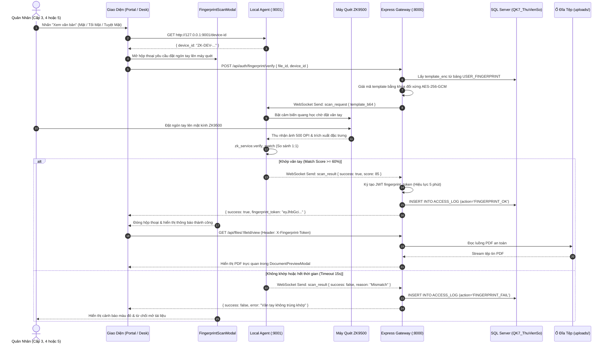
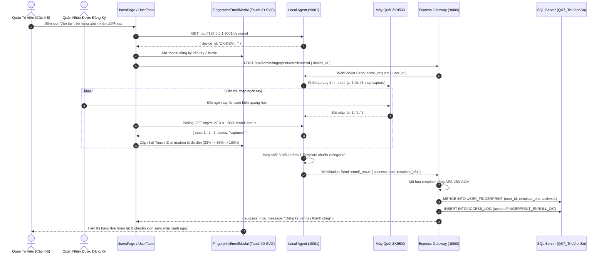
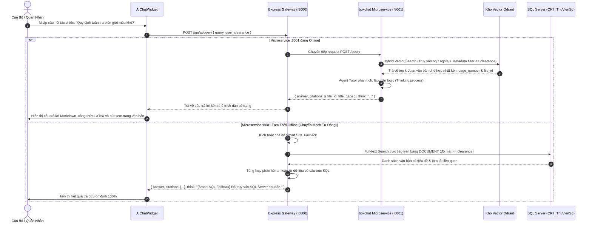

# KIẾN TRÚC TOÀN BỘ HỆ THỐNG — TRƯỜNG QUÂN SỰ QUÂN KHU 7 DATAHUB

> **Bảo mật:** Cấp Trường Quân sự Quân khu 7  
> **Phiên bản kiến trúc:** v3.8-ENTERPRISE (Dual-Platform Desktop & iPadOS, React 18 + TS SPA, Express 5 Gateway, AI RAG & ZKTeco Biometric Engine)  
> **Ngày cập nhật:** 21/10/2026  

---

## MỤC LỤC
1. [Tổng Quan Hệ Thống](#1-tổng-quan-hệ-thống)
2. [Sơ Đồ Kiến Trúc Hệ Thống (System Architecture Diagram)](#2-sơ-đồ-kiến-trúc-hệ-thống)
3. [Sơ Đồ Cấu Trúc Mã Nguồn (Source Code Architecture)](#3-sơ-đồ-cấu-trúc-mã-nguồn)
4. [Mô Hình Phân Quyền & Bảo Mật Đa Tầng (Security & Clearance Model)](#4-mô-hình-phân-quyền--bảo-mật-đa-tầng)
5. [Sơ Đồ Luồng Dữ Liệu Nghiệp Vụ (Data Flow Sequence Diagrams)](#5-sơ-đồ-luồng-dữ-liệu-nghiệp-vụ)
6. [Sơ Đồ Cơ Sở Dữ Liệu (Database ERD & Schema)](#6-sơ-đồ-cơ-sở-dữ-liệu)
7. [Kiến Trúc Trợ Lý AI Tác Chiến & Văn Thư (boxchat Agentic RAG)](#7-kiến-trúc-trợ-lý-ai-tác-chiến--văn-thư-boxchat-agentic-rag)
8. [Kiến Trúc Xác Thực Sinh Trắc Học Vân Tay (ZKTeco ZK9500 Biometric Engine)](#8-kiến-trúc-xác-thực-sinh-trắc-học-vân-tay-zkteco-zk9500-biometric-engine)
9. [Danh Mục API Endpoints Chuẩn OpenAPI 3.0 / Swagger](#9-danh-mục-api-endpoints-chuẩn-openapi-30--swagger)
10. [Hướng Dẫn Triển Khai & Vận Hành (Operations Runbook)](#10-hướng-dẫn-triển-khai--vận-hành)
11. [Kiến Trúc Trung Tâm Kiểm Toán & Giám Sát An Ninh SOC (Security Audit Log Engine)](#11-kiến-trúc-trung-tâm-kiểm-toán--giám-sát-an-ninh-soc)
12. [Kiến Trúc Bảng Phân Cấp Đơn Vị Quân Khu Đa Tầng (Military Unit Hierarchy & Command Tree Engine)](#12-kiến-trúc-bảng-phân-cấp-đơn-vị-quân-khu-đa-tầng)
13. [Đặc Tả Kỹ Thuật Mô-đun Xuất Báo Cáo Kiểm Toán Quân Đội Dạng Excel (Military Audit Reporting Engine)](#13-đặc-tả-kỹ-thuật-mô-đun-xuất-báo-cáo-kiểm-toán-quân-đội-dạng-excel)
14. [Kiến Trúc Giao Diện Kép Đa Nền Tảng (Dual-Platform Desktop & iPadOS Touch UI Engine)](#14-kiến-trúc-giao-diện-kép-đa-nền-tảng-dual-platform-desktop--ipados-touch-ui-engine)
15. [Phân Hệ Quản Lý Tài Liệu Đơn Vị Trực Thuộc (MyUnitPage) & Chuẩn Hóa Danh Xưng Thư Viện Số](#15-phân-hệ-quản-lý-tài-liệu-đơn-vị-trực-thuộc-myunitpage--chuẩn-hóa-danh-xưng-thư-viện-số)
16. [Kiến Trúc Giao Diện Tự Thích Ứng Chống Bể Layout Mọi Mức Phóng To (Adaptive Zoom-Proof Layout Engine)](#16-kiến-trúc-giao-diện-tự-thích-ứng-chống-bể-layout-mọi-mức-phóng-to-adaptive-zoom-proof-layout-engine)

---

## 1. Tổng Quan Hệ Thống

**TRƯỜNG QUÂN SỰ QUÂN KHU 7 DATAHUB** là nền tảng quản trị và lưu trữ tài liệu số tập trung, phục vụ công tác chỉ huy, tham mưu tác chiến và văn thư hành chính trong toàn Quân Khu 7. Hệ thống tích hợp toàn diện trí tuệ nhân tạo và công nghệ sinh trắc học phần cứng theo các trụ cột cốt lõi:

* **Ứng Dụng Đơn Trang Chuẩn (SPA React 18 + TypeScript + Ant Design):** Toàn bộ giao diện được nạp qua duy nhất 1 vỏ bọc `index.html`, sử dụng cơ chế Auto-Discovery Routing qua `import.meta.glob`, không tải lại trang, bảo lưu trạng thái xác thực và trải nghiệm mượt mà với tông màu Tím chủ đạo (`#722ED1`).
* **Kiến Trúc Giao Diện Kép Đa Nền Tảng (Dual-Platform PC & iPad Air M4 Touch UI):** Tương thích tối ưu cả Máy tính để bàn (Widescreen 16:9) và máy tính bảng iPad Air M4 (11-inch & 13-inch) với cơ chế `DeviceModeContext`, cho phép chuyển đổi chế độ xem tức thì. Trên iPadOS hỗ trợ vuốt chạm chuẩn Apple HIG (Touch Target ≥ 44×44px); trên Desktop PC sử dụng cụm nút bấm chuyển trang màu sắc chuyên biệt (`Đăng tải`, `Trung tâm thư viện số`, `Đơn vị của tôi`, `Quản trị`) ổn định, loại bỏ hiệu ứng viên thuốc trượt để ngăn ngừa triệt để lỗi nhảy giao diện.
* **Chuẩn Hóa Danh Xưng "Trung Tâm Thư Viện Số" & Phân Hệ "Đơn Vị Của Tôi":** Chuẩn hóa toàn bộ nhãn giao diện từ "Portal" thành "Trung tâm thư viện số", đồng thời cung cấp phân hệ `/my-unit` hỗ trợ các cơ quan, đơn vị trực thuộc Quân Khu 7 tra cứu, lưu trữ và khai thác tài liệu nội bộ chuyên biệt.
* **Kiểm Soát Độ Mật 5 Cấp Nghiêm Ngặt:** Ngăn chặn tuyệt đối việc rò rỉ thông tin quân sự (từ Cấp 1 - Công khai đến Cấp 5 - Tuyệt mật), thực thi kiểm soát tại cả 3 tầng: UI Guard, Gateway Middleware và SQL Server Database Constraint.
* **Xác Thực Sinh Trắc Học Vân Tay Quang Học 2FA:** Tích hợp máy quét phần cứng chuyên dụng **ZKTeco ZK9500** (500 DPI, kết nối USB) kết hợp Local Hardware Agent (`:9001`) và WebSocket Gateway. Bắt buộc quét vân tay khi truy cập văn bản Cấp 3 (Mật), Cấp 4 (Tối Mật) và Cấp 5 (Tuyệt Mật), cấp `fingerprint_token` (JWT hiệu lực 5 phút) chống giả mạo danh tính. Giao diện thu thập vân tay 3 bước tích hợp vector Touch ID trực quan và cơ chế lọc lỗi nhảy gián đoạn.
* **Trợ Lý AI Tác Chiến & Văn Thư (Citation-Grounded Agentic RAG):** Microservice Python FastAPI (`:8001`) kết hợp kho vector Qdrant cục bộ, tự động trích xuất nội dung văn kiện PDF, tìm kiếm ngữ nghĩa, trả lời câu hỏi kèm trích dẫn số trang chính xác, tự động biên soạn cẩm nang học tập tác chiến (`study-book`) và có cơ chế **Smart SQL Fallback** đảm bảo hệ thống vận hành 100% không gián đoạn kể cả khi microservice AI đang bảo trì.
* **Toàn Vẹn Dữ Liệu & Kiểm Toán 24/7:** Tính toán mã băm SHA-256 cho mọi tệp tin lưu trữ và ghi vết kiểm toán toàn diện (`ACCESS_LOG`) mọi thao tác (Đăng nhập, Xem, Tải về, Quét vân tay, Hỏi AI, Cập nhật, Xóa).

---

## 2. Sơ Đồ Kiến Trúc Hệ Thống

```mermaid
graph TB
    subgraph CLIENT_TIER ["1. TẦNG NGƯỜI DÙNG & PHẦN CỨNG CLIENT"]
        Officer["Sĩ quan / Cán bộ<br/>(Cấp 1 - 3)"]
        Commander["Chỉ huy / Trưởng phòng<br/>(Cấp 4)"]
        AdminHigh["Thủ trưởng / Quản trị<br/>(Cấp 5)"]
        
        ScannerHardware["Máy quét vân tay quang học<br/>ZKTeco ZK9500 (USB 500 DPI)"]
        LocalAgent["Local Fingerprint Agent<br/>(:9001 HTTP & WS Client)<br/>agent.py + zk_service.py"]
        BrowserApp["Trình Duyệt Web Quân Sự<br/>(Máy Tính Bàn / iPad Air M4 iPadOS<br/>Safari, Chrome, Cốc Cốc)"]

        Officer & Commander & AdminHigh --> BrowserApp
        ScannerHardware -->|USB Driver| LocalAgent
        BrowserApp <-->|GET /device-id, /enroll-status| LocalAgent
    end

    subgraph PRESENTATION_TIER ["2. TẦNG GIAO DIỆN REACT 18 + ANT DESIGN (DUAL-PLATFORM)"]
        SingleHTML["index.html<br/>(Vỏ nạp duy nhất)"]
        AppRouter["React Router (useRoutes)<br/>Auto-Discovery Routing"]
        DeviceModeComp["DeviceModeSwitch & Context<br/>(Desktop PC Widescreen vs iPad Touch UI)"]
        HeaderComp["Header Bar Navigation<br/>(PC: Nút Chuyển Màu Sắc | iPad: Segmented Glider)"]
        
        LoginPage["/login (Xác thực quân nhân)"]
        PortalPage["/portal (Trung tâm thư viện số)"]
        MyUnitPage["/my-unit (Đơn vị của tôi)"]
        DeskPage["/document-desk (Bàn làm việc văn thư)"]
        AdminDashboard["/admin-dashboard (Bảng điều khiển QTV)"]
        UsersPage["/users (Quản lý quân nhân & cấp bậc)"]
        
        AIChatWidgetComp["AIChatWidget<br/>(Trợ lý AI nổi, Markdown, LaTeX, Citations)"]
        FpModals["FingerprintScanModal & FingerprintEnrollModal<br/>(Animation Touch ID Vector 3 bước)"]
        SecurityAuditLogComp["SecurityAuditLog (Trung Tâm SOC)<br/>(Live Monitor, 4 KPI, Filter Pills, Deep JSON Drawer)"]
        UnitTreeComp["UnitTreeTable (Cây Đơn Vị)<br/>(Command Hierarchy, 6 Tiers, Orphan Safe)"]
        ExcelExportTool["exportAuditReportExcel<br/>(ExcelJS Báo Cáo Quân Đội .xlsx)"]

        BrowserApp --> SingleHTML
        SingleHTML --> AppRouter
        AppRouter --> HeaderComp
        HeaderComp -.-> DeviceModeComp
        AppRouter --> LoginPage & PortalPage & MyUnitPage & DeskPage & AdminDashboard & UsersPage
        PortalPage & MyUnitPage & DeskPage & AdminDashboard -.-> AIChatWidgetComp
        PortalPage & MyUnitPage & DeskPage & UsersPage -.-> FpModals
        AdminDashboard -.-> SecurityAuditLogComp & UnitTreeComp
        SecurityAuditLogComp -.-> ExcelExportTool
    end

    subgraph GATEWAY_TIER ["3. TẦNG MÁY CHỦ EXPRESS GATEWAY (:8000)"]
        ExpressStatic["Static Server & SPA Fallback<br/>(public/index.html & assets/)"]
        AuthSecMiddleware["Auth & Clearance Middleware<br/>(JWT Bearer, X-User-Id, X-Clearance)"]
        BiometricBridge["WebSocket Server /ws/fingerprint<br/>(Quản lý pool ZK9500 Agents)"]
        AIRouterProxy["AI Gateway Router (/api/ai/*)<br/>(Proxy sang :8001 + Smart SQL Fallback)"]
        CoreAPIRouter["Core API Router<br/>(/api/documents, /api/admin, /api/auth)"]
        AuditLoggingEngine["Audit Logging Engine<br/>(Ghi vết ACCESS_LOG)"]

        AppRouter -->|REST Calls| AuthSecMiddleware
        LocalAgent <-->|WebSocket Connection| BiometricBridge
        AuthSecMiddleware --> CoreAPIRouter
        AuthSecMiddleware --> AIRouterProxy
        CoreAPIRouter --> AuditLoggingEngine
    end

    subgraph AI_MICROSERVICE_TIER ["4. TẦNG TRỢ LÝ AI TÁC CHIẾN (:8001 - FastAPI)"]
        FastAPIServer["FastAPI Server (:8001)<br/>boxchat/main.py"]
        AgentTutor["Agent Tutor<br/>(RAG Agentic Logic & Think Process)"]
        PDFProcessor["PDF Processor<br/>(Trích xuất text & metadata trang)"]
        StudyBookGen["Study Book Generator<br/>(Biên soạn giáo trình & trắc nghiệm)"]
        MediaTimeline["Media Timeline Manager<br/>(Dòng thời gian sự kiện quân sự)"]
        HybridVectorStore["Hybrid Vector Store<br/>(Qdrant Local Engine)"]

        AIRouterProxy -->|HTTP POST/GET| FastAPIServer
        FastAPIServer --> AgentTutor & StudyBookGen & MediaTimeline
        AgentTutor & StudyBookGen --> HybridVectorStore
        PDFProcessor -->|Nạp chunk tài liệu| HybridVectorStore
    end

    subgraph STORAGE_TIER ["5. TẦNG LƯU TRỮ VẬT LÝ & DỮ LIỆU"]
        MSSQLDB[("SQL Server: QK7_ThuVienSo<br/>- USER, ROLE, PERMISSION<br/>- USER_FINGERPRINT (Mã hóa AES-256-GCM)<br/>- DOCUMENT, DOCUMENT_TYPE<br/>- UNIT, SECURITY_LEVEL<br/>- ACCESS_LOG")]
        DiskStorage[("Kho Tệp PDF Vật Lý<br/>d:/QK7_DataHub/qk7-datahub/uploads/<br/>(Lưu theo YYYY/MM/ & SHA-256)")]
        VectorStorage[("Kho Vector Embedding Qdrant<br/>boxchat/local_storage/qdrant_data/")]

        CoreAPIRouter -->|Truy vấn & Phân quyền| MSSQLDB
        CoreAPIRouter -->|Lưu & Đọc tệp PDF| DiskStorage
        AIRouterProxy -.->|Smart SQL Fallback khi :8001 offline| MSSQLDB
        AuditLoggingEngine -->|Ghi nhật ký hệ thống| MSSQLDB
        FastAPIServer -->|Đọc file phân tích| DiskStorage
        HybridVectorStore -->|Lưu & Tra cứu vector| VectorStorage
    end

    classDef client fill:#1e293b,stroke:#3b82f6,stroke-width:2px,color:#fff;
    classDef front fill:#0f172a,stroke:#10b981,stroke-width:2px,color:#fff;
    classDef gate fill:#064e3b,stroke:#34d399,stroke-width:2px,color:#fff;
    classDef ai fill:#312e81,stroke:#818cf8,stroke-width:2px,color:#fff;
    classDef store fill:#450a0a,stroke:#f43f5e,stroke-width:2px,color:#fff;

    class Officer,Commander,AdminHigh,ScannerHardware,LocalAgent,BrowserApp client;
    class SingleHTML,AppRouter,LoginPage,PortalPage,DeskPage,AdminDashboard,UsersPage,AIChatWidgetComp,FpModals,SecurityAuditLogComp,UnitTreeComp,ExcelExportTool front;
    class ExpressStatic,AuthSecMiddleware,BiometricBridge,AIRouterProxy,CoreAPIRouter,AuditLoggingEngine gate;
    class FastAPIServer,AgentTutor,PDFProcessor,StudyBookGen,MediaTimeline,HybridVectorStore ai;
    class MSSQLDB,DiskStorage,VectorStorage store;
```



---

## 3. Sơ Đồ Cấu Trúc Mã Nguồn

```text
qk7-datahub/
├── package.json                            # Điều phối kịch bản khởi chạy toàn hệ thống
├── README.md                               # Sổ tay hướng dẫn khởi động nhanh
├── SETUP_SERVER.md                         # Sổ tay hướng dẫn cài đặt Server & Client chi tiết
├── SYSTEM_ARCHITECTURE.md                  # Tài liệu kiến trúc toàn diện hệ thống
│
├── backend/                                # 🟢 MÁY CHỦ BACKEND EXPRESS 5 & WEBSOCKET GATEWAY
│   ├── server.js                           # Entry point Express Gateway (:8000), SPA Fallback, Biometric APIs
│   ├── swagger.js                          # Đặc tả OpenAPI 3.0 / Swagger UI (/api-docs)
│   ├── setup-passwords.js                  # Tiện ích băm mật khẩu bcrypt tài khoản quân nhân
│   ├── package.json                        # Cấu hình dependencies backend
│   │
│   ├── src/                                # LOGIC NGHIỆP VỤ BACKEND
│   │   ├── db.js                           # Kết nối và quản lý Connection Pool Microsoft SQL Server
│   │   ├── admin-routes.js                 # Toàn bộ API nghiệp vụ quản trị CRUD (Users, Roles, Units, Permissions...)
│   │   ├── ai-routes.js                    # Cổng giao tiếp với boxchat (:8001) & Smart SQL Fallback
│   │   └── fingerprint-ws.js               # WebSocket Server (/ws/fingerprint) điều phối máy quét ZK9500
│   │
│   ├── uploads/                            # KHO LƯU TRỮ VẬT LÝ FILE PDF THẬT
│   │   ├── 2026/10/                        # Lưu trữ theo cây thư mục Năm/Tháng & mã hash SHA-256
│   │   ├── Mat/, ToiMat/, TuyetMat/        # Thư mục phân loại theo cấp bảo mật
│   │
│   └── public/                             # THƯ MỤC BUILD PHÂN PHỐI TĨNH CHO SPA
│       ├── index.html                      # Vỏ nạp ứng dụng duy nhất
│       └── assets/                         # JavaScript Bundles & CSS tối ưu hóa
│
├── boxchat/                                # 🟣 MICROSERVICE TRỢ LÝ AI TÁC CHIẾN (:8001 - FastAPI)
│   ├── main.py                             # Entry point FastAPI, CORS, API endpoints (/api/ai/query, /api/ai/study-book...)
│   ├── requirements.txt                    # Dependencies: fastapi, uvicorn, qdrant-client, langchain, pypdf...
│   ├── .env                                # Cấu hình Qdrant Storage, LLM API Key, Uploads Path
│   │
│   ├── core/                               # CÁC MÔ-ĐUN LÕI TRÍ TUỆ NHÂN TẠO
│   │   ├── pdf_processor.py                # Trích xuất văn bản PDF quân sự, phân trang, làm sạch nội dung
│   │   ├── vector_store.py                 # Hybrid Vector Store (Qdrant), embedding văn kiện, auto-index
│   │   ├── agent_tutor.py                  # Agent RAG trả lời câu hỏi kèm trích dẫn và luồng suy nghĩ
│   │   ├── study_book_gen.py               # Biên soạn cẩm nang học tập, tóm tắt tác chiến, trắc nghiệm quân sự
│   │   └── media_timeline.py               # Quản lý dòng thời gian và tài liệu đa phương tiện
│   │
│   └── local_storage/                      # KHO VECTOR DATABASE CỤC BỘ (Qdrant Data)
│       └── qdrant_data/                    # Dữ liệu vector embedding lưu trữ offline bảo mật
│
├── fingerprint/                            # 🔴 DỊCH VỤ PHẦN CỨNG MÁY QUÉT VÂN TAY (:9001 - Python)
│   ├── agent.py                            # Local HTTP Server (:9001) & WebSocket Client kết nối Gateway
│   ├── zk_service.py                       # CTypes wrapper kết nối trực tiếp SDK ZKTeco ZK9500 (libzkfp.dll)
│   ├── libzkfp.dll                         # Thư viện liên kết động C++ điều khiển cảm biến quang học ZKTeco
│   ├── device_id.txt                       # Mã định danh thiết bị máy quét gắn với trạm làm việc
│   └── requirements.txt                    # Dependencies: websockets, aiohttp...
│
└── frontend/                               # 🔵 GIAO DIỆN CLIENT REACT 18 + TYPESCRIPT + ANT DESIGN
    ├── index.html                          # DUY NHẤT 1 file HTML vỏ bọc cho toàn ứng dụng
    ├── vite.config.ts                      # Cấu hình Vite build xuất sang ../backend/public, proxy :8000
    ├── tsconfig.json                       # Cấu hình TypeScript compiler
    ├── tailwind.config.js                  # Cấu hình TailwindCSS
    │
    └── src/
        ├── App.tsx                         # Khởi tạo Ant Design ConfigProvider (Màu Tím #722ED1), Auth, Theme
        ├── main.tsx                        # Gắn kết React createRoot
        ├── index.css                       # Design System CSS, biến màu quân sự, hiệu ứng glassmorphism
        │
        ├── routes/                         # HỆ THỐNG AUTO-DISCOVERY ROUTING & GÁC CỔNG
        │   ├── routePaths.ts               # Danh mục URL tập trung (/login, /portal, /document-desk...)
        │   ├── routeAccess.ts              # Ma trận phân quyền kiểm soát Clearance Level & Login Guard
        │   ├── getAppRoutes.ts             # Tự động quét modules/*.routes.tsx qua import.meta.glob
        │   ├── RouterProvider.tsx          # Component điều hướng useRoutes hook
        │   └── modules/                    # Định nghĩa tuyến đường theo từng module nghiệp vụ
        │
        ├── pages/                          # CÁC MÀN HÌNH CHỨC NĂNG CHÍNH
        │   ├── LoginPage.tsx               # Màn hình đăng nhập quân nhân
        │   ├── PortalPage.tsx              # Trung tâm thư viện số (Cổng tra cứu tài liệu)
        │   ├── MyUnitPage.tsx              # Đơn vị của tôi (Quản lý tài liệu theo đơn vị trực thuộc)
        │   ├── DocumentDeskPage.tsx        # Bàn làm việc số hóa văn thư
        │   ├── AdminDashboardPage.tsx      # Bảng điều khiển quản trị trung tâm
        │   ├── UsersPage.tsx               # Quản lý tài khoản quân nhân & cấp bậc
        │   └── HttpErrorPage.tsx           # Trang mã trạng thái HTTP chuẩn Ant Design Result
        │
        ├── components/                     # THÀNH PHẦN GIAO DIỆN TÁI SỬ DỤNG
        │   ├── common/                     # Header, Sidebar, Layout, DeviceModeSwitch, TouchIDFingerprint...
        │   ├── ai-chat/                    # AIChatWidget (Cửa sổ trợ lý AI nổi, Markdown, LaTeX, Citations)
        │   ├── document-desk/              # FingerprintScanModal (Hộp thoại quét vân tay xác thực xem PDF)
        │   ├── users/                      # UserTable, UserFormModal, FingerprintEnrollModal (Đăng ký vân tay 3 bước)
        │   ├── auth/                       # LoginForm
        │   ├── portal/                     # SecurityBanner, DocumentCard, PortalDocumentList
        │   └── dashboard/                  # PHÂN HỆ QUẢN TRỊ & TRUNG TÂM KIỂM TOÁN SOC
        │       ├── SecurityAuditLog.tsx    # Trung tâm SOC, Live Monitor, 4 KPI, Filter Pills, Raw JSON Drawer
        │       ├── UnitTreeTable.tsx       # Bảng cây đơn vị 6 cấp bậc, bảo vệ mồ côi, tìm kiếm không dấu
        │       ├── StatCard.tsx            # Thẻ thống kê chỉ số nghiệp vụ
        │       └── DistributionChart.tsx   # Biểu đồ phân bổ loại văn bản & an ninh
        │
        ├── hooks/                          # REACT CUSTOM HOOKS
        │   └── useDeviceMode.ts            # Hook điều khiển chế độ PC Widescreen & iPad Air M4 Touch UI
        │
        ├── utils/                          # TIỆN ÍCH HỆ THỐNG
        │   └── exportAuditReportExcel.ts   # Xuất file Excel (.xlsx) chuẩn biểu mẫu báo cáo Quân đội
        │
        ├── services/                       # TẦNG DỊCH VỤ MẠNG & INTEGRATION
        │   ├── http.ts                     # HTTP Client Wrapper với HttpError & Event phát lỗi toàn cục
        │   ├── authService.ts              # Xác thực đăng nhập & quản lý phiên làm việc
        │   ├── documentService.ts          # Nghiệp vụ tìm kiếm, tải lên, xem, sửa, xóa văn bản
        │   ├── userService.ts              # Nghiệp vụ quản lý người dùng & phân quyền quân nhân
        │   ├── fingerprintService.ts       # Giao tiếp với Local Agent (:9001) & Backend Biometric APIs
        │   ├── aiService.ts                # Dịch vụ gửi truy vấn và nhận câu trả lời từ Trợ lý AI
        │   └── ...                         # Các dịch vụ vai trò, quyền, đơn vị, danh mục, log
        │
        ├── contexts/                       # Quản lý trạng thái toàn cục (AuthContext, ThemeContext, DeviceModeContext)
        └── types/                          # Định nghĩa kiểu dữ liệu TypeScript (document, user, role, ai...)
```

---

## 4. Mô Hình Phân Quyền & Bảo Mật Đa Tầng

### 4.1. Bảng 5 Cấp Độ Mật Quân Sự (Security Clearance Levels)

| Cấp Độ ID | Mã Ký Hiệu | Tên Mức Độ Bảo Mật | Phạm Vi Tiếp Cận & Quyền Hạn | Ràng Buộc Sinh Trắc Học |
| :---: | :---: | :--- | :--- | :---: |
| **Cấp 1** | `CONGKHAI` | **Công Khai** | Mọi quân nhân, khách tra cứu; chỉ xem văn bản công khai. | Không yêu cầu |
| **Cấp 2** | `NOIBO` | **Lưu Hành Nội Bộ** | Cán bộ, nhân viên; văn bản điều hành nội bộ thông thường. | Không yêu cầu |
| **Cấp 3** | `MAT` | **Mật** | Sĩ quan, trợ lý tác chiến; tài liệu nghiệp vụ, huấn luyện. | **Bắt buộc quét vân tay ZK9500** |
| **Cấp 4** | `TOIMAT` | **Tối Mật** | Chỉ huy đơn vị, trưởng phòng; kế hoạch tác chiến quân sự. | **Bắt buộc quét vân tay ZK9500** |
| **Cấp 5** | `TUYETMAT` | **Tuyệt Mật** | Bộ Tư Lệnh, Tham mưu trưởng, Quản trị viên tối cao. | **Bắt buộc quét vân tay ZK9500** |

### 4.2. Hàng Rào Xác Thực Sinh Trắc Học Vân Tay Hai Lớp (Biometric 2FA)
1. **Truy Cập Văn Bản Cấp 3, 4 & 5 (Mật, Tối Mật, Tuyệt Mật):** Khi quân nhân yêu cầu xem hoặc tải tệp PDF có độ mật cao (`security_level_id >= 3`, bao gồm Cấp 3 - Mật, Cấp 4 - Tối Mật và Cấp 5 - Tuyệt Mật), Gateway yêu cầu kèm theo HTTP Header:
   > `X-Fingerprint-Token: <token_jwt>`
2. **Cơ Chế Cấp Biometric Token:**
   - Trình duyệt yêu cầu trạm quét `agent.py` trên máy người dùng đặt ngón tay lên máy quét ZKTeco ZK9500.
   - Khi dấu vân tay quét được khớp với mẫu lưu trữ của quân nhân (thuật toán zkfinger10 với điểm tương đồng ≥ 60%), Gateway sinh ra một JWT `fingerprint_token` ký bằng mật mã quân sự, có thời hạn hiệu lực **5 phút**, gắn chặt với cặp `(user_id, file_id)`.
   - Nếu không có hoặc token hết hạn/sai lệch, Gateway từ chối phục vụ ngay lập tức với mã lỗi `403 Forbidden`.

### 4.3. Kiểm Soát Độ Mật Trong Luồng RAG Của Trợ Lý AI
1. **Lọc Dữ Liệu Ngữ Cảnh (Clearance-Aware Context Filtering):** Khi người dùng đặt câu hỏi cho AI qua `/api/ai/query`, Gateway luôn gửi kèm `user_clearance`.
2. **Áp bộ lọc Metadata an toàn:** Kho vector Qdrant và RAG Agent tự động áp điều kiện lọc dữ liệu:
   > `doc.security_level_id <= user_clearance`

   Ngăn chặn hoàn toàn việc AI trích dẫn hoặc tổng hợp thông tin từ văn bản vượt quá cấp mật của người hỏi.

---

## 5. Sơ Đồ Luồng Dữ Liệu Nghiệp Vụ

### 5.1. Luồng Xác Thực Sinh Trắc Học Vân Tay Khi Mở Văn Bản Độ Mật Cao (Cấp 3, 4, 5)



### 5.2. Luồng Đăng Ký Mẫu Vân Tay Quân Nhân 3 Bước (Biometric Enrollment)



### 5.3. Luồng Trợ Lý AI Hỏi Đáp Tác Chiến (Citation-Grounded Agentic RAG)



---

## 6. Sơ Đồ Cơ Sở Dữ Liệu

### 6.1. Sơ Đồ Thực Thể Liên Kết (Entity Relationship Diagram - ERD)


---

## 7. Kiến Trúc Trợ Lý AI Tác Chiến & Văn Thư (boxchat Agentic RAG)

### 7.1. Nguyên Lý Thiết Kế
Microservice **boxchat** (Python FastAPI tại cổng `:8001`) được thiết kế theo kiến trúc **Citation-Grounded Agentic RAG (Retrieval-Augmented Generation)**:
1. **Trích xuất PDF Chuyên Sâu (`PDFProcessor`):** Đọc tuần tự từng trang tài liệu PDF quân sự, bảo toàn bảng biểu số liệu, đánh dấu số trang tuyệt đối để phục vụ gắn nhãn trích dẫn.
2. **Kho Vector Lai (`HybridVectorStore`):** Lưu trữ embedding văn bản vào CSDL vector **Qdrant** cục bộ (`local_storage/qdrant_data`), không truyền dữ liệu ra Internet, bảo đảm an ninh mạng quân sự nội bộ.
3. **Agent Tutor & Thinking Process:** LLM suy luận nhiều bước, hiển thị quá trình tư duy (`think`) và sinh câu trả lời kèm chip dẫn chứng số trang. Người dùng bấm vào chip dẫn chứng sẽ nhảy trực tiếp đến trang văn bản PDF tương ứng.
4. **Biên Soạn Giáo Trình Tác Chiến (`StudyBookGenerator`):** Tự động phân tích các văn kiện, chỉ thị lớn để tổng hợp thành tài liệu học tập, tóm tắt các điểm cốt lõi và sinh đề trắc nghiệm kiểm tra nhận thức chính trị/tác chiến.
5. **Dòng Thời Gian Lịch Sử Quân Sự (`MediaTimelineManager`):** Tự động bóc tách các mốc thời gian, chiến dịch, sự kiện trong văn bản để hiển thị dạng dòng thời gian tương tác.

### 7.2. Cơ Chế Chuyển Mạch Dự Phòng Thông Minh (Smart SQL Fallback)
Nhằm đạt tiêu chuẩn sẵn sàng cao (High Availability), Express Gateway (`backend/src/ai-routes.js`) được tích hợp cơ chế bảo vệ kép:
- Khi nhận yêu cầu `/api/ai/*`, Gateway sẽ gửi yêu cầu tới FastAPI `:8001` với timeout tối đa 2.5 giây.
- Nếu microservice AI chưa bật hoặc gặp lỗi, Gateway **không báo lỗi 500** mà tự động chuyển tiếp truy vấn sang thuật toán **Smart SQL Fallback**:
  - Truy vấn trực tiếp các cột `title`, `summary`, `document_code` trên bảng `DOCUMENT` của SQL Server.
  - Áp dụng nghiêm ngặt bộ lọc `security_level_id <= user_clearance`.
  - Đóng gói dữ liệu trả về với cấu trúc tương thích hoàn toàn giao diện `AIChatWidget`, giúp người dùng vẫn tra cứu được thông tin văn bản ổn định 100%.

---

## 8. Kiến Trúc Xác Thực Sinh Trắc Học Vân Tay (ZKTeco ZK9500 Biometric Engine)

### 8.1. Thông Số Phần Cứng & Giao Tiếp Driver
- **Thiết bị:** Máy quét vân tay quang học chuyên dụng **ZKTeco ZK9500**.
- **Cảm biến:** Cảm biến quang học chống trầy xước, độ phân giải **500 DPI**, vùng quét 16.5 × 24 mm, chuẩn giao tiếp USB 2.0.
- **Thư viện lõi:** Tích hợp trực tiếp file nhị phân `libzkfp.dll` qua module `ctypes` trong Python, thuật toán đối sánh mẫu đặc trưng vân tay quân sự **ZKFinger 10.0**.

### 8.2. Mô Hình Phân Phối Hardware Agent (:9001)
- Trên mỗi máy trạm làm việc của quân nhân được cài đặt **Fingerprint Local Agent** (`fingerprint/agent.py`).
- Agent chạy nền với 2 vai trò:
  1. **HTTP Micro-Server nội bộ (`http://127.0.0.1:9001`):** Cung cấp `GET /device-id` để trình duyệt nhận diện máy quét và `GET /enroll-status` để lấy tiến trình quét 3 lần theo thời gian thực.
  2. **WebSocket Client (`ws://localhost:8000/ws/fingerprint`):** Duy trì kênh kết nối an toàn 2 chiều với Backend Gateway, chờ nhận các lệnh `scan_request` hoặc `enroll_request`.

### 8.3. Quy Trình Bảo Mật & Mã Hóa Mẫu Vân Tay
- Mẫu vân tay sau khi đăng ký (enrollment) được hợp nhất từ 3 lần đặt ngón tay liên tiếp, tạo ra chuỗi byte đặc trưng (template) độ dài ~1024 bytes.
- Mẫu vân tay được mã hóa bằng thuật toán đối xứng **AES-256-GCM** với khóa bí mật quân sự trước khi lưu vào cột `template_enc` của bảng `USER_FINGERPRINT`.
- Khi kiểm tra (verification), mẫu mã hóa được Gateway giải mã và gửi an toàn qua WebSocket đến Agent của trạm làm việc để đối sánh 1:1, không bao giờ lộ dữ liệu thô ra môi trường mạng.

### 8.4. Nâng Cấp Giao Diện Thu Thập & Xác Thực Vân Tay Trực Quan (UX Touch ID Vector 3 Bước & Ổn Định Trạng Thái)
- **Hoạt Ảnh Touch ID Vector 3 Bước Trực Quan (`FingerprintEnrollModal`):**
  - Sử dụng biểu tượng vector dấu vân tay quang học độ phân giải cao kết hợp hiệu ứng sóng âm (radar pulse) và chuyển màu gradient động.
  - Phản hồi tức thì trạng thái đặt ngón tay qua 3 bước (Lần 1: Nhận diện cấu trúc cơ bản → Lần 2: Mở rộng vùng đặc trưng biên → Lần 3: Hợp nhất và tạo template chuẩn).
  - Tích hợp vòng tròn tiến trình Ant Design `<Progress type="circle">` hiển thị phần trăm hoàn thành (33% → 66% → 100%) kèm hướng dẫn động tác cho quân nhân ("Nhấc ngón tay lên và đặt lại").
- **Cơ Chế Khử Lỗi Nhảy Liên Tục & Debounce Polling:**
  - Khắc phục triệt để hiện tượng văng popup cảnh báo hoặc lỗi nhấp nháy liên tục khi máy quét ở trạng thái chờ đặt ngón tay bằng cơ chế `status-filtering` trong `fingerprintService.ts`.
  - Phân tách rõ ràng giữa trạng thái đang chờ cảm biến (`WAITING_FOR_FINGER`) và lỗi phần cứng thực sự (`DEVICE_DISCONNECTED`), giúp trải nghiệm đăng ký vân tay mượt mà, không gây hoang mang cho người dùng.
- **Xác Thực 1 Lần Chạm Mở Tài Liệu Mật (`FingerprintScanModal`):**
  - Tự động nhận diện `device_id` trạm cục bộ qua cổng `127.0.0.1:9001`.
  - Khi quân nhân chạm ngón tay, modal chuyển trạng thái quét và cấp quyền truy cập tài liệu Cấp 3 (Mật), Cấp 4 (Tối Mật) và Cấp 5 (Tuyệt Mật) chỉ trong < 1.2 giây.

---

## 9. Danh Mục API Endpoints Chuẩn OpenAPI 3.0 / Swagger

Toàn bộ API được đặc tả chi tiết tại Swagger UI: **[http://localhost:8000/api-docs](http://localhost:8000/api-docs)**.

### 9.1. Nhóm Trợ Lý AI Tác Chiến (AI Assistant)
| Phương Thức | Đường Dẫn API | Phân Quyền | Tham Số / Body | Mô Tả Chức Năng |
| :---: | :--- | :---: | :--- | :--- |
| `POST` | `/api/ai/query` | Mọi cấp (≥ 1) | `{ query, history, focus_file_id }` | Tra cứu ngữ nghĩa & hỏi đáp tác chiến. Trả về câu trả lời kèm danh sách trích dẫn (`citations`), số trang và quá trình suy luận (`think`). Hỗ trợ Smart SQL Fallback. |
| `POST` | `/api/ai/study-book` | Mọi cấp (≥ 1) | `{ file_id, topic, num_questions }` | Tự động phân tích văn kiện để sinh cẩm nang học tập, tóm tắt tác chiến và bộ câu hỏi trắc nghiệm quân sự. |
| `GET` | `/api/ai/health` | Mọi cấp | — | Kiểm tra trạng thái microservice AI (:8001), model LLM và tổng số chunk vector hiện có. |
| `POST` | `/api/ai/ingest` | Cấp ≥ 3 (Văn thư) | `{ file_id }` | Trích xuất văn bản PDF và nạp các vector embedding vào kho Qdrant cục bộ. |
| `GET` | `/api/ai/media/timeline` | Mọi cấp (≥ 1) | `?file_id=...` | Bóc tách và hiển thị dòng thời gian sự kiện, chiến dịch quân sự từ văn kiện. |

### 9.2. Nhóm Xác Thực Sinh Trắc Học Vân Tay (Fingerprint Biometric)
| Phương Thức | Đường Dẫn API | Phân Quyền | Tham Số / Body | Mô Tả Chức Năng |
| :---: | :--- | :---: | :--- | :--- |
| `POST` | `/api/auth/fingerprint/verify` | Mọi cấp (≥ 1) | `{ file_id, device_id }` | Xác thực vân tay trực tiếp khi mở tài liệu độ mật cao (Cấp 3 - Mật, Cấp 4 - Tối Mật, Cấp 5 - Tuyệt Mật). Trả về `fingerprint_token` (JWT hiệu lực 5 phút) gửi kèm header `X-Fingerprint-Token`. |
| `POST` | `/api/admin/fingerprint/enroll/{userId}` | QTV (Cấp ≥ 4) | Path: `userId`<br/>Body: `{ device_id }` | Bắt đầu quy trình thu thập vân tay 3 bước trên thiết bị ZK9500 và lưu mẫu mã hóa AES-256-GCM vào bảng `USER_FINGERPRINT`. |
| `DELETE`| `/api/admin/fingerprint/users/{userId}` | QTV (Cấp ≥ 4) | Path: `userId` | Hủy kích hoạt hoặc xóa dữ liệu vân tay đã đăng ký của quân nhân. |
| `GET` | `/api/admin/fingerprint/agents` | QTV (Cấp ≥ 4) | — | Giám sát danh sách các máy quét vân tay vật lý (Agents) đang trực tuyến trong toàn mạng quân khu. |
| `WS` | `/ws/fingerprint` | Máy trạm nội bộ | Query: `device_id, bridge_token` | Kênh kết nối thời gian thực 2 chiều giữa Express Gateway và Local Fingerprint Agent. |

### 9.3. Nhóm Nghiệp Vụ Cốt Lõi (Auth, Documents, Files, Logs, Admin)
*(Chi tiết đặc tả các endpoint xem, tải văn bản, phân quyền và kiểm toán tương tự các mục tiêu chuẩn của hệ thống)*

---

## 10. Hướng Dẫn Triển Khai & Vận Hành (Operations Runbook)

### 10.1. Thiết Lập Máy Chủ Server (192.168.1.xxx)
*(Thay `192.168.1.xxx` bằng địa chỉ IP server thực tế trong mạng nội bộ)*

#### 1. Kiểm tra môi trường hệ thống
Mở PowerShell và kiểm tra phiên bản:
```powershell
node --version        # Yêu cầu >= 22.13 (https://nodejs.org/)
npm --version
python --version      # Yêu cầu >= 3.10  (https://www.python.org/downloads/)
```

#### 2. Kiểm tra dịch vụ Microsoft SQL Server
```powershell
Get-Service | Where-Object {$_.Name -like "MSSQL*"}
```
> **Yêu cầu:** Phải có ít nhất 1 service trạng thái **Running** (ví dụ: `MSSQLSERVER` hoặc `MSSQL$SQLEXPRESS`).

#### 3. Cấu hình biến môi trường Backend (`backend/.env`)
Tạo hoặc chỉnh sửa tệp `backend/.env`:
```env
# ─── Server ───
PORT=8000
NODE_ENV=production

# ─── SQL Server ───
# localhost nếu cùng máy. IP máy khác nếu SQL Server ở máy khác.
DB_SERVER=localhost
DB_PORT=1433
DB_DATABASE=QK7_ThuVienSo
DB_USER=sa
DB_PASSWORD=<mật_khẩu_SQL_Server_thật_của_bạn>
DB_ENCRYPT=false
DB_TRUST_CERT=true

# ─── Bảo vệ đăng nhập ───
LOCKOUT_MAX_ATTEMPTS=6
LOCKOUT_WINDOW_MINUTES=15
IPBLOCK_MAX_ATTEMPTS=6
IPBLOCK_WRONG_PASSWORD_MAX_ATTEMPTS=15
IPBLOCK_WINDOW_MINUTES=15
IPBLOCK_DURATION_MINUTES=30

# ─── Swagger ───
ENABLE_SWAGGER=false

# ─── Parser ───
PARSER_STRICT_MODE=false

# ─── JWT ───
JWT_SECRET=<sinh_ngay_bên_dưới>
JWT_EXPIRES_IN=8h

# ─── Fingerprint ───
FP_ENC_KEY=k42yVJ1TDdgCiNX+gIFRDvddfvihwjvREJcBSPbpJkw=
FINGERPRINT_BRIDGE_TOKEN=qk7_bridge_2026_secret_xyz9876543210abcdef
```

* **Sinh `JWT_SECRET` mới:** Chạy lệnh PowerShell và dán chuỗi sinh được vào `JWT_SECRET`:
```powershell
[Convert]::ToBase64String([System.Security.Cryptography.RandomNumberGenerator]::GetBytes(48))
```

#### 4. Cấu hình biến môi trường AI boxchat (`boxchat/.env`)
Tạo hoặc chỉnh sửa tệp `boxchat/.env`:
```env
BACKEND_UPLOADS_DIR=../backend/uploads
QDRANT_STORAGE_PATH=./local_storage/qdrant_data
OLLAMA_BASE_URL=http://localhost:11434
OLLAMA_MODEL=qwen2.5:7b
```

#### 5. Cài đặt dependencies (Chỉ chạy lần đầu)
Mở CMD thực thi lần lượt:
```cmd
cd /d D:\QK7_DataHub\qk7-datahub\backend
npm install

cd /d D:\QK7_DataHub\qk7-datahub\frontend
npm install

cd /d D:\QK7_DataHub\qk7-datahub\boxchat
pip install -r requirements.txt
```

#### 6. Đóng gói giao diện Frontend (Production Build)
```cmd
cd /d D:\QK7_DataHub\qk7-datahub\frontend
npm run build
```
Kiểm tra file build đã tự động xuất sang `backend/public/`:
```cmd
dir D:\QK7_DataHub\qk7-datahub\backend\public\index.html
```

#### 7. Khởi tạo tài khoản quản trị viên
Tại thư mục `backend`, chạy:
```cmd
cd /d D:\QK7_DataHub\qk7-datahub\backend
node setup-passwords.js
```
*(Thiết lập tài khoản: Mã `USR-001`, Mật khẩu `123456789`, Vai trò `ADMIN`)*

#### 8. Mở cổng tường lửa Windows Firewall (Server)
Chạy lệnh PowerShell (Run as Administrator) mở port 8000:
```powershell
New-NetFirewallRule -DisplayName "QK7 Backend 8000" -Direction Inbound -LocalPort 8000 -Protocol TCP -Action Allow
```

---

### 10.2. Quy Trình Khởi Động Server Hàng Ngày

1. **Khởi động hệ thống máy chủ (Backend + AI boxchat):**
   - Click đúp vào tệp `s.bat` tại thư mục gốc `D:\QK7_DataHub\qk7-datahub\s.bat`.
2. **Khởi động trạm quét vân tay trên server (nếu máy server có gắn ZK9500):**
   ```cmd
   cd /d D:\QK7_DataHub\qk7-datahub\fingerprint
   python agent.py
   ```

---

### 10.3. Thiết Lập Máy Trạm Client Quét Vân Tay (192.168.1.X)

#### 1. Cài đặt driver ZK9500 & Python
- Cài driver ZK9500 trên máy client và kiểm tra:
  ```cmd
  dir C:\Windows\System32\libzkfp.dll
  ```
- Kiểm tra Python (yêu cầu >= 3.10):
  ```cmd
  python --version
  ```

#### 2. Cài chứng chỉ rootCA vào Windows Root Store
Mở PowerShell (Run as Administrator) trên máy Client:
```powershell
# Copy rootCA.pem từ thư mục chia sẻ LAN về client
Copy-Item "\\192.168.1.229\QK7Share\rootCA.pem" "C:\QK7Agent\rootCA.pem" -Force

# Cài chứng chỉ vào Windows Root Store
Import-Certificate -FilePath "C:\QK7Agent\rootCA.pem" -CertStoreLocation Cert:\LocalMachine\Root
```

#### 3. Tạo thư mục trạm máy quét `C:\QK7Agent\`
```text
C:\QK7Agent\
├── agent.py
├── libzkfp.dll
├── requirements.txt
├── s-agent.bat
├── .env                    ← sửa ở bước 4
└── (chưa có device_id.txt — sẽ tự sinh khi chạy lần đầu)
```

#### 4. Cấu hình file `C:\QK7Agent\.env`
Tạo/sửa file `.env` trên máy Client (thay IP bằng IP máy server thực tế):
```env
# Cấu hình cho MÁY CLIENT — KHÔNG dùng localhost
BACKEND_WS_URL=ws://192.168.1.229:8000/ws/fingerprint
BRIDGE_TOKEN=qk7_bridge_2026_secret_xyz9876543210abcdef
DEVICE_SERVER_HOST=127.0.0.1
DEVICE_SERVER_PORT=9001
MATCH_SCORE_THRESHOLD=45
```

#### 5. Cài đặt Python dependencies
```cmd
cd /d C:\QK7Agent
pip install -r requirements.txt
```

#### 6. Chạy thử nghiệm Fingerprint Agent
```cmd
cd /d C:\QK7Agent
python agent.py
```
*(Hoặc click đúp file `s-agent.bat`)*

#### 7. Đăng ký tự động chạy khi Login (Startup)
1. Nhấn **Win + R**, nhập `shell:startup`, bấm **Enter**.
2. Trong thư mục vừa mở, click chuột phải → **New** → **Shortcut**.
3. Trong ô *"Type the location of the item"*, nhập:
   ```text
   C:\QK7Agent\s-agent.bat
   ```
4. Bấm **Next** → đặt tên `QK7 Fingerprint Agent` → bấm **Finish**.

---

### 10.4. Kiểm Tra & Giám Sát Truy Cập Toàn Mạng
* **Cổng giao diện người dùng:** `http://192.168.1.229:8000` *(hoặc IP máy server)*
* **Tài liệu Swagger API:** `http://192.168.1.229:8000/api-docs`
* **API Trợ lý AI boxchat:** `http://192.168.1.229:8001/docs`
* **Trạm kiểm soát vân tay nội bộ:** `http://127.0.0.1:9001/device-id`

---

## 11. Kiến Trúc Trung Tâm Kiểm Toán & Giám Sát An Ninh SOC

### 11.1. Triết Lý Thiết Kế SOC (Security Operations Center Dual-Theme)
Phân hệ **SecurityAuditLog** (`frontend/src/components/dashboard/SecurityAuditLog.tsx`) được thiết kế nhằm phục vụ kíp trực ban an ninh mạng, cán bộ giám sát tác chiến của Bộ Tư Lệnh 24/7 với 2 chế độ hiển thị chuyên biệt:
- **Dark Mode (Night Ops / Phòng tác chiến đêm):**
  - Nền phân lớp thị giác: Nền gốc `bg-slate-950` / `bg-[#0b0f19]`, thẻ card thống kê & toolbar `bg-slate-900/80` phủ hiệu ứng kính mờ `backdrop-blur-md`.
  - Đường viền và phân cách: `border-slate-800/80` kèm hiệu ứng phát sáng nhẹ (subtle glow), giảm thiểu tối đa hiện tượng lóa và mỏi mắt khi trực ca đêm kéo dài.
- **Light Mode (Day Ops / Văn phòng ban ngày):**
  - Nền `bg-slate-50`, card `bg-white/90`, viền `border-slate-200/90`, văn bản tương phản rõ ràng, bảo đảm khả năng đọc văn bản dưới ánh sáng mạnh.
- **Màu sắc hành động chủ đạo:** Tông màu tím Ant Design (`#722ED1`, `bg-purple-600`) đồng nhất toàn hệ thống.

### 11.2. Bốn Thẻ Chỉ Số KPI Tác Chiến Thời Gian Thực (Tactical KPI Cards)
Hệ thống tự động phân loại và tính toán 4 chỉ số KPI ngay trên dữ liệu nhật ký kiểm toán:
1. **Tổng Hoạt Động (Total Activities):** Thống kê tổng số lượng bản ghi kiểm toán trong hệ thống kèm tỷ lệ phát sinh trong 24 giờ qua.
2. **Cảnh Báo An Ninh & Vi Phạm Chính Sách (Security Alerts):** Tự động lọc và đếm các hành vi nguy cơ cao:
   > `Security Alert Actions`: `FINGERPRINT_FAIL`, `ACCESS_DENIED`, `CLEARANCE_VIOLATION`, `SUSPICIOUS_LOGIN`
3. **Thay Đổi Vai Trò & Đặc Quyền (Privilege Mutations):** Giám sát các can thiệp nhạy cảm về phân quyền quân nhân:
   > `Privilege Actions`: `ASSIGN_ROLE`, `ENROLL_FINGERPRINT`, `REVOKE_PERMISSION`, `UPDATE_USER`
4. **Truy Xuất Văn Bản Mật (Document Access Events):** Theo dõi lưu lượng xem và tải các tài liệu quân sự cấp độ Mật, Tối Mật và Tuyệt Mật.

### 11.3. Cơ Chế Giám Sát Trực Tuyến & Tự Động Làm Mới (Live SOC Monitor)
- **Tín hiệu trực tuyến Live Pulse:** Hiển thị huy hiệu `🟢 Hệ thống Trực tuyến` với hiệu ứng xung nhịp (pulse animation), cho phép kíp trực bấm nút Tạm dừng (Pause) hoặc Tiếp tục (Resume) giám sát bất cứ lúc nào.
- **Bộ đếm ngược làm mới (Auto-Refresh Countdown):**
  - Hỗ trợ các chu kỳ: **10 giây**, **30 giây**, hoặc **Tắt**.
  - Thanh tiến trình đếm ngược trực quan (Progress Bar) hiển thị thời gian còn lại trước khi tự động nạp dữ liệu mới nhất từ máy chủ, ngăn chặn việc gián đoạn thao tác của người dùng.

### 11.4. Bảng Nhật Ký SOC Thông Minh & Trích Xuất Thực Thể Mục Tiêu
- **Thời gian Monospace:** Định dạng `YYYY-MM-DD HH:mm:ss` với font chữ đơn cách, bảo đảm tính thẳng hàng và chính xác đến từng giây.
- **Quân nhân & Đơn vị:** Hiển thị Avatar dạng chữ viết tắt với màu sắc quân hàm, tên đầy đủ, chức vụ và đơn vị, cấu hình không ngắt dòng (`whitespace-nowrap`).
- **Phân loại mức độ nghiêm trọng (Severity Pills):**
  - **Critical (Cực kỳ nghiêm trọng):** Vi phạm sinh trắc học vân tay, từ chối cấp quyền, cố ý vượt cấp mật (Màu đỏ).
  - **Warning (Cảnh báo):** Thay đổi vai trò, xóa tệp, khóa tài khoản (Màu cam vàng).
  - **Info (Thông tin):** Đăng nhập thành công, xem văn bản, tải tệp thông thường (Màu xanh dương / xanh lục).
- **Smart Target Entity Extraction:** Tự động dùng biểu thức chính quy (Regex) quét trường ghi chú `note` để nhận diện các mã thực thể mục tiêu và hiển thị thành Tag nổi bật:
  - Mã quân nhân: `USR-[A-Za-z0-9_-]+` (Badge Tím)
  - Mã thiết bị: `DEV-[A-Za-z0-9_-]+` (Badge Cam)
  - Mã vai trò: `ROL-[A-Za-z0-9_-]+` (Badge Xanh lam)
  - Mã văn bản: `DOC-[A-Za-z0-9_-]+` (Badge Xanh ngọc)
- **Nhãn IP Thông Minh:** Tự động phát hiện và đánh dấu các kết nối nội bộ hoặc trạm làm việc cục bộ (`::1`, `127.0.0.1` -> Tag `Localhost`).

### 11.5. Hộp Thoại Điều Tra Sự Cố Chuyên Sâu (Deep Security Incident Inspection Drawer)
- Khi chọn bất kỳ sự kiện nào trên bảng, Drawer/Modal trượt mở từ cạnh phải, cung cấp hồ sơ toàn diện:
  - Thông tin định danh: Log ID, Unix Timestamp, ISO 8601 Timestamp.
  - Chủ thể thực hiện: Mã quân nhân, Họ tên, Đơn vị trực thuộc, Cấp bậc, Địa chỉ IP nguồn.
  - Hành động & Phân loại an ninh: Action code, Severity status, Ghi chú nguyên văn.
  - **Raw JSON Payload:** Trình diễn toàn bộ gói dữ liệu JSON thô với định dạng thụt dòng chuẩn cú pháp, kèm nút bấm **1-click sao chép Clipboard (`navigator.clipboard.writeText`)** để lập báo cáo điều tra sự cố an ninh mạng.

---

## 12. Kiến Trúc Bảng Phân Cấp Đơn Vị Quân Khu Đa Tầng

### 12.1. Thuật Toán Dựng Cây Chỉ Huy & Bảo Vệ Đơn Vị Mồ Côi (Orphan Safeguarding)
Phân hệ **UnitTreeTable** (`frontend/src/components/dashboard/UnitTreeTable.tsx`) giải quyết bài toán biểu diễn cơ cấu tổ chức lực lượng vũ trang quân khu từ bảng quan hệ phẳng `UNIT (unit_id, name, parent_id)`:
1. **Dựng cây thứ bậc đệ quy:**
   - Khởi tạo bảng tra cứu nhanh `Map<string, UnitNode>`.
   - Lặp qua danh sách đơn vị, xác định các nút Gốc (Root) có `parent_id == null` hoặc rỗng.
   - Gắn các nút con vào danh sách `children` của nút cha tương ứng và tự động tính toán tổng số đơn vị con trực thuộc (`childrenCount`).
2. **Cơ chế bảo vệ đơn vị "mồ côi" (Orphan Unit Safeguarding):**
   - Trong môi trường quân đội, khi một cơ quan cấp trên được điều động, giải thể hoặc mã cha chưa kịp đồng bộ, các đơn vị cấp dưới có nguy cơ biến mất khỏi cây thứ bậc.
   - Thuật toán tự động phát hiện những đơn vị có `parent_id` không tồn tại trong tập dữ liệu và chủ động gắn chúng vào cấp Gốc (Root) kèm nhãn chú thích, bảo toàn 100% dữ liệu hiển thị.

### 12.2. Mô Hình Phân Loại Cấp Bậc Tự Động 6 Tầng Quân Sự
Hệ thống sử dụng bộ phân loại từ khóa và biểu thức chính quy để phân loại đơn vị thành 6 cấp hành chính quân đội:

| Phân Cấp | Tiêu Chí Nhận Diện Tên Đơn Vị | Màu Sắc / Badge |
| :--- | :--- | :---: |
| **Cấp Quân Khu** | `Bộ Tư Lệnh`, `Quân Khu`, `BTL` | Tím Đậm (`#722ED1`) |
| **Cấp Sư Đoàn** | `Sư đoàn`, `Lữ đoàn`, `F[0-9]+`, `Lữ` | Xanh Lam Đậm |
| **Cấp Trung Đoàn** | `Trung đoàn`, `E[0-9]+` | Xanh Dương |
| **Cấp Tiểu Đoàn** | `Tiểu đoàn`, `Đại đội`, `D[0-9]+`, `C[0-9]+` | Xanh Lá Cây |
| **Nhà Trường / Học Viện** | `Trường`, `Học viện`, `Trung tâm Đào tạo` | Cam Vàng |
| **Cơ Quan / Phòng Ban** | `Phòng`, `Ban`, `Trợ lý`, `Bộ phận` | Xám Tro |

### 12.3. Thanh Thống Kê Tương Tác & Tìm Kiếm Tiếng Việt Thông Minh
- **Mini KPI Stat Pills:** Thanh chỉ số tương tác nhanh hiển thị tổng số đơn vị theo từng nhóm cấp bậc. Click vào pill sẽ kích hoạt lọc nhanh và tô sáng các đơn vị thuộc nhóm đó.
- **Tìm kiếm tiếng Việt không dấu (Accent-Insensitive Search):**
  - Tự động chuẩn hóa chuỗi Unicode (NFD normalization) để loại bỏ dấu thanh, cho phép gõ "su doan" vẫn khớp "Sư đoàn".
  - **Tự động mở rộng (Auto-Expand):** Khi tìm thấy kết quả ở tầng con sâu, hệ thống tự động xác định đường dẫn ngược lên gốc và mở rộng tất cả các nút cha, giúp người chỉ huy định vị vị trí đơn vị tức thì.

---

## 13. Đặc Tả Kỹ Thuật Mô-đun Xuất Báo Cáo Kiểm Toán Quân Đội Dạng Excel

### 13.1. Động Cơ Xuất Báo Cáo Phía Client (ExcelJS Engine)
Mô-đun **exportAuditReportExcel** (`frontend/src/utils/exportAuditReportExcel.ts`) thay thế cơ chế xuất CSV giản lược bằng định dạng bảng tính nhị phân Microsoft Excel (`.xlsx`) tiêu chuẩn, tuân thủ 100% biểu mẫu công văn quy chuẩn Quân đội (`Xuất báo cáo mẫu.xlsx`).
- Biên dịch trực tiếp trên trình duyệt bằng thư viện `exceljs`, không cần tải qua trung gian máy chủ.
- Xuất file nhị phân qua `Blob` kiểu MIME:
  `application/vnd.openxmlformats-officedocument.spreadsheetml.sheet`

### 13.2. Cấu Trúc Biểu Mẫu Công Văn Hành Chính Quân Sự Chuẩn Mực

```text
Row 1:  [A1:D1] PHÒNG THAM MƯU HÀNH CHÍNH      [E1:I1] CỘNG HÒA XÃ HỘI CHỦ NGHĨA VIỆT NAM
Row 2:  [A2:D2] TỔ CÔNG NGHỆ THÔNG TIN         [E2:I2] Độc lập - Tự do - Hạnh phúc
Row 3:  [A3:D3] Số: ....../BC-CNTT             [E3:I3] TP. Hồ Chí Minh, ngày DD tháng MM năm YYYY
Row 4:  (Dòng trống)
Row 5:  [A5:I5] NHẬT KÝ HOẠT ĐỘNG - THƯ VIỆN SỐ (14pt BOLD, MERGE CENTER, HEIGHT 28)
Row 6:  [A6:I6] TIÊU ĐỀ 9 CỘT DỮ LIỆU (FILL #FFC000, 11pt BOLD, THIN BORDER)
Row 7+: DỮ LIỆU NHẬT KÝ (Times New Roman 11pt, Thin Border các ô)
Row N+2:                                       [H:I]   NGƯỜI LẬP (11pt BOLD)
Row N+6:                                       [H:I]   Thiếu tá QNCN Nguyễn Mạnh Nam (12pt BOLD)
```

### 13.3. Đặc Tả Kỹ Thuật 9 Cột Dữ Liệu Bảng Tính

| STT | Tên Cột | Chiều Rộng (Width) | Kiểu Dữ Liệu | Định Dạng Căn Lề | Ghi Chú |
| :---: | :--- | :---: | :---: | :---: | :--- |
| **A** | **Mã Log** | 14 | Chuỗi | Căn giữa | `LOG-xxx` hoặc mã tự tăng |
| **B** | **Thời Gian** | 22 | Thời gian | Căn giữa | Định dạng `YYYY-MM-DD HH:mm:ss` |
| **C** | **Mã Quân Nhân** | 16 | Chuỗi | Căn giữa | `USR-xxx` |
| **D** | **Họ Tên Quân Nhân** | 25 | Chuỗi | Căn trái | Tên đầy đủ quân nhân |
| **E** | **Hành Động** | 22 | Chuỗi | Căn giữa | Mã hành vi kiểm toán (`LOGIN`, `VIEW`...) |
| **F** | **Nhóm Phân Loại** | 20 | Chuỗi | Căn giữa | Xác thực, Tài liệu, An ninh, Hệ thống |
| **G** | **Đối Tượng / Văn Bản** | 22 | Chuỗi | Căn giữa | Mã tài liệu, mã quân nhân tác động |
| **H** | **Địa Chỉ IP** | 18 | Chuỗi | Căn giữa | Địa chỉ IP máy trạm phát sinh |
| **I** | **Ghi Chú** | 35 | Chuỗi | Căn trái | Nội dung diễn giải chi tiết |

- **Quy chuẩn Font & Đường viền:** Toàn bộ bảng tính sử dụng duy nhất phông chữ **Times New Roman** kích thước 11pt (riêng tiêu đề 14pt, tên người ký 12pt). Toàn bộ tiêu đề cột được đổ màu nền vàng cam **`#FFC000`**. Mọi ô dữ liệu đều áp dụng khung viền mảnh chuẩn mực (`border: { top, left, bottom, right: { style: 'thin' } }`).
- **Khối ký duyệt báo cáo:** Đặt tại cột H và I, cách 2 dòng sau bảng dữ liệu với tiêu đề `NGƯỜI LẬP` và chức danh quân nhân ký duyệt `Thiếu tá QNCN Nguyễn Mạnh Nam`.

---

## 14. Kiến Trúc Giao Diện Kép Đa Nền Tảng (Dual-Platform Desktop & iPadOS Touch UI Engine)

### 14.1. Bối Cảnh & Thách Thức Vận Hành Đa Thiết Bị Quân Khu 7
Trong môi trường công tác tại Trường Quân sự Quân khu 7:
- **80% thời gian chỉ huy & tác chiến:** Thủ trưởng, sĩ quan tác chiến sử dụng máy tính bảng **iPad Air M4 (11-inch & 13-inch)** khi cơ động tại sở chỉ huy, phòng họp tác chiến, thực địa.
- **Tại văn phòng cố định:** Cán bộ văn thư, quản trị viên sử dụng máy tính bàn (Desktop PC Widescreen tỉ lệ 16:9).
- **Thách thức:** Việc ép một layout PC co giãn thông thường (Responsive đơn thuần) khiến giao diện trên iPad bị bể nặng: Header rớt thành nhiều dòng, tên quân nhân bị cắt cụt, thanh điều hướng bị gãy đôi, và các nút bấm quá nhỏ không phù hợp thao tác ngón tay. Do đó, hệ thống đã kiến tạo kiến trúc **Dual-Platform chuyên biệt**.

### 14.2. Đặc Tả Thông Số Viewport iPad Air M4
Hệ thống được thiết kế và kiểm thử thực tế trên thiết bị iPad Air M4 thông qua 4 trình duyệt iPadOS: **Safari, Google Chrome, Google App và Cốc Cốc**:
- **Chế độ Nằm Ngang (Landscape - Chế độ thao tác chính):** Kích thước thực tế `1210 × 802 px`, tỉ lệ W/H = `1.51`.
- **Chế độ Nằm Dọc (Portrait):** Kích thước thực tế `834 × 1178 px`, tỉ lệ W/H = `0.71`.
- **Quy chuẩn Apple Human Interface Guidelines:** Vùng chạm tối thiểu (Touch Target) đạt chuẩn **≥ 44 × 44 px**, khoảng cách an toàn (padding/margin) mở rộng chống bấm nhầm ngón tay khi tác chiến khẩn trương.

### 14.3. Mô-Đun Quản Lý Trạng Thái Thiết Bị (`DeviceModeContext` & `useDeviceMode`)
- **Trạng thái lưu trữ bền vững:** Lưu cấu hình qua `localStorage.getItem('qk7_device_mode')` (`'pc' | 'ipad'`), tự động khôi phục chế độ người dùng lựa chọn sau mỗi phiên làm việc.
- **Hook `useDeviceMode`:** Cung cấp thuộc tính `deviceMode`, `isPC`, `isIPad` và hàm `setDeviceMode` cho toàn bộ cây component React.
- **Bộ chuyển đổi thông minh `DeviceModeSwitch`:**
  - Đặt tại góc phải thanh Header (bên cạnh đồng hồ hệ thống).
  - Hỗ trợ xem nhanh Popover thông số kỹ thuật thiết bị: Viewport thực tế, DPR, Touch Area, Gestures, Định dạng tối ưu.
  - **Hỗ trợ toàn diện 2 Theme:**
    - **Light Mode:** Nền `bg-purple-50/70`, viền `border-purple-200/80`, nút kích hoạt đổ màu tím đậm thương hiệu QK7 (`#722ED1`, `bg-purple-600 text-white`). Popover nền trắng tinh khiết `#ffffff`, viền tím nhạt thanh lịch.
    - **Dark Mode:** Nền `bg-slate-900/80`, viền `border-slate-800`, nút kích hoạt tím dạ quang sang trọng.

### 14.4. Cơ Chế Điều Hướng Chuyển Trang Phân Biệt Giữa PC & iPad
Nhằm giải quyết triệt để lỗi nhảy giao diện và đáp ứng thói quen thao tác của từng thiết bị:
1. **Trên Chế Độ iPad Air M4 (`deviceMode === 'ipad'`):**
   - Sử dụng thanh điều hướng trung tâm căn giữa dạng **Segmented Navigation Bar**.
   - Thiết kế dạng viên thuốc lớn, tích hợp hiệu ứng trượt mượt mà (smooth pill glider transition) tối ưu cho việc quan sát trực quan trên máy tính bảng.
2. **Trên Chế Độ Máy Tính Bàn (`deviceMode === 'pc'`):**
   - **Loại bỏ Dynamic Sliding Pill Indicator (Hiệu ứng viên thuốc trượt):** Do mỗi trang trong hệ thống mount component Header riêng, việc dùng indicator trượt động tính theo `offsetLeft` gây hiện tượng nhảy vị trí và chớp nháy (layout shift) khi chuyển từ "Đơn vị của tôi" sang "Quản trị".
   - **Phục hồi cụm nút bấm cũ chuyển trang màu sắc chuyên biệt:**
     - Nút **Đăng tải**: Tông màu Xanh ngọc Emerald (`bg-emerald-50 text-emerald-700 border-emerald-300`).
     - Nút **Trung tâm thư viện số**: Tông màu Xanh lam Blue (`bg-blue-50 text-blue-700 border-blue-300`).
     - Nút **Đơn vị của tôi**: Tông màu Tím Violet (`bg-purple-50 text-purple-700 border-purple-300`).
     - Nút **Quản trị**: Tông màu Vàng cam Amber (`bg-amber-50 text-amber-700 border-amber-300`).
   - Cụm nút bấm độc lập giúp tốc độ chuyển trang tức thì (0ms latency), ổn định tuyệt đối và không phụ thuộc vào tọa độ DOM.

---

## 15. Phân Hệ Quản Lý Tài Liệu Đơn Vị Trực Thuộc (`MyUnitPage`) & Chuẩn Hóa Danh Xưng Thư Viện Số

### 15.1. Chuẩn Hóa Danh Xưng "Trung Tâm Thư Viện Số" Toàn Diện
Nhằm chuẩn hóa thuật ngữ hành chính quân sự của Trường Quân sự Quân khu 7:
- Toàn bộ các chữ hiển thị `"Portal"` hoặc `"PORTAL"` trên toàn bộ giao diện đã được chuyển đổi thành **`"Trung tâm thư viện số"`**:
  - Thanh Header điều hướng (Desktop nav pills & iPad segmented glider).
  - Tiêu đề và biểu ngữ phụ của trang tra cứu văn bản (`PortalPage.tsx`).
  - Huy hiệu phân loại tài khoản đăng nhập nhanh (`LoginForm.tsx`: `Cấp 3 • Trung tâm thư viện số`).
  - Menu cá nhân trong Popover đại diện người dùng (`User Profile Menu`).
  - Ngăn kéo điều hướng dành cho thiết bị di động / máy tính bảng (`Mobile Navigation Drawer`).
- **Cam kết bảo toàn hạ tầng:** Giữ nguyên 100% đường dẫn URL nội bộ (`/portal`), hằng số định tuyến `ROUTE_PATHS.PORTAL` và API endpoint backend để bảo đảm không xảy ra bất kỳ lỗi hồi quy định tuyến nào.

### 15.2. Kiến Trúc Phân Hệ "Đơn Vị Của Tôi" (`MyUnitPage` - `/my-unit`)
- **Mục tiêu phân hệ:** Đáp ứng nhu cầu phân cấp quản lý tài liệu theo chiều dọc. Mỗi cơ quan, đơn vị trực thuộc Quân Khu 7 (Sư đoàn, Lữ đoàn, Trung đoàn, Phòng ban Tham mưu...) có một không gian số riêng để quản lý, lưu trữ và khai thác các văn bản nội bộ chuyên biệt.
- **Các tính năng nòng cốt trên giao diện:**
  - **Banner nhận diện đơn vị:** Hiển thị tên cơ quan/đơn vị trực thuộc của quân nhân đang đăng nhập, cấp bậc và số lượng tài liệu đang lưu hành.
  - **Bộ lọc đa chiều thời gian thực:** Lọc tài liệu theo mức độ bảo mật (Công Khai, Nội Bộ, Mật, Tối Mật, Tuyệt Mật), loại văn kiện (Kế hoạch, Mệnh lệnh, Báo cáo, Chỉ thị, Hướng dẫn) và đơn vị phát hành.
  - **Tích hợp xác thực vân tay 2FA:** Cho phép xem trước trực tiếp (Preview Inline) và tải về tệp PDF đính kèm. Đối với tài liệu độ mật Cấp 3, 4, 5, hệ thống tự động kích hoạt `FingerprintScanModal` để bảo vệ an ninh tuyệt đối.
  - **Tương thích hoàn hảo Dual-Platform:** Giao diện lưới thẻ tài liệu (Document Grid) và bảng danh sách tự động co giãn tối ưu trên cả màn hình máy tính bàn lẫn màn hình cảm ứng iPad Air M4.

---

## 16. Kiến Trúc Giao Diện Tự Thích Ứng Chống Bể Layout Mọi Mức Phóng To (Adaptive Zoom-Proof Layout Engine)

### 16.1. Bối Cảnh & Thách Thức Khi Phóng To Màn Hình (Browser Zooming 125% – 200%)
Trong môi trường công tác thực tế tại Trường Quân sự Quân khu 7:
- Cán bộ và chỉ huy thường phóng to trình duyệt (125%, 150%, 175%, 200%) để theo dõi chi tiết văn bản hoặc sử dụng màn hình laptop có độ phân giải phổ thông (1366×768, 1536×864).
- Khi phóng to 175% trên màn hình Full HD (1920×1080), kích thước viewport thực tế co hẹp chỉ còn **~1097px** (trên màn hình 1536px chỉ còn ~877px).
- **Hệ quả của layout cũ khi chưa tối ưu:**
  - Nút điều hướng không có `whitespace-nowrap`, dẫn đến khi bị co hẹp, chữ bị ngắt dòng thành 2–3 tầng (*"Trung / tâm thư / viện số"*, *"Đơn / vị của / tôi"*).
  - Chiều rộng cố định của các thành phần vượt quá viewport khiến nút `DeviceModeSwitch` bị cắt đôi, nút `ThemeToggle` và `User Profile` bị đẩy mất khỏi mép phải màn hình.
  - Thanh tab phụ chuyển sang chế độ cuộn ẩn thanh cuộn (`no-scrollbar`) nhưng không có nút điều hướng, khiến người dùng dùng chuột máy tính không cuộn được và các tab chức năng cuối bị ẩn.

### 16.2. Giải Pháp Kiến Trúc Header Đa Tầng Thích Ứng (3-Tier Adaptive Header Engine)
Hệ thống thiết kế giải pháp phản hồi kích thước viewport theo 3 tầng trạng thái tự động:
1. **Tier 1 — Widescreen Mode (Viewport ≥ 1536px / Zoom 100%):**
   - Hiển thị đầy đủ Logo, Tên hệ thống, Phụ đề quân sự và Đồng hồ số thời gian thực (`liveClock`).
   - Cụm nút điều hướng nhanh hiển thị đầy đủ icon và nhãn dài chính quy: `Đăng tải`, `Trung tâm thư viện số`, `Đơn vị của tôi`, `Quản trị`.
   - Nút đại diện quân nhân hiển thị đầy đủ Họ tên và Cấp độ bảo mật.
2. **Tier 2 — Compact Text Mode (1280px ≤ Viewport < 1536px / Zoom 125% – 150%):**
   - Phụ đề quân sự áp dụng cơ chế `truncate max-w-[220px]`.
   - Nút điều hướng tự động rút ngắn nhãn: *"Thư viện số"*, *"Đơn vị"*, tiết kiệm hơn 120px bề ngang.
   - Giữ nguyên các thao tác trực tiếp mà không cần ẩn bớt công cụ.
3. **Tier 3 — Icon-Only Tooltip Mode (Viewport < 1280px / Zoom 175% – 200%):**
   - Ẩn phụ đề đơn vị và đồng hồ số để nhường toàn bộ không gian cho tác vụ chính.
   - Cụm điều hướng nhanh chuyển sang dạng **Icon Button chuẩn kích thước 36×36px**, tích hợp **Ant Design `<Tooltip>`** hiển thị nhãn đầy đủ khi rê chuột.
   - Cụm điều khiển trọng yếu (`DeviceModeSwitch`, `ThemeToggle`, `User Profile`) được bảo vệ bằng `shrink-0`, cam kết **100% hiển thị đầy đủ trên mọi mức phóng to (kể cả zoom 200%)**.

### 16.3. Kiến Trúc Thanh Tab Quản Trị Tương Tác Hai Chiều (Smart Horizontal Tab Strip)
- **Cơ chế cuộn bánh xe chuột (`onWheel`):** Bắt sự kiện cuộn chuột dọc trên desktop và chuyển hóa mượt mà thành cuộn ngang (`tabStripRef.current.scrollLeft += e.deltaY`).
- **Nút điều hướng hai đầu:** Bổ sung nút cuộn trái (`ChevronLeft`) và nút cuộn phải (`ChevronRight`) cho phép di chuyển tức thì 220px mỗi lần bấm (`scrollBy({ behavior: 'smooth' })`).
- **Tự động căn giữa tab kích hoạt (`scrollIntoView`):** Khi chuyển tab (bằng click hoặc từ sidebar), tab mục tiêu tự động trượt vào trung tâm khung nhìn (`inline: 'center'`).
- **Chuẩn hóa tinh gọn:** Loại bỏ nút `[ ≡ Danh mục ]` trùng lặp ở hàng thứ 2, nhường toàn bộ không gian ngang cho 10 tab chức năng quản trị.

### 16.4. Tối Ưu Hóa Giao Diện Thanh Bên Sidebar
- Loại bỏ nút toggle `< Thu gọn danh mục` ở đáy sidebar (vốn bị trùng lặp với nút gạt ở đầu header sidebar).
- Điều chỉnh khoảng đệm chân trang (`pb-4`), mang lại trải nghiệm thị giác gọn gàng, liền mạch và tập trung hoàn toàn vào 10 danh mục quản trị.

---
<<<<<<< HEAD

## 17. Kiến Trúc Phân Hệ Giám Sát Phiên Đang Trực Tuyến (Active Online Sessions Real-time Monitoring Engine)

### 17.1. Bối Cảnh Tác Chiến & Yêu Cầu An Ninh Mạng Quân Khu
Trong môi trường mạng quân sự nội bộ của Trường Quân sự Quân khu 7:
- Các cán bộ, sĩ quan và nhân viên tác chiến đồng thời kết nối vào hệ thống từ nhiều loại thiết bị: máy tính bàn văn phòng (Desktop PC Widescreen), máy tính bảng tác chiến di động (**iPad Air M4**) và thiết bị đầu cuối chuyên dụng.
- Nhằm phòng chống rủi ro chiếm đoạt phiên làm việc (Session Hijacking), tài khoản bị chia sẻ trái phép hoặc cán bộ rời vị trí quên đăng xuất, hệ thống triển khai phân hệ **Giám Sát Phiên Đang Trực Tuyến (`SessionsPage.tsx` - `/sessions`)** cung cấp bảng điều khiển trung tâm (Command Center Telemetry) cho kíp trực tác chiến mạng.

### 17.2. Chu Kỳ Thăm Dò Thời Gian Thực (Live 15s Polling) & Chỉ Báo Xung Nhịp
- **Thăm dò trực tiếp tự động:** Cứ mỗi **15 giây**, giao diện tự động gửi truy vấn `GET /api/admin/sessions` để cập nhật trạng thái các phiên đang kết nối, hiển thị nhãn trạng thái `LIVE 15s` với hiệu ứng nhấp nháy phát quang (`animate-ping`).
- **Phân loại 3 mức độ nhịp đập phiên làm việc:**
  1. 🟢 **Đang hoạt động (Active):** `idle_seconds <= 120s` (có thao tác trong vòng 2 phút). Điểm sáng nhấp nháy xanh lục, nhãn `"Đang trực"`.
  2. 🟡 **Chờ thao tác (Idle):** `120s < idle_seconds <= 7200s` (từ 2 đến 120 phút không phát sinh thao tác mới). Điểm sáng vàng kim, hiển thị số phút chờ dạng `tabular-nums`.
  3. 🔴 **Cảnh báo treo (Hanging / Warning):** `idle_seconds > 7200s` (quá 2 giờ không hoạt động). Điểm sáng đỏ nhấp nháy, cảnh báo máy trạm không người trông coi. Hệ thống tự động thu hồi phiên sau 180 phút (`sessionIdleTimeoutMinutes`).

### 17.3. Trình Bóc Tách User-Agent Quân Sự (Military User-Agent Parsing Engine)
Hệ thống tích hợp bộ phân tích chuỗi User-Agent trực tiếp tại frontend và backend:
- Loại bỏ chuỗi User-Agent kỹ thuật thô dài dòng và rối mắt (`Mozilla/5.0 (Windows NT 10.0; Win64; x64)...`).
- Chuyển đổi thành định dạng thông tin thiết bị chuẩn mực:
  - **Biểu tượng thiết bị:** Máy tính để bàn (`Monitor` / `Laptop`), Máy tính bảng iPad (`Tablet`), Điện thoại di động (`Smartphone`).
  - **Hệ điều hành nhận diện:** Windows, macOS, iPadOS, iOS, Android, Linux.
  - **Trình duyệt nhận diện:** Chrome, Microsoft Edge, Safari, Mozilla Firefox, Opera, Cốc Cốc.
  - **Hiển thị trực quan:** Định dạng `Windows • Chrome` hoặc `iPadOS • Safari` với icon minh họa rõ ràng.

### 17.4. Quy Chuẩn Typography Tabular-Nums & Cân Xứng Bảng Toàn Diện
- **Ép kiểu số liệu đơn cự ly (`font-mono tabular-nums text-sm`):** Áp dụng cho toàn bộ cột Địa chỉ IP, Thời gian đăng nhập (`login_time`), Hoạt động cuối (`last_activity`) và Thời gian chờ (`idle_time`), bảo đảm các con số luôn thẳng hàng tuyệt đối như màn hình radar quân sự.
- **Cân giữa đồng bộ 100% (`text-center`):** Toàn bộ tiêu đề cột (`<th>`) và ô dữ liệu (`<td>`) từ Trạng thái, Quân nhân, Thiết bị, IP, Thời gian đăng nhập, Hoạt động cuối, Thời gian chờ đến Thao tác đều được căn giữa, loại bỏ hoàn toàn cảm giác lệch trục thị giác.
- **Quy chuẩn độ rộng bảng an toàn (`min-w-[1280px]` & `table-auto`):** Ngăn chặn triệt để hiện tượng co ép chữ hoặc tràn mép bảng trên màn hình độ phân giải thấp và khi phóng to màn hình 150% - 200%.

### 17.5. Cơ Chế Ngắt Phiên Cưỡng Bức (Kill Session Engine) & Bảo Vệ Quản Trị Viên
- **Ngắt phiên đơn lẻ (`killSessionById`):** Gọi endpoint `POST /api/admin/sessions/:id/kill`. Quản trị viên có thể ngắt kết nối của bất kỳ phiên làm việc nào bị nghi vấn an ninh chỉ với một thao tác.
- **Thu hồi toàn bộ phiên đa thiết bị (`revokeAllUserSessions`):** Gọi endpoint `POST /api/admin/sessions/user/:userId/revoke-all` để cưỡng bức đăng xuất tài khoản quân nhân khỏi mọi máy tính và iPad trong toàn mạng quân khu khi phát hiện sự cố bảo mật nghiêm trọng.
- **Cơ chế tự bảo vệ an toàn (Self-Kill Protection):** Phiên làm việc hiện tại của chính Quản trị viên đang đăng nhập được gán cờ `is_current: true`. Hệ thống hiển thị huy hiệu `Phiên hiện tại` với icon `ShieldCheck` màu xanh ngọc và vô hiệu hóa nút hủy, ngăn chặn tuyệt đối tình huống Quản trị viên tự khóa chính mình ra khỏi hệ thống.
- **Ghi nhận vết kiểm toán:** Mọi hành vi ngắt phiên đều được ghi nhận vào `ACCESS_LOG` với hành động `SESSION_KILL` kèm IP và mã người thực hiện.

---

## 18. Kiến Trúc Thùng Rác Tài Liệu Tác Chiến & Khôi Phục Dữ Liệu An Toàn 2 Bước (Tactical Trash Bin & Double-Safety Recovery Engine)

### 18.1. Vòng Đời Xóa Mềm Tài Liệu Quân Sự (Soft Delete Lifecycle)
Tài liệu số trong Quân Khu 7 mang tính bảo mật và pháp lý cao, không thể tùy tiện xóa bỏ hoàn toàn ngay lập tức:
- Khi người dùng có thẩm quyền thực hiện thao tác xóa văn bản (`DELETE /api/documents/:fileId`), hệ thống áp dụng cơ chế **Xóa Mềm (Soft Delete)**:
  - Cập nhật bản ghi trong SQL Server: `deleted_at = GETDATE()`, `deleted_by = @uid`, `deleted_reason = @reason`.
  - Tệp tin PDF vật lý trên ổ đĩa (`uploads/YYYY/MM/...`) vẫn được bảo toàn nguyên vẹn với mã băm SHA-256.
  - Tài liệu ngay lập tức ẩn khỏi Trung tâm thư viện số (`/portal`), Bàn làm việc văn thư (`/document-desk`) và Đơn vị của tôi (`/my-unit`), đồng thời chuyển vào danh sách lưu trữ của Thùng rác tài liệu (`TrashPage.tsx` - `/trash`).
- **Kiểm soát độ mật:** Endpoint `GET /api/documents/trash` chỉ mở cho người có quyền `DOC_TRASH_VIEW` (hoặc Quản trị viên `ROL-01`) và bắt buộc lọc theo cấp độ mật: `d.security_level_id <= @clearance`.

### 18.2. Khôi Phục Tài Liệu Tác Chiến (Single & Batch Restore Actions)
- **Khôi phục đơn lẻ (`POST /api/documents/:fileId/restore`):** Đặt lại `deleted_at = NULL, deleted_by = NULL, deleted_reason = NULL`, tài liệu lập tức xuất hiện trở lại trong thư viện số, ghi log `DOC_RESTORE`.
- **Khôi phục hàng loạt (Batch Restore):** Cho phép Quản trị viên chọn checkbox nhiều tài liệu cùng lúc và khôi phục toàn bộ trong một thao tác duy nhất, tiết kiệm thời gian xử lý khi cần phục hồi nhiều hồ sơ tác chiến.

### 18.3. Cơ Chế Xóa Vĩnh Viễn An Toàn 2 Bước (Double-Safety Purge Engine)
Xóa vĩnh viễn (`DELETE /api/documents/:fileId/purge`) là hành động phá hủy dữ liệu không thể hoàn tác. Để loại trừ hoàn toàn nguy cơ bấm nhầm do thao tác vội vàng:
- **Hộp thoại cảnh báo màu Đỏ Quân Kỳ (`#b91c1c` / red-600):** Cảnh báo mức độ rủi ro tối cao, hiển thị rõ ràng mã tài liệu, trích yếu văn bản, dung lượng tệp và hậu quả không thể đảo ngược.
- **Xác nhận 2 bước nghiêm ngặt:**
  - *Bước 1:* Quản trị viên bấm nút `Xóa vĩnh viễn`. Hộp thoại an toàn xuất hiện với thông điệp cảnh báo quân sự.
  - *Bước 2:* Bắt buộc gửi mã xác nhận `confirm === fileId` (hoặc nhập chính xác từ khóa bảo vệ `XAC NHAN XOA` khi dọn sạch thùng rác). Nếu chuỗi xác nhận không khớp, Gateway lập tức từ chối `400 Bad Request`.
- **Thực thi phá hủy vật lý:** Khi xác thực hợp lệ, máy chủ xóa tệp tin PDF trên đĩa vật lý bằng `fs.unlinkSync`, sau đó xóa bản ghi khỏi bảng `DOCUMENT` trong SQL Server và ghi vết `ACCESS_LOG` với mức cảnh báo `DOC_PURGE` (Critical).

### 18.4. Loại Bỏ Tàn Dư Màu AI Mặc Định & Bố Cục Bảng Rộng Rãi
- **Đồng bộ bảng màu Quân đội:** Xóa bỏ hoàn toàn màu tím AI mặc định ở tab sidebar và nút bấm của Thùng rác, thay thế bằng bảng màu chuẩn: Xanh Lục Quân (`#166534`), Vàng Kim (`#fbbf24`), Đỏ Quân Kỳ (`#b91c1c`).
- **Bố cục bảng tối ưu:** Thiết lập `min-w-[1150px]` và `table-auto`, các cột Trích yếu, Mã hiệu, Đơn vị phát hành, Người xóa, Ngày xóa và Thao tác có khoảng đệm rộng rãi, chống hiện tượng tràn dòng hoặc đè chữ.

---

## 19. Kiến Trúc Quản Lý Phân Quyền Nâng Cao & Kéo Thả Thứ Tự Trực Quan (Granular Permissions, Subgroups & Drag-and-Drop Order Engine)

### 19.1. Mô Hình Phân Quyền Kép: Vai Trò (`ROLE_PERMISSION`) & Cá Nhân Trực Tiếp (`USER_PERMISSION`)
Hệ thống áp dụng mô hình phân quyền ma trận đáp ứng yêu cầu linh hoạt trong quân đội:
1. **Phân quyền theo Vai trò (Role-Based Access Control):** Gán tập quyền chuẩn cho các nhóm chức danh thông qua bảng `ROLE_PERMISSION` (Quản trị viên, Thủ trưởng đơn vị, Sĩ quan tác chiến, Cán bộ văn thư, Chiến sĩ độc giả).
2. **Phân quyền Trực tiếp Cá nhân (Direct User Permissions):** Cho phép chỉ định quyền đặc thù cho một cá nhân quân nhân thông qua bảng `USER_PERMISSION`. Mô hình hỗ trợ:
   - `expires_at`: Cấp quyền có thời hạn phục vụ nhiệm vụ đột xuất hoặc chiến dịch ngắn ngày, tự động hết hạn mà không cần thu hồi thủ công.
   - `note`: Ghi chú lý do phê duyệt giao quyền phục vụ công tác thanh tra.
   - Trong quá trình xác thực (`getUserPermissions`), hệ thống tự động gộp (Union) quyền từ vai trò và quyền cá nhân trực tiếp còn hiệu lực.

### 19.2. Cơ Chế Kéo - Thả (Drag & Drop) Sắp Xếp Thứ Tự Trực Quan
- **Xóa bỏ Pain-point "Sort Order":** Trước đây, việc nhập số thứ tự `Sort order tổng` thủ công trong form gây bối rối lớn cho người dùng (phải nhớ các số thứ tự cũ, dễ gây trùng lặp hoặc nhảy thứ tự lộn xộn).
- **Tích hợp cơ chế Kéo - Thả chuẩn HTML5:**
  - Mỗi hàng quyền trong Bảng danh mục quyền (`AdminDashboardPage.tsx`) được tích hợp tay cầm kéo-thả chuyên dụng (`GripVertical` icon) với tooltip hướng dẫn trực quan.
  - Hiệu ứng phản hồi trạng thái kéo: Hàng đang được kéo giảm độ mờ (`opacity-40 scale-[0.99]`), viền vàng hổ phách phát sáng, đường viền trên hàng đích hiển thị rõ vị trí thả mới.
  - **Cập nhật giao diện tức thì (Optimistic UI Update):** Thứ tự các quyền trên bảng lập tức thay đổi ngay khi nhả chuột, mang lại cảm giác mượt mà 0ms độ trễ.
  - **Đồng bộ giao dịch Backend (`PUT /api/admin/permissions/reorder`):** Gửi mảng `[{ permission_id, sort_order }]` về Gateway. Máy chủ Express mở một **SQL Transaction nguyên tử** cập nhật tuần tự toàn bộ thứ tự mới trong CSDL và ghi nhận vết `writeAccessLog`. Nếu có sự cố, hệ thống tự động rollback trạng thái trên UI và hiển thị thông báo `AnimatedToast`.

### 19.3. Tối Ưu Form Modal Thêm/Sửa Quyền (Intuitive Split Grid Modal)
Form nhập liệu quyền được tái cấu trúc hoàn toàn:
- **Lưới 2 cột (`grid grid-cols-2 gap-4`):** Bố trí gọn gàng các trường Mã quyền (`permission_id`), Tên quyền (`name`), Nhóm quyền (`group_code`) và Mức độ nghiêm trọng (`severity`).
- **Phân vùng Phân loại con (Subgroup Partition):** Được đóng khung trong một khối Fieldset chuyên biệt với viền màu hổ phách nhạt (`border-amber-500/20 bg-amber-500/5`), tiêu đề Legend rõ ràng, nhóm 3 trường: Mã phân loại con (`subgroup_code`), Tên phân loại con (`subgroup_name`) và Thứ tự trong nhóm (`subgroup_order`).
- **Loại bỏ hoàn toàn ô nhập `Sort order tổng`** trong modal để tránh gây nhầm lẫn cho cán bộ quản trị.

### 19.4. Bảng Phân Cấp Mức Độ Rủi Ro 4 Tông Màu & Huy Hiệu Nhóm Quyền Quân Sự
- **Dropdown mức độ rủi ro (`severity`) chuẩn 4 cấp:**
  - 🟢 **READ (Chỉ đọc / Xem):** Mức độ an toàn cao nhất, điểm chấm màu xanh lục Emerald.
  - 🟡 **WRITE (Ghi / Thêm mới):** Mức độ nghiệp vụ thông thường, điểm chấm màu vàng kim Amber.
  - 🟣 **SECURITY (Bảo mật / Cấu hình):** Mức độ tác động cấu hình hệ thống, điểm chấm màu tím Violet.
  - 🔴 **DELETE (Xóa / Nguy hiểm):** Mức độ rủi ro tối cao, điểm chấm màu đỏ quân đội Red.
- **Hệ thống Huy hiệu Nhóm quyền động (Dynamic Group Badges):**
  - `DOCUMENT`: Xanh lam Blue (`bg-blue-500/10 text-blue-600 border-blue-500/20`).
  - `SYSTEM`: Tím Slate (`bg-purple-500/10 text-purple-600 border-purple-500/20`).
  - `USER`: Xanh lục Emerald (`bg-emerald-500/10 text-emerald-600 border-emerald-500/20`).
  - `ROLE`: Hổ phách Amber (`bg-amber-500/10 text-amber-600 border-amber-500/20`).
  - `FINGERPRINT`: Tím Fuchsia (`bg-fuchsia-500/10 text-fuchsia-600 border-fuchsia-500/20`).
  - `AUDIT`: Đỏ Rose (`bg-rose-500/10 text-rose-600 border-rose-500/20`).

---

## 20. Kiến Trúc Header AI Slide-Over Drawer & Khám Phá Hệ Thống Tự Động (Header AI Drawer & Guided Tour Engine)

### 20.1. Ngăn Kéo Trợ Lý AI Tác Chiến Nổi (Header AI Slide-Over Drawer)
Nhằm hỗ trợ thủ trưởng và cán bộ tác chiến tra cứu nhanh điều lệnh và chỉ thị mà không cần rời khỏi màn hình làm việc hiện tại:
- **Cơ chế trượt tức thì (Slide-Over Drawer 380px):** Kích hoạt bằng nút bấm Trợ lý AI trên Header hoặc phím tắt. Ngăn kéo trượt ra êm ái nhờ cơ chế lò xo vật lý (`--ux-spring`), tích hợp lớp kính mờ `backdrop-blur-md`.
- **Tương tác đàm thoại tác chiến:** Hỗ trợ đầy đủ định dạng văn bản Markdown, hiển thị công thức, bảng biểu, danh sách tài liệu trích dẫn (`citations`) kèm số trang PDF và quá trình suy luận quân sự (`think`).
- **Gợi ý tác chiến nhanh (Quick Prompts):** Cung cấp sẵn các nút bấm câu hỏi thông dụng về phương án tác chiến, bảo mật tài liệu và hướng dẫn nghiệp vụ.

### 20.2. Cơ Chế Khám Phá Hệ Thống Tự Động (Guided Tour Engine)
- **Tự động kích hoạt cho Khách vãng lai (Guest):** Đối với các tài khoản dùng thử, khách tham quan hoặc cán bộ đăng nhập lần đầu, hệ thống tự động kích hoạt chuỗi hướng dẫn trực quan (Step-by-step Spotlight Tour) giới thiệu từng khu vực trọng yếu: Thanh tìm kiếm tài liệu, Bộ lọc độ mật, Bàn làm việc văn thư và Trợ lý AI.
- **Nút khám phá La bàn (`Compass` button) trên `SecurityBanner`:** Cán bộ có thể chủ động bấm nút La bàn tác chiến trên biểu ngữ an ninh bất kỳ lúc nào để kích hoạt lại tour hướng dẫn.
- **Tinh giản giao diện Header:** Loại bỏ nút hướng dẫn nhanh thừa thãi trên Header bar để nhường không gian cho các công cụ điều khiển trọng yếu (`DeviceModeSwitch`, `ThemeToggle`, `User Profile`), chuyển toàn bộ điểm nhấn khám phá về đúng ngữ cảnh của Banner tác chiến.

---
*Tài liệu kiến trúc hệ thống TRƯỜNG QUÂN SỰ QUÂN KHU 7 DATAHUB được cập nhật và phê duyệt chính thức bởi Trường Quân sự Quân khu 7.*
=======
*Tài liệu kiến trúc hệ thống TRƯỜNG QUÂN SỰ QUÂN KHU 7 DATAHUB được cập nhật và phê duyệt chính thức bởi Bộ Tư Lệnh Quân Khu 7.*
>>>>>>> 9cca8193b4de194f8f1694b8c69925ce22b91e94

