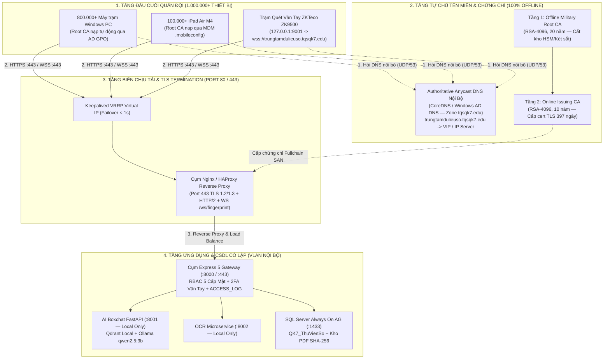

# KIẾN TRÚC TỰ CHỦ 100% CHO HỆ THỐNG QUÂN ĐỘI (AIR-GAPPED — QUY MÔ 1.000.000+ THIẾT BỊ)
*(Phiên bản v1.0 — Triển khai Tên miền Nội bộ `https://trungtamdulieuso.tqsqk7.edu`, 2-Tier Private Military PKI, Anycast DNS & Chuyển đổi IP 1 Dòng Lệnh)*

---

## 1. Mục Tiêu Chiến Lược

Tài liệu này chuẩn hóa kiến trúc hạ tầng và bộ công cụ vận hành tự động để hệ thống **QK7 DataHub** hoạt động hoàn toàn độc lập trong mạng quân sự cô lập (**100% Air-Gapped, không cần Internet, không phụ thuộc Tailscale / Cloudflare / Let's Encrypt**), đạt đồng thời 4 tiêu chuẩn:

1. **Truy cập chuẩn bằng tên miền sạch không số cổng:** **`https://trungtamdulieuso.tqsqk7.edu`** (HTTPS cổng mặc định `443`, tự động chuyển hướng HTTP cổng `80` $\rightarrow$ `443` chuẩn `301`).
2. **Đổi địa chỉ IP máy chủ chỉ bằng 1 dòng lệnh duy nhất:** Khi chuyển máy chủ từ `192.168.1.229` sang bất kỳ địa chỉ IP mới nào (ví dụ `192.168.1.150`, `10.20.30.40`...), chạy đúng 1 lệnh `scripts\doi-ip.bat <IP_MỚI>` (hoặc `scripts\doi-ip.bat` để tự dò IP LAN) — hệ thống tự đồng bộ cả 7 tầng cấu hình trong vài giây.
3. **Tách biệt hoàn toàn Tên miền khỏi IP vật lý (Scale 1.000.000+ thiết bị):** Khi mở rộng lên quy mô Trường / Quân khu / Toàn quân, toàn bộ máy trạm PC, iPad Air M4 và trạm quét vân tay ZKTeco đều gắn với `https://trungtamdulieuso.tqsqk7.edu` và `wss://trungtamdulieuso.tqsqk7.edu/ws/fingerprint`. Khi đổi IP máy chủ, **0 máy trạm phải sửa lại cấu hình**.
4. **Tuyệt đối giữ nguyên Bảo mật 3 Tầng:** `UI Guard -> Gateway Middleware -> SQL Server Constraint` và xác thực sinh trắc học 2FA ZKTeco ZK9500 cho văn bản Cấp 3–5.

---

## 2. Sơ Đồ Kiến Trúc Tổng Thể (1.000.000+ Thiết Bị Air-Gapped)



---

## 3. Thao Tác 1 Dòng Lệnh Khi Đổi Máy Chủ / Đổi Địa Chỉ IP Bất Kỳ

Khi di chuyển toàn bộ mã nguồn QK7 DataHub từ máy chủ hiện tại sang bất kỳ máy chủ mới nào (ví dụ `192.168.1.150`, `10.10.20.5`, `172.16.8.9`...):

### Cách 1: Truyền thẳng địa chỉ IP mới (1 dòng lệnh duy nhất)
```cmd
scripts\doi-ip.bat 192.168.1.150
```

### Cách 2: Không cần nhớ số IP — Script tự động dò IP card mạng LAN của máy mới
```cmd
scripts\doi-ip.bat
```

### Cách 3: Chạy bằng PowerShell với tùy chọn nâng cao (PKI Quân đội / Tên miền tùy chỉnh)
```powershell
powershell -ExecutionPolicy Bypass -File scripts\switch-ip.ps1 -NewIP 192.168.1.150 -Hostname trungtamdulieuso.tqsqk7.edu -CertMode military-pki
```

### 7 tác vụ script tự động hoàn tất trong 1 lần chạy:
| Bước | Phạm vi tự động xử lý | Chi tiết kỹ thuật |
| :---: | :--- | :--- |
| **1** | **Tự dò & thẩm định IPv4** | Ưu tiên card mạng có Default Gateway, loại bỏ card ảo Bluetooth/Docker/WSL/APIPA `169.254.x.x`. |
| **2** | **Đồng bộ `.env` gốc & `backend/.env`** | Cập nhật `SERVER_IP`, `SERVER_DOMAIN=trungtamdulieuso.tqsqk7.edu`, `USE_HTTPS=true`, `PUBLIC_HTTPS_PORT=443`, `HTTP_REDIRECT_PORT=80`, dọn dòng key trùng lặp, và **tự động thêm IP mới vào `ADMIN_ALLOWED_IP`** để tài khoản `USR-001` không bị khóa IP Whitelist. |
| **3** | **Cấp lại Chứng chỉ SSL/TLS** | Gọi `scripts\gen_cert.ps1` sinh `backend\certs\cert.pem` & `private-key.pem` kèm đầy đủ SAN (`trungtamdulieuso.tqsqk7.edu`, `<IP_MỚI>`, `tqsqk7.cntt`, `localhost`, `127.0.0.1`), đồng bộ `rootCA.pem` sang `backend\certs\` và `fingerprint\`. |
| **4** | **Cập nhật `hosts` & Flush DNS** | Cập nhật sạch `C:\Windows\System32\drivers\etc\hosts` và chạy `ipconfig /flushdns`. |
| **5** | **Đồng bộ Trạm Vân Tay ZKTeco** | Tái tạo `config\client.info` và `fingerprint\.env` sử dụng tên miền `wss://trungtamdulieuso.tqsqk7.edu/ws/fingerprint`. |
| **6** | **Đồng bộ Hạ tầng DNS/Proxy Quân đội** | Cập nhật `config\military-infra\dns\tqsqk7.edu.zone`, `config\military-infra\proxy\haproxy-ha.cfg`, và cập nhật thẳng Windows Server DNS (nếu máy chủ chạy DNS Role). |
| **7** | **Mở Firewall Đúng Nguyên Tắc Tối Thiểu** | Chỉ mở TCP `443`, `80`, `8000`; **tuyệt đối giữ kín** `:8001` (AI), `:8002` (OCR), `:9001` (Agent 127.0.0.1). |

Sau khi chạy xong, khởi động lại hệ thống bằng `scripts\s.bat` và truy cập thẳng **`https://trungtamdulieuso.tqsqk7.edu`** (không cần `:8000`).

---

## 4. Triển Khai 3 Trụ Cột Kiến Trúc Tự Chủ Cho Quy Mô 1.000.000+ Thiết Bị

Toàn bộ cấu hình hạ tầng chuẩn quân đội đã được đóng gói sẵn tại thư mục `config/military-infra/`:

### 4.1. Trụ cột 1 — Hệ thống Tên miền Nội bộ Tự Chủ (`config/military-infra/dns/`)
- **Cấu hình CoreDNS Air-Gapped:** [`config/military-infra/dns/Corefile`](../../config/military-infra/dns/Corefile) — Không chuyển tiếp truy vấn ra Internet, hỗ trợ đồng bộ Zone AXFR xuống các cụm DNS Slave tại Sư đoàn/Lữ đoàn/Quân khu.
- **Tệp Zone Thẩm quyền RFC 1035:** [`config/military-infra/dns/tqsqk7.edu.zone`](../../config/military-infra/dns/tqsqk7.edu.zone).
- **Script tự động hóa DNS:** [`scripts/setup-military-dns.ps1`](../../scripts/setup-military-dns.ps1).
- **Khi đổi IP máy chủ trên mạng 1.000.000 thiết bị:** Chỉ cần chạy 1 dòng lệnh duy nhất trên Máy chủ DNS Quân đội:
  ```cmd
  dnscmd /RecordDelete tqsqk7.edu trungtamdulieuso A /f && dnscmd /RecordAdd tqsqk7.edu trungtamdulieuso 30 A <IP_MỚI>
  ```

### 4.2. Trụ cột 2 — Hạ tầng Khóa Công Khai Quân sự 2 Tầng (`config/military-infra/pki/`)
- **Khởi tạo 2-Tier Military PKI (100% Offline):**
  ```powershell
  powershell -ExecutionPolicy Bypass -File scripts\setup-military-pki.ps1 -ServerIP <IP_MÁY_CHỦ> -Hostname trungtamdulieuso.tqsqk7.edu
  ```
- **Kiến trúc phân tầng bảo vệ khóa bí mật:**
  - **Tầng 1 — Offline Root CA** ([`root-ca.cnf`](../../config/military-infra/pki/root-ca.cnf)): RSA 4096-bit, SHA-384, hiệu lực **20 năm**. Sau khi ký Tầng 2, di chuyển tệp khóa bí mật `root-ca.key.pem` ra khỏi máy chủ Web và lưu trữ ngoại tuyến (HSM / két sắt).
  - **Tầng 2 — Online Intermediate Issuing CA** ([`issuing-ca.cnf`](../../config/military-infra/pki/issuing-ca.cnf)): RSA 4096-bit, `pathlen:0`, hiệu lực **10 năm**. Cấp và xoay vòng chứng chỉ Leaf TLS ([`server-san.cnf`](../../config/military-infra/pki/server-san.cnf)) mỗi năm.
- **Tự động phát hành gói tin cậy Root CA cho 1.000.000+ thiết bị:**
  - **800.000+ máy tính Windows:** Dùng `backend/certs/rootCA.pem` + `backend/certs/install-root-ca-client.ps1` đẩy hàng loạt qua **Active Directory Group Policy (GPO)** (`Computer Configuration -> Policies -> Windows Settings -> Security Settings -> Public Key Policies -> Trusted Root Certification Authorities`).
  - **100.000+ iPad Air M4 (iPadOS):** Đẩy file **`backend/certs/QK7-Military-Root-CA.mobileconfig`** tự động sinh ra qua hệ thống MDM nội bộ (hoặc Apple Configurator), sau đó bật *Settings -> General -> About -> Certificate Trust Settings* cho **QK7 Military Root CA**.
  - **Trạm Vân Tay ZKTeco (`:9001`):** Tự động đồng bộ `fingerprint/rootCA.pem` + Windows Root Store.

### 4.3. Trụ cột 3 — Tầng Cân Bằng Tải & Edge Reverse Proxy (`config/military-infra/proxy/`)
- **Chế độ Đơn máy chủ (1 – 500 thiết bị):** Express Gateway (`backend/server.js`) tự động mở song song cổng chuẩn **HTTPS `443`** + **HTTP Redirect `80`** + cổng quản trị `:8000` (dùng chung 1 trình quản lý WebSocket `/ws/fingerprint` thống nhất).
- **Chế độ Cụm Trường / Quân khu / Toàn quân (500 – 1.000.000+ thiết bị):**
  - Đặt `PUBLIC_HTTPS_PORT=0` và `HTTP_REDIRECT_PORT=0`, `TRUST_PROXY=1` trong `.env`.
  - Triển khai cụm **Nginx** ([`nginx-qk7.conf`](../../config/military-infra/proxy/nginx-qk7.conf)) hoặc **HAProxy** ([`haproxy-ha.cfg`](../../config/military-infra/proxy/haproxy-ha.cfg)) kết hợp **Keepalived VRRP VIP** ([`keepalived.conf`](../../config/military-infra/proxy/keepalived.conf)) phía trước cụm Express Gateway `:8000`.
  - Hoặc chạy trọn bộ Stack Air-Gapped qua Docker:
    ```bash
    docker compose -f docker-compose.yml -f config/military-infra/docker-compose.military.yml up -d
    ```

---

## 5. Ma Trận Cổng Mạng & Nguyên Tắc Bảo Mật Bắt Buộc

| Cổng | Giao thức | Phạm vi mở | Mục đích & Quy tắc Bảo mật |
| :---: | :---: | :--- | :--- |
| **`443`** | TCP (HTTPS/WSS) | LAN / Mạng Quân sự | Cổng chính duy nhất cho người dùng (`https://trungtamdulieuso.tqsqk7.edu`) và Trạm vân tay (`wss://trungtamdulieuso.tqsqk7.edu/ws/fingerprint`). TLS 1.2+, HSTS 1 năm. |
| **`80`** | TCP (HTTP) | LAN / Mạng Quân sự | Chỉ dùng để chuyển hướng cưỡng bức `301` sang `https://trungtamdulieuso.tqsqk7.edu`. Không phục vụ dữ liệu. |
| **`53`** | UDP/TCP (DNS) | LAN / Mạng Quân sự | Máy chủ DNS Nội bộ tự chủ (CoreDNS / AD DNS), không forward Internet. |
| **`8000`** | TCP (HTTPS) | Nội bộ / Dự phòng | Express Gateway. Khi chạy sau Nginx/HAProxy chỉ bind nội bộ/VLAN ứng dụng. |
| **`8001`** | TCP (HTTP) | **127.0.0.1 / VLAN kín** | AI Boxchat FastAPI + Qdrant Local — **Cấm mở ra mạng người dùng**. |
| **`8002`** | TCP (HTTP) | **127.0.0.1 / VLAN kín** | OCR Microservice — **Cấm mở ra mạng người dùng**. |
| **`9001`** | TCP (HTTP) | **127.0.0.1 (Loopback)** | ZKTeco Local Fingerprint Agent — **Tuyệt đối chỉ bind `127.0.0.1`**. |
| **`1433`** | TCP (TDS) | **VLAN CSDL kín** | Microsoft SQL Server `QK7_ThuVienSo` — Chỉ cho phép Gateway kết nối. |

---

## 6. Triển Khai Thực Chiến Phương Án 2 — Cấp Đơn Vị / Trường Quân Sự & iPad Air M4 (50 – 5.000 Thiết Bị)

Phương án 2 giúp **toàn bộ máy tính Windows và iPad Air M4** trong mạng LAN/Wi-Fi của đơn vị truy cập thẳng **`https://trungtamdulieuso.tqsqk7.edu`** mà **KHÔNG cần sửa file `hosts` trên bất kỳ máy con nào**, không cần Docker, không cần Internet:

### Bước 1 — Chạy Máy Chủ DNS Nội Bộ Tự Chủ (`:53`) trên Máy Chủ (`192.168.1.229`)
- Nháy đúp hoặc chạy lệnh (Administrator):
  ```cmd
  scripts\start-dns.bat
  ```
- Dịch vụ [`scripts/dns-server.js`](../../scripts/dns-server.js) (Node.js thuần, không phụ thuộc gói ngoài) tự động mở cổng DNS `53` (UDP + TCP), mở Firewall Windows cho cổng `53`, trả lời tức thì (`<1ms`) cho `trungtamdulieuso.tqsqk7.edu`, `*.tqsqk7.edu` và `tqsqk7.cntt` trỏ về đúng `SERVER_IP` trong `.env`.
- Khi đổi máy chủ sang IP khác bằng `scripts\doi-ip.bat <IP_MỚI>`, DNS Server tự động nạp lại IP mới sau **3 giây** mà không cần khởi động lại!
- *Tùy chọn chuyển tiếp LAN/Intranet:* Mặc định `DNS_UPSTREAM=none` (cô lập Air-Gap 100%). Nếu mạng nội bộ đơn vị có máy chủ DNS cấp trên (vd `192.168.1.1`), có thể thêm `DNS_UPSTREAM=192.168.1.1` vào `.env`.

### Bước 2 — Cấu Hình 1 Dòng Duy Nhất Trên Router Wi-Fi / Core Switch Đơn Vị (`192.168.1.1`)
Chọn **1 trong 2 cách** trên giao diện quản trị Router Wi-Fi (`http://192.168.1.1`):
- **Cách A (Khuyến nghị — Dùng Máy chủ DNS nội bộ của QK7 DataHub):**
  - Vào mục **LAN / DHCP Server** $\rightarrow$ điền **Primary DNS Server = `192.168.1.229`** (địa chỉ IP máy chủ QK7 DataHub).
- **Cách B (Dùng tính năng Static DNS của Router Mikrotik / DrayTek / FortiGate / Asus):**
  - Vào **Static DNS Host** $\rightarrow$ thêm 1 dòng: `trungtamdulieuso.tqsqk7.edu` $\rightarrow$ `192.168.1.229`.

### Bước 3 — Cài Chứng Chỉ 1 Chạm Cho iPad Air M4 & Máy Con Windows (Không Cần USB / AirDrop!)
Sau khi bắt Wi-Fi / cắm dây LAN đơn vị, trên **bất kỳ iPad Air M4 hoặc máy tính Windows mới nào**, mở trình duyệt vào cổng tự phục vụ tích hợp sẵn:

> **`http://trungtamdulieuso.tqsqk7.edu/ca`** *(hoặc `http://192.168.1.229/ca`)*

- **Trên iPad Air M4 (mở bằng Safari):**
  1. Chạm **"Tải Hồ Sơ Chứng Chỉ iPad (.mobileconfig)"** $\rightarrow$ chọn **Cho phép (Allow)**.
  2. Vào **Cài đặt (Settings)** $\rightarrow$ **Đã tải về hồ sơ (Profile Downloaded)** $\rightarrow$ bấm **Cài đặt (Install)**.
  3. Vào **Cài đặt chung (General)** $\rightarrow$ **Giới thiệu (About)** $\rightarrow$ **Cài đặt tin cậy chứng chỉ (Certificate Trust Settings)** $\rightarrow$ gạt bật xanh **QK7 DataHub Root CA**.
  4. Bấm **"Truy cập `https://trungtamdulieuso.tqsqk7.edu`"** $\rightarrow$ Hiện ổ khóa xanh HTTPS!
- **Trên Máy Tính Windows PC:**
  1. Bấm **"Tải Bộ Cài 1-Click Windows (.bat)"** $\rightarrow$ chạy tệp `cai-dat-chung-chi-qk7.bat` (chọn **Yes** quyền Admin).
  2. Máy con tự nạp chứng chỉ vào Windows Trusted Root Store, xóa cache DNS và tự mở thẳng **`https://trungtamdulieuso.tqsqk7.edu`**!

