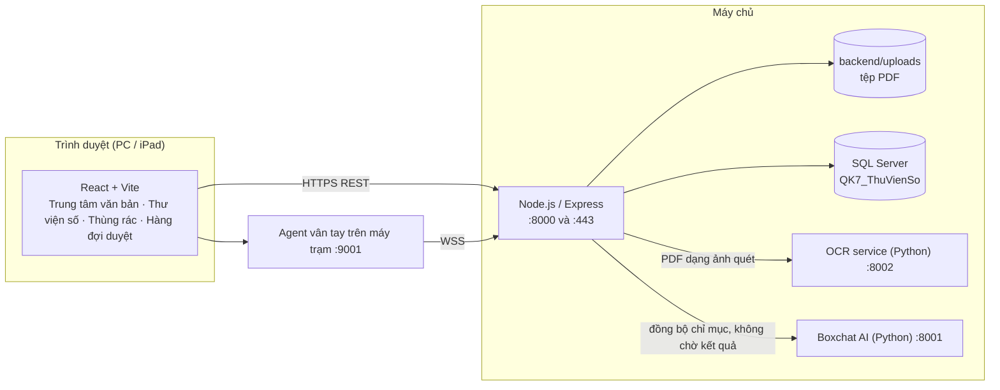
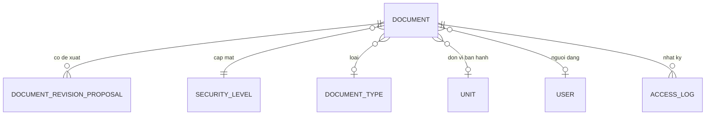
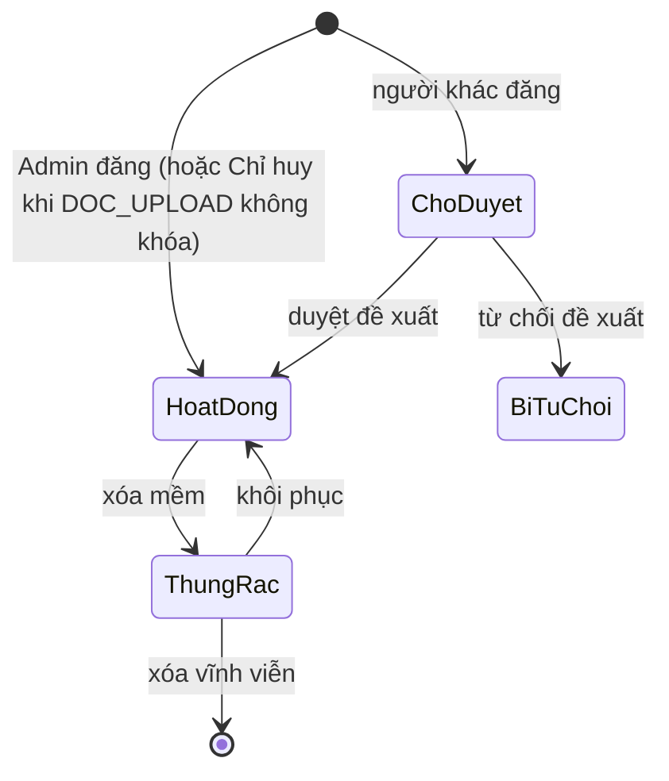
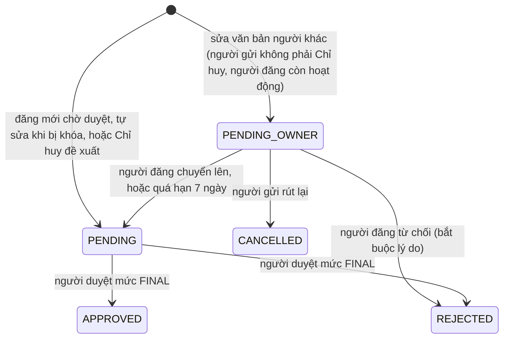
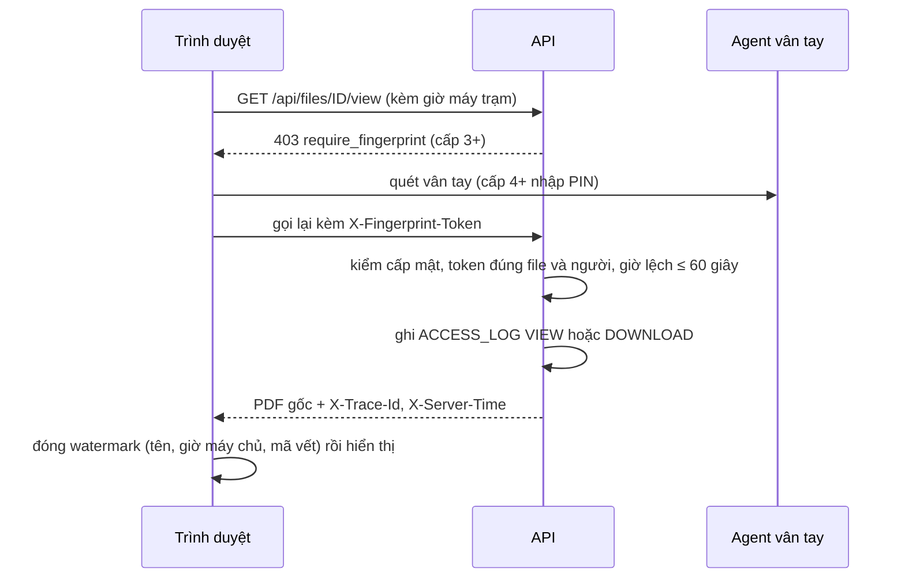

# Phân hệ Văn bản số — Tài liệu kỹ thuật

| | |
|---|---|
| Hệ thống | QK7 DataHub |
| Phạm vi | Tiếp nhận, số hóa, lưu trữ, tra cứu, xem, sửa, duyệt, xóa văn bản PDF |
| Đối tượng đọc | Lập trình viên, quản trị hệ thống, người nghiệm thu |
| Trạng thái mã nguồn | Nhánh `thang`, ngày 25/11/2026, gồm cả thay đổi chưa commit |
| Phân loại | **Nội bộ.** Mục 14 liệt kê điểm yếu bảo mật chưa khắc phục, không phát tán ra ngoài nhóm phát triển |

Nhãn kiểm chứng dùng trong tài liệu: **[Chạy]** đã gọi thử trên hệ thống đang chạy, **[DB]** đã truy vấn cơ sở dữ liệu, **[Mã]** rút ra từ đọc mã, chưa chạy thử.

---

## 1. Mục tiêu nghiệp vụ

- Thay việc xử lý văn bản giấy bằng soạn, đưa lên hệ thống, duyệt và tra cứu trực tuyến.
- Người đăng chịu trách nhiệm về văn bản mình đưa lên; người duyệt chịu trách nhiệm về quyết định duyệt.
- Quản trị viên vận hành hệ thống, hỗ trợ tài khoản và quyền, không làm thay nghiệp vụ.
- Văn bản mật được kiểm soát theo cấp độ mật, sinh trắc học và nhật ký truy cập.

## 2. Kiến trúc tổng thể

| Thành phần | Vị trí | Vai trò |
|---|---|---|
| API văn bản | `backend/server.js` | Toàn bộ route `/api/documents*`, `/api/files/:id/view`, cảnh báo an ninh |
| Phân quyền theo route | `backend/src/route-permissions.js` | Ánh xạ phương thức + đường dẫn sang mã quyền |
| Khóa duyệt | `backend/src/approval-workflow.js` | Quyền bị Admin khóa thì thao tác thành yêu cầu chờ duyệt |
| Thẩm quyền duyệt | `backend/src/approval-authority.js` | Mức `FINAL`, `DELEGATE`, `NONE` |
| API hàng đợi duyệt | `backend/src/admin-routes.js` | `/api/admin/approval-requests*` |
| Bóc tách metadata | `backend/pdf-parser.js` | Đọc lớp chữ, Tesseract dự phòng, nhận diện trường |
| Đường dẫn lưu trữ | `backend/src/storage-helper.js` | Thư mục theo phân hệ, năm, tháng |
| Báo cáo tài liệu trùng | `backend/src/duplicate-docs.js` | Chỉ đọc, chỉ Admin |
| Đo hiệu năng | `backend/src/perf-timing.js` | Log thời gian request, SQL, dịch vụ ngoài |

## 3. Giao diện

| Màn hình | Tệp (`frontend/src`) | Ai vào được | Chức năng |
|---|---|---|---|
| Trung tâm văn bản (`DocumentDeskPage`) | `pages/DocumentDeskPage.tsx` | Có ít nhất một trong `DOC_UPLOAD`, `DOC_EDIT`, `DOC_DELETE`, `DOC_PARSE` | Danh sách, lọc, tiếp nhận, sửa, xóa, đề xuất chờ duyệt; 30 dòng mỗi trang (phân trang ở trình duyệt) |
| Thư viện số (`PortalPage`) | `pages/PortalPage.tsx` | Cả khách chưa đăng nhập | Tra cứu, xem, tải theo cấp mật |
| Thùng rác | `pages/TrashPage.tsx` | Quyền thùng rác; tab Bài giảng và Tài liệu trùng chỉ Admin | Khôi phục, xóa vĩnh viễn, báo cáo trùng |
| Hàng đợi duyệt | `pages/ApprovalQueuePage.tsx` | Người duyệt và người gửi yêu cầu | Duyệt, từ chối, thẩm định |

Thành phần chính trong `components/document-desk/`:

| Tệp | Nhiệm vụ |
|---|---|
| `DocumentUploadModal.tsx` | Chọn tệp, tự bóc tách, cảnh báo trùng, xem trước, gửi |
| `DocumentPreviewModal.tsx` | Xác thực cấp mật, đóng watermark, chống chụp màn hình |
| `PdfPagesViewer.tsx` | Hiển thị trang bằng pdf.js, bút dạ quang, tiến độ đọc |
| `ApprovalDiffModal.tsx`, `PendingProposalsModal.tsx` | So sánh bản cũ/đề xuất, duyệt |
| `OwnerReviewSection.tsx` | Người đăng xem đề xuất gửi tới mình |
| `DuplicateDocumentsPanel.tsx` | Báo cáo tài liệu trùng |

## 4. Mô hình dữ liệu

### 4.1 `DOCUMENT` [DB]
| Cột | Ý nghĩa |
|---|---|
| `file_id` | Khóa chính, dạng `DOC-<mili giây>-<4 ký tự>` |
| `document_code`, `title`, `summary`, `signer`, `issued_date` | Metadata |
| `doc_type_id`, `issuing_unit_id`, `security_level_id` | Phân loại, đơn vị ban hành, cấp mật |
| `original_name`, `stored_path`, `mime_type`, `file_size`, `sha256` | Thông tin tệp |
| `uploaded_by`, `created_at`, `updated_at` | Dấu vết |
| `deleted_at`, `deleted_by`, `deleted_reason` | Xóa mềm **và** trạng thái chờ duyệt (xem mục 6) |

Chỉ mục có trên `deleted_at`, `document_code`, `issued_date`, `security_level_id`, `(issuing_unit_id, deleted_at)`. Không có ràng buộc duy nhất trên `sha256` hay `stored_path`.

### 4.2 `DOCUMENT_REVISION_PROPOSAL` [DB]
Giữ bản metadata đề xuất, tệp mới (`new_stored_path`, `new_sha256`…), `status`, người đề xuất, ghi chú, người duyệt, bước người đăng (`owner_id`, `owner_decision`, `owner_note`) và bước thẩm định (`validated_by`, `validate_decision`, `validate_note`).

### 4.3 Bảng khác
- `DOCUMENT_TYPE`: 11 loại (Biên bản, Báo cáo, Chỉ thị, Công văn, Kế hoạch, Nghị định, Nghị quyết, Quy chế, Quyết định, Thông báo, Thông tư).
- `SECURITY_LEVEL`: 1 Công khai, 2 Nội bộ, 3 Mật, 4 Tối mật, 5 Tuyệt mật.
- `DOCUMENT_VERSION`: có cấu trúc nhưng **0 dòng**; luồng hiện tại không ghi lịch sử phiên bản.
- `APPROVAL_REQUEST`, `PROTECTED_PERMISSION`: cơ chế khóa duyệt.
- `ACCESS_LOG` (và `ACCESS_LOG_ARCHIVE`): nhật ký truy cập, lưu kho theo tháng.

### 4.4 Lưu trữ tệp
`backend/uploads/van-ban-so/YYYY/MM/YYYYMMDD_<LOAI>_<SOHIEU>_<8 ký tự SHA-256>.pdf`

Dữ liệu cũ còn ở `uploads/YYYY/MM/`. Khi xem tệp, nếu không thấy theo `stored_path` thì máy chủ thử đường dẫn cũ/mới, sau đó tìm theo 8 ký tự SHA trong `uploads`. [Mã]

## 5. Phân quyền

### 5.1 Quyền theo vai trò [DB, 25/11/2026]
Admin (`ROL-01`) bỏ qua mọi kiểm tra quyền. Giáo viên (`ROL-07`) không có quyền văn bản nào.

| Quyền | Ý nghĩa | Chỉ huy 02 | Trợ lý 03 | Văn thư 04 | Cơ yếu 05 | NV IT 06 | Đang bị khóa duyệt |
|---|---|:-:|:-:|:-:|:-:|:-:|:-:|
| `DOC_VIEW` | Xem danh sách, chi tiết | ✔ | ✔ | ✔ | ✔ | ✔ | |
| `DOC_DOWNLOAD` | Tải PDF (trừ cấp 3+) | ✔ | ✔ | ✔ | ✔ | ✔ | |
| `DOC_PARSE` | Tự đọc PDF/OCR | ✔ | ✔ | ✔ | ✔ | ✔ | |
| `DOC_UPLOAD` | Đăng văn bản mới | ✔ | ✔ | ✔ | ✔ | ✔ | **Có** |
| `DOC_EDIT` | Sửa, thay tệp | ✔ | ✔ | ✔ | ✔ | ✔ | **Có** |
| `DOC_DELETE` | Xóa mềm | ✔ | | ✔ | ✔ | ✔ | **Có** |
| `DOC_TRASH_VIEW` | Xem thùng rác | | | | | ✔ | |
| `DOC_RESTORE` | Khôi phục | | | | | ✔ | **Có** |
| `DOC_PURGE` | Xóa vĩnh viễn | | | | | ✔ | **Có** |
| `APPROVAL_VALIDATE` | Duyệt/thẩm định | ✔ | | | | ✔ | |

Quyền hiệu lực là hợp của mọi vai trò và quyền cấp riêng. Bộ nhớ đệm quyền khoảng 5 phút.

### 5.2 Ba tầng kiểm soát
1. **Quyền** (`requirePermission`): có mã quyền hay không.
2. **Khóa duyệt**: quyền bị khóa thì người không phải Admin không thực thi ngay.
3. **Cấp mật**: `security_level_id` không được vượt `clearance_level_id`; cấp 3+ thêm vân tay, cấp 4+ thêm PIN.

> Phạm vi đơn vị **chỉ** được kiểm ở bước duyệt và ở màn hình "đơn vị của tôi". Sửa, xóa, đăng không kiểm đơn vị (mục 14).

### 5.3 Khách chưa đăng nhập
Được gán tài khoản ảo "Đại biểu", cấp mật 1. Gọi thử: danh sách trả 20 văn bản, tất cả cấp 1; đăng, đọc PDF, thùng rác, đề xuất, đơn vị của tôi đều 401. [Chạy]

## 6. Vòng đời

### 6.1 Văn bản
Trạng thái suy ra từ `deleted_at` và `deleted_reason`.

| Trạng thái | `deleted_at` | `deleted_reason` |
|---|---|---|
| Hoạt động | NULL | |
| Chờ duyệt | có | `PENDING_APPROVAL` |
| Bị từ chối | có | `REJECTED_BY_COMMANDER` |
| Thùng rác | có | lý do người xóa nhập (có thể trống) |

### 6.2 Đề xuất

Mỗi văn bản chỉ có một đề xuất đang chờ (`409 PROPOSAL_ALREADY_PENDING`). Việc tự chuyển lên chạy mỗi giờ và khi mở danh sách.

## 7. Luồng nghiệp vụ

### 7.1 Bóc tách PDF — `POST /api/documents/parse`
1. Kiểm tệp: đuôi `.pdf`, MIME, chữ ký `%PDF-`, tối đa 50MB, tên không chứa `..`.
2. Đọc lớp chữ. Trên 100 ký tự thì dùng luôn.
3. Ít hơn: coi là bản quét, gửi trang 1 sang OCR :8002 (150 dpi, hạn 60 giây). OCR lỗi hoặc không chạy thì dùng Tesseract.
4. Nhận diện số hiệu, loại, ngày, người ký, đơn vị. Bản quét nhiều trang chưa thấy người ký thì OCR thêm trang cuối.
5. Kiểm trùng theo SHA-256 và theo số hiệu, trả `duplicate_check`.

Giới hạn 20 lần mỗi phút.

### 7.2 Đăng mới — `POST /api/documents/upload`
1. Kiểm trích yếu, cấp mật 1–5, đơn vị tồn tại, định dạng số hiệu, cấp mật không vượt người đăng (Admin được vượt).
2. Trùng SHA-256 với văn bản đang hoạt động trả `409`, trừ khi gửi `force_upload=1`.
3. Ghi tệp xuống đĩa.
4. Rẽ nhánh:
   - Admin, hoặc Chỉ huy khi `DOC_UPLOAD` **không** khóa: ghi `DOCUMENT` hoạt động, đồng bộ AI.
   - Còn lại: ghi `DOCUMENT` trạng thái chờ duyệt và tạo đề xuất `PENDING`.
5. Lỗi giữa chừng thì xóa tệp vừa ghi.

Hiện `DOC_UPLOAD` đang khóa nên mọi người trừ Admin đều đi nhánh chờ duyệt.

### 7.3 Sửa — `PUT /api/documents/:fileId`
- **Sửa thẳng:** Admin, hoặc người đăng khi `DOC_EDIT` không khóa. Có tệp mới thì ghi tệp mới, xóa tệp cũ.
- **Thành đề xuất:** mọi trường hợp còn lại. Tệp mới được ghi sẵn và gắn vào đề xuất.

### 7.4 Duyệt đề xuất
`POST /api/documents/proposals/:id/approve|reject`, hoặc qua `/api/admin/approval-requests/PROP-*`.

| Mức | Ai | Kết quả |
|---|---|---|
| `FINAL` | Admin; Chỉ huy có `APPROVAL_VALIDATE` | Chính thức |
| `DELEGATE` | Người khác có `APPROVAL_VALIDATE` | Chỉ ghi thẩm định, vẫn chờ Chỉ huy; không tự thẩm định của mình |
| `NONE` | Còn lại, hoặc chưa chạy migration | 403 |

Phạm vi: đơn vị người duyệt và cấp dưới, tính theo đơn vị **người đề xuất hoặc** đơn vị ban hành của văn bản.

Duyệt: áp metadata, chuyển tệp đề xuất về đường dẫn chính, gỡ trạng thái chờ. Từ chối: đề xuất `REJECTED`; văn bản đăng mới chuyển `REJECTED_BY_COMMANDER`.

### 7.5 Yêu cầu do khóa duyệt (xóa, khôi phục, xóa vĩnh viễn)
1. Người không phải Admin gọi thao tác bị khóa: máy chủ trả `202 APPROVAL_REQUIRED` và lưu `APPROVAL_REQUEST` (phương thức, đường dẫn, nội dung). Yêu cầu trùng không tạo thêm; có trần số yêu cầu chờ mỗi người.
2. Người duyệt trong phạm vi đơn vị **người yêu cầu** chấp thuận.
3. Thao tác được thực thi lại với header `x-approval-override`. Mã chỉ dùng một lần, phải khớp phương thức, đường dẫn, nội dung, và do người yêu cầu hoặc người duyệt gọi.

`upload`, `parse`, `proposals` và `PUT` văn bản được miễn vì có luồng đề xuất riêng.

### 7.6 Xem và tải — `GET /api/files/:fileId/view[?download=1]`

- Quyền xem/tải bị khóa thì cần duyệt riêng cho đúng văn bản (`VIEW_APPROVAL_REQUIRED`).
- Cấp 3+ chỉ xem, không tải.
- Văn bản chờ duyệt chỉ người đăng và người duyệt xem được; văn bản đã xóa cần quyền thùng rác.
- Lệch giờ quá 60 giây bị từ chối và ghi `CLOCK_TAMPER_ALERT`.

### 7.7 Bảo vệ khi xem
- Phát hiện phím/công cụ chụp màn hình, che nội dung, ghi `SCREENSHOT_ATTEMPT`.
- **Quá 3 lần trong 24 giờ: khóa tài khoản và thu hồi mọi phiên.**
- Cấp 1–2 cho bôi đen, sao chép; cấp 3+ không.
- Nét bút dạ quang lưu ở `localStorage` của máy trạm, không lên máy chủ.

Các biện pháp phía trình duyệt chỉ làm khó, không ngăn được người dùng cố ý (chụp bằng điện thoại, gọi API trực tiếp).

## 8. Danh mục API

| Phương thức, đường dẫn | Yêu cầu | Ghi chú |
|---|---|---|
| `GET /api/meta` | Không | Loại, đơn vị, cấp mật, cấp bậc, chức vụ |
| `GET /api/documents` | Khách được | Lọc `q, code, title, type, unit, include_children, from, to, lv`; không phân trang |
| `GET /api/documents/my-unit` | `DOC_VIEW` | Theo cây đơn vị và đơn vị kế thừa |
| `GET /api/documents/:fileId` | Kiểm cấp mật | Chi tiết |
| `POST /api/documents/parse` | `DOC_PARSE` | Mục 7.1 |
| `POST /api/documents/upload` | `DOC_UPLOAD` | multipart: `file, title, security_level_id, issuing_unit_id, document_code, doc_type_id, issued_date, signer, summary` |
| `PUT /api/documents/:fileId` | `DOC_EDIT` | Mục 7.3 |
| `DELETE /api/documents/:fileId` | `DOC_DELETE` | Xóa mềm, gỡ chỉ mục AI |
| `GET /api/documents/trash` | `DOC_TRASH_VIEW` | Gồm cả chờ duyệt và bị từ chối |
| `POST /api/documents/:fileId/restore` | `DOC_RESTORE` | |
| `DELETE /api/documents/:fileId/purge` | `DOC_PURGE` | Cần `confirm = fileId`; xóa tệp và bản ghi |
| `GET /api/documents/duplicates` | Admin | Mục 10 |
| `GET /api/documents/proposals/pending` | `DOC_VIEW` | Admin thấy hết; người duyệt theo phạm vi; còn lại thấy của mình |
| `GET /api/documents/proposals/awaiting-owner` | Đăng nhập | Đề xuất chờ tôi (người đăng) |
| `POST …/proposals/:id/withdraw` | Người gửi | Chỉ khi `PENDING_OWNER` |
| `POST …/proposals/:id/owner-forward`, `owner-reject` | Người đăng | |
| `POST …/proposals/:id/approve`, `reject` | `APPROVAL_VALIDATE` | Mục 7.4 |
| `GET /api/files/:fileId/view` | Mục 7.6 | |
| `POST /api/security/screenshot-alert` | Không bắt buộc | Mục 7.7 |

Swagger: `/api-docs`. Giới hạn chung mặc định 300 yêu cầu mỗi phút (`RATE_LIMIT_MAX`).

Mã lỗi nghiệp vụ hay gặp: `CLEARANCE_EXCEEDED`, `INVALID_DOCUMENT_CODE`, `PROPOSAL_ALREADY_PENDING`, `PERMISSION_DENIED`, `PROPOSAL_OUT_OF_SCOPE`, `APPROVAL_REQUIRED`, `VIEW_APPROVAL_REQUIRED`, `NOT_DOCUMENT_OWNER`, `CANNOT_WITHDRAW`.

## 9. Tích hợp

| Dịch vụ | Gọi khi | Khi dịch vụ tắt |
|---|---|---|
| OCR :8002 (`/api/ocr/extract`) | Bóc tách bản quét | Dùng Tesseract trong Node, chậm và kém chính xác hơn |
| AI :8001 (`/ai/ingest`, `DELETE /ai/documents/:id`) | Đăng, sửa, duyệt, xóa, khôi phục | Chỉ ghi cảnh báo, **không thử lại**; chỉ mục lệch tới khi đồng bộ lại (`/ai/sync-all`) |
| Agent vân tay | Mở văn bản cấp 3+ | Không mở được |

Danh sách văn bản loại trừ bản ghi có mã `DOC-LEC-*` (tệp thuộc phân hệ bài giảng).

## 10. Báo cáo tài liệu trùng
Thùng rác → **Tài liệu trùng** (Admin). Gom theo SHA-256 của tệp thật; tệp đã mất dùng SHA lưu trong DB. Một nhóm là trùng khi có từ 2 bản ghi hoặc 2 tệp. Không quét thư mục bài giảng. Mã băm được lưu đệm theo kích thước và thời điểm sửa. Chỉ đọc.

## 11. Cấu hình (`backend/.env`)

| Biến | Mặc định | Tác dụng |
|---|---|---|
| `DB_SERVER`, `DB_DATABASE`, `DB_USER`, `DB_PASSWORD`, `DB_PORT` | | Kết nối SQL Server |
| `PROPOSAL_OWNER_REVIEW_DAYS` | 7 | Hạn người đăng xem đề xuất |
| `OCR_SERVICE_URL` | `http://127.0.0.1:8002` | Dịch vụ OCR |
| `OCR_SERVICE_TIMEOUT_MS` | 60000 | Hạn chờ OCR |
| `AI_SERVICE_URL` | `http://127.0.0.1:8001` | Dịch vụ AI |
| `RATE_LIMIT_MAX` | 300 | Giới hạn yêu cầu mỗi phút |
| `PERF_LOG`, `PERF_SLOW_MS`, `PERF_SQL_SLOW_MS` | bật, 1000, 100 | Log hiệu năng |

## 12. Vận hành

| Việc | Cách làm |
|---|---|
| Chạy toàn bộ | `s.bat` ở thư mục gốc |
| Chạy riêng | `cd backend && npm start`; `cd frontend && npm run dev` |
| Build giao diện | `cd frontend && npm run build` (xuất ra `backend/public`) |
| Migration liên quan | `node backend/migrations/add_proposal_owner_review.cjs`, `add_delegated_approval.cjs` (chạy lại nhiều lần được; thiếu thì tính năng tương ứng tự tắt) |
| Kiểm tra sống | `GET /api/health` |
| Báo cáo hiệu năng | `scripts\perf-report.bat` |
| Sao lưu | Phải sao lưu **đồng thời** CSDL và `backend/uploads`; thiếu một bên sẽ có bản ghi mất tệp hoặc tệp mồ côi |

## 13. Hiện trạng dữ liệu và kiểm chứng

Thời điểm 25/11/2026, trên **máy phát triển** (không phải máy chủ .229):

| Chỉ số | Giá trị |
|---|---|
| Bản ghi `DOCUMENT` | 48 (47 hoạt động, 1 bị từ chối) [DB] |
| Đề xuất | 44 duyệt, 24 từ chối [DB] |
| PDF văn bản trên đĩa (lần quét trước đó) | 14 tệp, 9 nhóm trùng, 1 tệp mồ côi |
| Bản ghi thiếu tệp (lần quét trước đó) | 36 |

| Đã kiểm khi viết tài liệu | Kết quả |
|---|---|
| Backend :8000/:443, giao diện :5173, SQL Server | Đang chạy; OCR và AI **không** chạy |
| `/api/health` | 200 |
| Khách: danh sách; các route cần đăng nhập | 20 văn bản cấp 1; 401 |
| Văn thư (cấp mật 3): danh sách; thùng rác | 42 văn bản, gồm của đơn vị khác; 403 |
| `GET /api/files/pdf/view` (khách) | 403 thay vì 404 (xem K5) |

Chưa kiểm bằng chạy thật: đăng, sửa, duyệt, xóa (tránh ghi vào dữ liệu thật), OCR, đồng bộ AI, luồng vân tay. `npm test` của backend đang lỗi vì thiếu tệp mẫu và OCR không chạy.

## 14. Vấn đề đã biết

### Nghiêm trọng

| Mã | Vấn đề | Hậu quả | Căn cứ | Hướng sửa |
|---|---|---|---|---|
| K1 | Thẩm quyền duyệt đề xuất chấp nhận đơn vị người đề xuất **hoặc** đơn vị văn bản | Chỉ huy đề xuất sửa văn bản đơn vị khác rồi tự duyệt | [Mã] `requireProposalApprover`; `admin-routes.js` nhánh `PROP-` | Chỉ xét đơn vị quản lý văn bản |
| K2 | Đăng, sửa, xóa, khôi phục không kiểm đơn vị; yêu cầu khóa duyệt xét theo đơn vị người yêu cầu | Người đơn vị này xóa được văn bản đơn vị khác sau khi Chỉ huy **mình** (có thể chính mình) duyệt | [Mã] route `DELETE`, `restore`, `canUserApproveRequest` | Chốt quy tắc "đơn vị quản lý" và kiểm ở mọi thao tác ghi |
| K3 | Khôi phục không phân biệt `deleted_reason` | Văn bản chờ duyệt hoặc bị từ chối nằm trong thùng rác có thể được "khôi phục" thành hoạt động, bỏ qua duyệt | [Mã] | Chỉ cho khôi phục bản xóa thật |
| K4 | Watermark đóng ở trình duyệt; API trả PDF gốc | Người có quyền xem lấy được bản không watermark | [Mã] `/api/files/:id/view` | Đóng watermark ở máy chủ |
| K5 | Không thấy `file_id` thì tìm theo số hiệu rồi `LIKE %id%` trên đường dẫn và tên tệp | Chuỗi chung chung trỏ tới một văn bản bất kỳ; vẫn kiểm cấp mật nhưng khó kiểm toán | [Mã], [Chạy] | Chỉ nhận đúng `file_id` |

### Trung bình

| Mã | Vấn đề | Căn cứ |
|---|---|---|
| T1 | "Ghi đè" khi trùng tệp tạo **bản ghi mới**, sinh thêm tệp giống hệt | [Mã] `force_upload` |
| T2 | Nhiều bản ghi có thể dùng chung một đường dẫn (đã thấy 2 đường dẫn như vậy); xóa vĩnh viễn hoặc thay tệp xóa tệp mà không kiểm bản ghi khác | [DB], [Mã] |
| T3 | Duyệt thay tệp không xóa tệp cũ; từ chối không dọn tệp đề xuất | [Mã] |
| T4 | Kiểm trùng khi đăng bỏ qua văn bản đang chờ duyệt | [Mã] |
| T5 | 36 bản ghi trỏ tới tệp không có trên máy phát triển, chưa xác định nguyên nhân | [DB] |
| T6 | Nhận diện Admin/Chỉ huy ở đăng và sửa còn dựa vào chuỗi tên vai trò, chức vụ ("chủ nhiệm", "trưởng phòng") | [Mã] |
| T7 | Đồng bộ AI không thử lại, không kiểm mã trả về | [Mã] |

### Thấp / cải tiến
- Danh sách không phân trang ở máy chủ; sẽ chậm khi dữ liệu lớn.
- Ký tự `%`, `_` trong ô tìm kiếm không được thoát.
- Chưa ghi lịch sử phiên bản (`DOCUMENT_VERSION` trống).
- Phần văn bản nằm trong `server.js` hơn 4.800 dòng; nên tách module `documents` (route, dịch vụ, kho tệp).
- Thiếu kiểm thử tự động cho luồng đăng, sửa, duyệt.

### Thứ tự đề xuất
1. K1, K2, K3 (đúng người, đúng đơn vị).
2. T1, T2, T3 (toàn vẹn tệp), rồi dọn dữ liệu trùng qua báo cáo ở mục 10.
3. K5, K4.
4. Kiểm thử tự động, sau đó tách module và phân trang.

## 15. Thuật ngữ

| Thuật ngữ | Nghĩa |
|---|---|
| Đơn vị ban hành | `issuing_unit_id`, nơi phát hành văn bản; có thể là cơ quan ngoài Trường |
| Người đăng | `uploaded_by`, người đưa văn bản lên hệ thống |
| Đề xuất | Bản thay đổi chờ duyệt |
| Khóa duyệt | Admin đánh dấu một quyền phải được duyệt trước khi thực thi |
| Thẩm định | Ý kiến của người được ủy quyền, chưa có hiệu lực chính thức |
