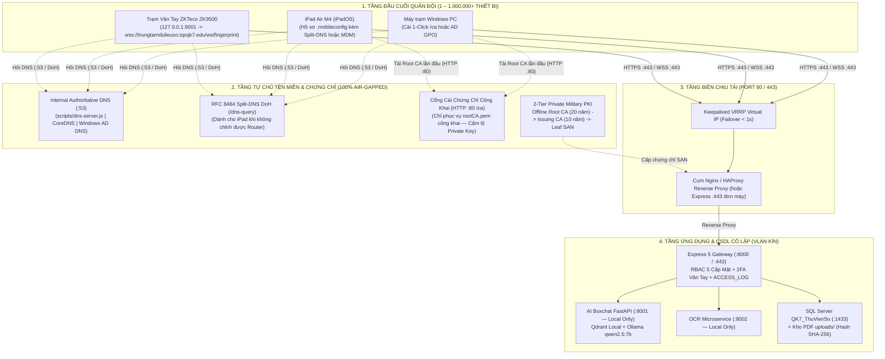

# 📘 SỔ TAY CHIẾN LƯỢC, VẬN HÀNH & BẢO TRÌ — TÊN MIỀN NỘI BỘ & HẠ TẦNG TỰ CHỦ 100% QUÂN ĐỘI (`https://trungtamdulieuso.tqsqk7.edu`)

> **Phiên bản:** v1.0 (23/11/2026)  
> **Dự án:** QK7 DataHub — Trung Tâm Dữ Liệu Số Trường Quân Sự Quân Khu 7  
> **Phạm vi:** Không cần Internet (100% Air-Gapped) • Không phụ thuộc bên thứ ba (không Tailscale / Cloudflare / Let's Encrypt) • Mở rộng từ **1 máy chủ phòng Lab** đến **1.000.000+ thiết bị toàn quân**.  
> **Mục đích tài liệu:** Ghi lại đầy đủ **chiến lược tổng thể**, **toàn bộ các hạng mục đã triển khai**, **hướng dẫn chạy thực tế** (Máy chủ, Máy con Windows, iPad Air M4, Trạm Vân Tay ZKTeco), **bài học sửa lỗi** và **bản đồ mã nguồn để sau này dễ dàng đọc lại, nâng cấp hoặc mở rộng**.

---

## Mục Lục Nhanh

1. [Bối Cảnh & Nguyên Lý Chiến Lược](#1-bối-cảnh--nguyên-lý-chiến-lược)
2. [Kiến Trúc Tổng Thể Tự Chủ 100% (1.000.000+ Thiết Bị)](#2-kiến-trúc-tổng-thể-tự-chủ-100-1000000-thiết-bị)
3. [Toàn Bộ Các Hạng Mục Đã Triển Khai (Bản Đồ File & Mã Nguồn)](#3-toàn-bộ-các-hạng-mục-đã-triển-khai-bản-đồ-file--mã-nguồn)
4. [Hướng Dẫn Chạy & Vận Hành Thực Tế (Runbook)](#4-hướng-dẫn-chạy--vận-hành-thực-tế-runbook)
   - [4.1. Khởi động hàng ngày trên Máy Chủ](#41-khởi-động-hàng-ngày-trên-máy-chủ)
   - [4.2. Đổi địa chỉ IP Máy Chủ bằng 1 dòng lệnh](#42-đổi-địa-chỉ-ip-máy-chủ-bằng-1-dòng-lệnh)
   - [4.3. Kết nối Máy Con khi KHÔNG vào được Router (`192.168.1.1`) — Zero-Router Mode](#43-kết-nối-máy-con-khi-không-vào-được-router-19216811--zero-router-mode)
   - [4.4. Kết nối Máy Con qua DNS Nội Bộ (50 – 5.000 thiết bị)](#44-kết-nối-máy-con-qua-dns-nội-bộ-50--5000-thiết-bị)
   - [4.5. Triển khai Cấp Quân Khu / Toàn Quân (10.000 – 1.000.000+ thiết bị)](#45-triển-khai-cấp-quân-khu--toàn-quân-10000--1000000-thiết-bị)
5. [Lộ Trình Mở Rộng 4 Giai Đoạn](#5-lộ-trình-mở-rộng-4-giai-đoạn)
6. [Ma Trận Cổng Mạng & Nguyên Tắc Bảo Mật 3 Tầng](#6-ma-trận-cổng-mạng--nguyên-tắc-bảo-mật-3-tầng)
7. [Bài Học Kinh Nghiệm & Khắc Phục Sự Cố (Troubleshooting)](#7-bài-học-kinh-nghiệm--khắc-phục-sự-cố-troubleshooting)
8. [Hướng Dẫn Cho Kỹ Sư Sau Này: Cách Thêm / Sửa / Mở Rộng](#8-hướng-dẫn-cho-kỹ-sư-sau-này-cách-thêm--sửa--mở-rộng)

---

## 1. Bối Cảnh & Nguyên Lý Chiến Lược

### 1.1. Hiện trạng trước khi nâng cấp
- Truy cập cũ phải gõ kèm số cổng: `https://trungtamdulieuso.tqsqk7.edu:8000/`.
- Tên miền `trungtamdulieuso.tqsqk7.edu` chỉ hoạt động trên duy nhất máy chủ nhờ dòng gán cứng trong file `C:\Windows\System32\drivers\etc\hosts` (không dùng Tailscale).
- Khi chuyển dự án sang máy chủ có IP khác (ví dụ từ `192.168.1.229` sang `192.168.1.150`), phải sửa thủ công tới 5 nơi (`.env` gốc, `backend/.env` + `ADMIN_ALLOWED_IP`, chứng chỉ SSL `backend/certs/`, file `hosts`, và cấu hình trạm vân tay ZKTeco).
- Máy con Windows và **iPad Air M4** trong mạng LAN/Wi-Fi nội bộ chưa có cơ chế tự nhận tên miền và tự cài chứng chỉ gốc mà không cần Internet hay USB.

### 1.2. Nguyên lý chiến lược cốt lõi
> **"Tách biệt hoàn toàn lớp Tên miền (`https://trungtamdulieuso.tqsqk7.edu`) khỏi lớp Địa chỉ IP vật lý (`192.168.1.229` / `192.168.1.150` / VIP)"**

1. **Ẩn hoàn toàn số cổng `:8000`:** Phục vụ chuẩn **HTTPS cổng `443`** + tự động chuyển hướng **HTTP cổng `80` $\rightarrow$ HTTPS `443`** (`301`), đồng thời giữ tương thích ngược cổng `:8000`.
2. **Tự chủ 100% Phân giải Tên miền (DNS):** Máy chủ tự chạy **Authoritative DNS nội bộ (`:53`)** và **RFC 8484 DNS-over-HTTPS (`/dns-query`)**, sẵn sàng mở rộng lên **CoreDNS / Windows AD DNS Anycast** ở quy mô 1.000.000+ thiết bị.
3. **Tự chủ 100% Chứng chỉ số (Private PKI):** Dùng `mkcert` cho triển khai nhanh phòng Lab/Đơn vị, và **2-Tier Private Military PKI** (Offline Root CA 20 năm + Online Issuing CA 10 năm) cho quy mô toàn quân.
4. **Cổng Tự Phục Vụ Chứng Chỉ (`/ca`):** Thiết bị mới kết nối vào mạng chỉ cần mở `http://<IP_MÁY_CHỦ>/ca` (HTTP cổng `80`, không bị cảnh báo SSL) để tải 1 chạm bộ cài Windows `.bat` hoặc hồ sơ iPad Air M4 `.mobileconfig` (kèm Split-DNS không cần đụng vào Router).
5. **Đổi IP Máy Chủ Bằng Đúng 1 Dòng Lệnh:** Mọi thay đổi IP trên máy chủ mới được tự động hóa hoàn toàn qua `scripts\doi-ip.bat <IP_MỚI>`.

---

## 2. Kiến Trúc Tổng Thể Tự Chủ 100% (1.000.000+ Thiết Bị)



---

## 3. Toàn Bộ Các Hạng Mục Đã Triển Khai (Bản Đồ File & Mã Nguồn)

### 3.1. Nâng cấp Mã Nguồn Ứng Dụng (Giữ nguyên 100% API Contract & Bảo mật 3 Tầng)
| Tệp mã nguồn | Vai trò & Chức năng đã triển khai |
| :--- | :--- |
| [backend/server.js](../../backend/server.js) | Mở song song cổng chuẩn **HTTPS `443`** (`PUBLIC_HTTPS_PORT=443`) + cổng **HTTP `80`** (`HTTP_REDIRECT_PORT=80`) tự động chuyển hướng `301` sang HTTPS (riêng tuyến `/ca/*` phục vụ trực tiếp trên HTTP `80` cho thiết bị mới). Tự động nhường cổng an toàn (`EADDRINUSE`/`EACCES`) khi đặt sau Nginx/HAProxy (`PUBLIC_HTTPS_PORT=0`). Mở rộng CORS Whitelist đầy đủ cho `SERVER_DOMAIN` & `SERVER_IP`. Tích hợp tuyến `/dns-query` (RFC 8484 DoH). |
| [backend/src/fingerprint-ws.js](../../backend/src/fingerprint-ws.js) | Chuyển WebSocket Server sang `noServer: true` + `attachServer(...)` để **1 phiên quản lý duy nhất** phục vụ đồng thời cả `wss://trungtamdulieuso.tqsqk7.edu/ws/fingerprint` (cổng `443`) và cổng `:8000`. |
| [backend/src/ca-portal.js](../../backend/src/ca-portal.js) | **Cổng tự phục vụ chứng chỉ gốc (`/ca`) & RFC 8484 DoH (`/dns-query`):**<br>• `GET /ca`: Trang hướng dẫn tiếng Việt (chuẩn iPad Touch UI $\ge 48$px, hiển thị mã băm SHA-256).<br>• `GET /ca/ipad.mobileconfig`: Sinh động hồ sơ Apple kèm **2 payload** (`com.apple.security.root` + `com.apple.dnsSettings.managed` Split-DNS trỏ `tqsqk7.edu` về `https://<SERVER_IP>/dns-query`).<br>• `GET /ca/cai-dat-windows.bat`: Bộ cài 1-Click cho máy con Windows (tự nạp `rootCA.crt` + tự ghi `hosts` + flush DNS + mở thẳng `https://trungtamdulieuso.tqsqk7.edu`).<br>• `GET /ca/rootCA.crt` & `/ca/rootCA.pem`: Chứng chỉ gốc công khai (có chốt chặn bảo mật tuyệt đối không đọc/gửi Private Key). |
| [fingerprint/agent.py](../../fingerprint/agent.py) | Xóa bỏ IP cứng `192.168.1.229`; dùng `urllib.parse.urlparse` để fallback loopback động cho mọi IP và tên miền. |
| [boxchat/main.py](../../boxchat/main.py) & [ocr-service/main.py](../../ocr-service/main.py) | Bổ sung `SERVER_DOMAIN` và các origin HTTPS vào danh sách CORS nội bộ. |

### 3.2. Bộ Script Tự Động Hóa Vận Hành (`scripts/`)
| Tệp script | Định dạng chuẩn | Công dụng |
| :--- | :---: | :--- |
| [scripts/doi-ip.bat](../../scripts/doi-ip.bat) | ASCII + CRLF | **Lệnh 1 dòng đổi IP máy chủ:** Tự xin quyền Admin và gọi `switch-ip.ps1`. |
| [scripts/switch-ip.ps1](../../scripts/switch-ip.ps1) | UTF-8 BOM + CRLF | Tự động đồng bộ 7 tầng: tự dò IP LAN (hoặc nhận `-NewIP`), cập nhật `.env` & `backend/.env` (UTF-8 không BOM, khử key trùng, tự nối vào `ADMIN_ALLOWED_IP`), cấp lại cert SSL SAN, cập nhật `hosts`, sinh `config/client.info`, cập nhật DNS Zone & HAProxy, mở Firewall `443/80/8000/53`. |
| [scripts/dns-server.js](../../scripts/dns-server.js) | UTF-8 (Node.js thuần) | **Máy chủ DNS Nội bộ RFC 1035** (UDP/TCP `:53`, không cần gói npm ngoài): trả lời `trungtamdulieuso.tqsqk7.edu`, `*.tqsqk7.edu`, `tqsqk7.cntt` -> `SERVER_IP` (`<1ms`), trả `NOERROR` cho `AAAA` & `HTTPS Type 65` (tương thích iPadOS Safari), tự động reload `.env` mỗi 3 giây, hỗ trợ chuyển tiếp các miền ngoài về `192.168.1.1` (hoặc `DNS_UPSTREAM=none` cho Air-Gap tuyệt đối). |
| [scripts/start-dns.bat](../../scripts/start-dns.bat) | ASCII + CRLF | Khởi động nhanh `dns-server.js` với quyền Admin và tự mở Firewall cổng `53` (UDP/TCP). |
| [scripts/cai-dat-may-con.bat](../../scripts/cai-dat-may-con.bat) | ASCII + CRLF | Script độc lập copy sang máy con Windows qua USB/Share LAN: 1 click nạp `rootCA.crt` + ánh xạ `hosts` + mở `https://trungtamdulieuso.tqsqk7.edu` (không cần vào Router `192.168.1.1`). |
| [scripts/gen_cert.ps1](../../scripts/gen_cert.ps1) | UTF-8 BOM + CRLF | Cấp chứng chỉ SSL SAN hỗ trợ 3 chế độ (`mkcert`, `military-pki`, `certbot`), tự tìm `mkcert` trong PATH hoặc `deploy/https/may-chu/mkcert.exe`, đồng bộ `rootCA.pem` sang `backend/certs/` & `fingerprint/`, tự xuất `QK7-DataHub-RootCA.mobileconfig`. |
| [scripts/setup-military-pki.ps1](../../scripts/setup-military-pki.ps1) | UTF-8 BOM + CRLF | Khởi tạo trọn bộ **2-Tier Private Military PKI** bằng OpenSSL (Offline Root CA 20 năm $\rightarrow$ Online Issuing CA 10 năm $\rightarrow$ Leaf Fullchain 397 ngày) + tự xuất `.mobileconfig` (iPad MDM) và `install-root-ca-client.ps1` (Windows AD GPO). |
| [scripts/setup-military-dns.ps1](../../scripts/setup-military-dns.ps1) | UTF-8 BOM + CRLF | Cập nhật Zone RFC 1035 (`tqsqk7.edu.zone`) và cập nhật trực tiếp **Windows Server Active Directory DNS** nếu máy chủ chạy DNS Role. |
| [scripts/generate-client-config.bat](../../scripts/generate-client-config.bat) & [scripts/s.bat](../../scripts/s.bat) | ASCII + CRLF | Sinh `config/client.info` ưu tiên `wss://trungtamdulieuso.tqsqk7.edu/ws/fingerprint` và khởi động toàn bộ stack Backend + AI + OCR. |

### 3.3. Cấu Hình Hạ Tầng Quân Đội Quy Mô Lớn (`config/military-infra/`)
- **DNS Air-Gapped:** [Corefile](../../config/military-infra/dns/Corefile), [tqsqk7.edu.zone](../../config/military-infra/dns/tqsqk7.edu.zone).
- **2-Tier Military PKI:** [root-ca.cnf](../../config/military-infra/pki/root-ca.cnf), [issuing-ca.cnf](../../config/military-infra/pki/issuing-ca.cnf), [server-san.cnf](../../config/military-infra/pki/server-san.cnf).
- **Edge Reverse Proxy & HA (1.000.000+ Thiết bị):** [nginx-qk7.conf](../../config/military-infra/proxy/nginx-qk7.conf), [nginx-docker.conf](../../config/military-infra/proxy/nginx-docker.conf), [haproxy-ha.cfg](../../config/military-infra/proxy/haproxy-ha.cfg), [keepalived.conf](../../config/military-infra/proxy/keepalived.conf), [docker-compose.military.yml](../../config/military-infra/docker-compose.military.yml).
- **Tài liệu kỹ thuật bổ trợ:** [MILITARY_AUTONOMOUS_INFRASTRUCTURE.md](../architecture/MILITARY_AUTONOMOUS_INFRASTRUCTURE.md), [.env.example](../../.env.example).

---

## 4. Hướng Dẫn Chạy & Vận Hành Thực Tế (Runbook)

### 4.1. Khởi động hàng ngày trên Máy Chủ
1. Chạy **`scripts\s.bat`** (khởi động Backend Gateway `:8000` + HTTPS `:443` + HTTP `:80`, AI Boxchat `:8001`, OCR `:8002`).
2. *(Nếu dùng Máy chủ làm DNS nội bộ)* Chạy thêm **`scripts\start-dns.bat`** (mở DNS cổng `:53`).
3. *(Nếu máy chủ có cắm đầu đọc vân tay ZKTeco ZK9500)* Chạy `fingerprint\s-agent.bat`.
4. Kiểm tra trên trình duyệt máy chủ: **`https://trungtamdulieuso.tqsqk7.edu`** (ổ khóa xanh, không cần `:8000`).

### 4.2. Đổi địa chỉ IP Máy Chủ bằng 1 dòng lệnh
Khi mang dự án sang máy chủ khác có địa chỉ IP bất kỳ (vd `192.168.1.150`, `10.20.30.40`...):
```cmd
:: Cách 1: Truyền thẳng IP mới
scripts\doi-ip.bat 192.168.1.150

:: Cách 2: Không cần gõ IP (tự động dò IP card mạng LAN của máy mới)
scripts\doi-ip.bat

:: Cách 3: Đổi cả IP lẫn tên miền nội bộ
scripts\doi-ip.bat 10.20.30.40 trungtamdulieuso.tqsqk7.edu
```
Sau khi chạy xong (mất ~3 giây), khởi động lại bằng `scripts\s.bat` là hệ thống hoạt động ngay trên IP mới với tên miền `https://trungtamdulieuso.tqsqk7.edu`.

### 4.3. Kết nối Máy Con khi KHÔNG vào được Router (`192.168.1.1`) — Zero-Router Mode
Áp dụng khi máy chủ cắm dây mạng LAN chung của tòa nhà/đơn vị và bạn không có mật khẩu quản trị Router `192.168.1.1`:

- **Trên Máy Con Windows PC:**
  1. Mở trình duyệt vào **`http://192.168.1.229/ca`** *(thay bằng IP máy chủ thực tế)*.
  2. Bấm nút vàng **"Tải Bộ Cài 1-Click Windows (.bat)"** $\rightarrow$ chạy file vừa tải, bấm **Yes** (Admin).
     *(Hoặc copy file `scripts\cai-dat-may-con.bat` sang máy con rồi click đúp).*
  3. Hệ thống tự động nạp Root CA + ánh xạ `trungtamdulieuso.tqsqk7.edu` + mở thẳng **`https://trungtamdulieuso.tqsqk7.edu`**.
- **Trên iPad Air M4 (Safari):**
  1. Mở **Safari** vào **`http://192.168.1.229/ca`** $\rightarrow$ chạm **"Tải Hồ Sơ Chứng Chỉ iPad (.mobileconfig)"** $\rightarrow$ chọn **Cho phép (Allow)**.
  2. Vào **Cài đặt (Settings)** $\rightarrow$ **Đã tải về hồ sơ** $\rightarrow$ bấm **Cài đặt** (hồ sơ đã tích hợp sẵn cả Root CA lẫn Split-DNS DoH).
  3. Vào **Cài đặt chung** $\rightarrow$ **Giới thiệu** $\rightarrow$ **Cài đặt tin cậy chứng chỉ** $\rightarrow$ **Bật xanh** cho `QK7 DataHub Root CA`.
  4. Mở Safari gõ **`https://trungtamdulieuso.tqsqk7.edu`** $\rightarrow$ vào thẳng hệ thống với ổ khóa xanh!
- **Hoặc nếu muốn dùng DNS trên Máy Con Windows (không sửa `hosts`):**
  1. Chạy `scripts\start-dns.bat` trên Máy Chủ (`192.168.1.229`).
  2. Trên Máy Con, mở `Ethernet Properties -> Internet Protocol Version 4 (TCP/IPv4)` $\rightarrow$ chọn **Use the following DNS server addresses**:
     - **Preferred DNS server:** `192.168.1.229`
     - **Alternate DNS server:** `192.168.1.1`

### 4.4. Kết nối Máy Con qua DNS Nội Bộ (50 – 5.000 thiết bị — Khi quản trị được Router/Switch)
1. Trên Máy Chủ (`192.168.1.229`): Chạy `scripts\s.bat` và `scripts\start-dns.bat`.
2. Trên Router Wi-Fi / Core Switch (`192.168.1.1`): Vào **LAN / DHCP Server** $\rightarrow$ đặt **Primary DNS Server = `192.168.1.229`**.
3. Trên mọi PC / iPad mới: Mở `http://trungtamdulieuso.tqsqk7.edu/ca` cài chứng chỉ 1 lần duy nhất $\rightarrow$ từ đó truy cập `https://trungtamdulieuso.tqsqk7.edu`.

### 4.5. Triển khai Cấp Quân Khu / Toàn Quân (10.000 – 1.000.000+ thiết bị)
1. **PKI 2 Tầng:** Chạy `powershell -ExecutionPolicy Bypass -File scripts\setup-military-pki.ps1 -ServerIP <VIP> -Hostname trungtamdulieuso.tqsqk7.edu`. Sau đó di chuyển khóa `root-ca.key.pem` ra lưu ngoại tuyến (HSM / két sắt).
2. **Đẩy Root CA tự động xuống 1.000.000+ thiết bị:**
   - **800.000+ PC Windows:** Đẩy `backend/certs/rootCA.pem` qua **Active Directory GPO** (`Trusted Root Certification Authorities`).
   - **100.000+ iPad Air M4:** Đẩy `backend/certs/QK7-Military-Root-CA.mobileconfig` qua hệ thống **MDM nội bộ**.
3. **DNS Phân Cấp / Anycast:** Chạy `scripts\setup-military-dns.ps1` trên Windows AD DNS Server (hoặc cụm CoreDNS `config/military-infra/dns/`). Khi đổi IP máy chủ trên quy mô 1 triệu thiết bị, chỉ chạy đúng 1 lệnh trên DNS Server:
   ```cmd
   dnscmd /RecordDelete tqsqk7.edu trungtamdulieuso A /f && dnscmd /RecordAdd tqsqk7.edu trungtamdulieuso 30 A <IP_MỚI>
   ```
4. **Reverse Proxy & High Availability:** Đặt `PUBLIC_HTTPS_PORT=0`, `HTTP_REDIRECT_PORT=0`, `TRUST_PROXY=1` trong `.env` và chạy cụm Nginx/HAProxy + Keepalived VIP (`config/military-infra/proxy/`) hoặc Docker stack:
   ```bash
   docker compose -f docker-compose.yml -f config/military-infra/docker-compose.military.yml up -d
   ```

---

## 5. Lộ Trình Mở Rộng 4 Giai Đoạn

| Giai đoạn | Quy mô thiết bị | Hạ tầng chính | Công cụ đã có sẵn trong repo |
| :---: | :--- | :--- | :--- |
| **GĐ 1** | 1 – 50 máy (Phòng Lab / LAN dây) | Express HTTPS `:443` + Cổng `/ca` 1-Click + `doi-ip.bat` | `scripts/doi-ip.bat`, `scripts/cai-dat-may-con.bat`, `backend/src/ca-portal.js` |
| **GĐ 2** | 50 – 5.000 máy (Cấp Trường / Đơn vị) | Máy chủ DNS nội bộ (`:53`) + Router DHCP Option 6 + Cổng `/ca` (iPad `.mobileconfig`) | `scripts/start-dns.bat`, `scripts/dns-server.js`, `scripts/gen_cert.ps1` |
| **GĐ 3** | 5.000 – 100.000 máy (Cấp Quân khu) | Nginx / HAProxy + Keepalived VIP + Cụm Express Gateway + SQL Server Always On | `config/military-infra/proxy/*`, `docker-compose.military.yml` |
| **GĐ 4** | 100.000 – 1.000.000+ máy (Toàn quân) | Anycast Authoritative DNS + 2-Tier Military PKI (Offline HSM Root CA) + AD GPO + MDM | `scripts/setup-military-pki.ps1`, `scripts/setup-military-dns.ps1`, `config/military-infra/dns/*`, `config/military-infra/pki/*` |

---

## 6. Ma Trận Cổng Mạng & Nguyên Tắc Bảo Mật 3 Tầng

| Cổng | Giao thức | Phạm vi mở | Ghi chú An toàn Thông tin |
| :---: | :---: | :--- | :--- |
| **`443`** | TCP (HTTPS/WSS) | LAN / Mạng Quân sự | Cổng chính (`https://trungtamdulieuso.tqsqk7.edu`, `wss://.../ws/fingerprint`). TLS 1.2+, HSTS 1 năm. |
| **`80`** | TCP (HTTP) | LAN / Mạng Quân sự | Chỉ phục vụ `/ca/*` (Root CA công khai) và chuyển hướng `301` $\rightarrow$ `https://`. |
| **`53`** | UDP/TCP (DNS) | LAN / Mạng Quân sự | Máy chủ DNS nội bộ tự chủ (`scripts/dns-server.js` / CoreDNS / AD DNS). |
| **`8000`** | TCP (HTTPS) | Nội bộ / Dự phòng | Express Gateway. Khi chạy sau Nginx/HAProxy chỉ mở trong VLAN ứng dụng. |
| **`8001`** | TCP (HTTP) | **127.0.0.1 / VLAN kín** | AI Boxchat + Qdrant Local — **Cấm mở ra mạng LAN người dùng**. |
| **`8002`** | TCP (HTTP) | **127.0.0.1 / VLAN kín** | OCR Microservice — **Cấm mở ra mạng LAN người dùng**. |
| **`9001`** | TCP (HTTP) | **127.0.0.1 (Loopback)** | ZKTeco Local Fingerprint Agent — **Chỉ bind `127.0.0.1`**. |
| **`1433`** | TCP (TDS) | **VLAN CSDL kín** | Microsoft SQL Server `QK7_ThuVienSo`. |

- **Bảo mật 3 tầng bắt buộc:** Mọi thay đổi hạ tầng tên miền/chứng chỉ đều giữ nguyên tuyệt đối `UI Guard -> Gateway Middleware -> SQL Server Constraint`, xác thực sinh trắc học 2FA ZKTeco cho văn bản Cấp 3–5, và khóa `ADMIN_ALLOWED_IP` cho `USR-001`.
- **Chống lộ Private Key:** Toàn bộ `backend/certs/*` (trừ `.gitkeep`), `*.pem`, `*.key`, `.env`, `config/client.info` đều bị chặn bởi `.gitignore`.

---

## 7. Bài Học Kinh Nghiệm & Khắc Phục Sự Cố (Troubleshooting)

1. **Lỗi `.bat` báo `'/d' is not recognized`, `'EM' is not recognized` trên Windows `cmd.exe`:**
   - **Nguyên nhân:** File `.bat` bị lưu ở định dạng xuống dòng Unix (`LF`) hoặc có ký tự tiếng Việt có dấu kết hợp `chcp 65001`.
   - **Quy tắc bắt buộc khi sửa `.bat`:** Mọi tệp `.bat` trong `scripts/` **BẮT BUỘC phải lưu thuần ASCII + xuống dòng Windows CRLF (`\r\n`)**.
2. **Lỗi `ParserError` khi chạy `.ps1` trên Windows PowerShell 5.1:**
   - **Nguyên nhân:** PowerShell 5.1 đọc file `.ps1` không có BOM theo ANSI Windows-1252 (mà VS Code / Git mặc định lưu UTF-8 không BOM khi mở file), khiến byte tiếng Việt UTF-8 hoặc dấu `—` bị hiểu nhầm thành dấu đóng ngoặc kép `"`.
   - **Quy tắc bắt buộc khi sửa `.ps1`:** Mọi tệp `.ps1` trong `scripts/` **BẮT BUỘC lưu 100% thuần ASCII 7-bit (tiếng Việt không dấu) + CRLF (`\r\n`)** để miễn nhiễm tuyệt đối với mọi trình soạn thảo, mọi codepage và cả PowerShell 5.1 lẫn 7.
3. **Lỗi `.env` / `tqsqk7.edu.zone` / `haproxy-ha.cfg` bị hỏng dòng đầu khi ghi bằng PowerShell 5.1:**
   - **Nguyên nhân:** `Set-Content -Encoding UTF8` trong PowerShell 5.1 tự chèn UTF-8 BOM làm hỏng `load-env.bat` và CoreDNS.
   - **Quy tắc bắt buộc:** Khi script PowerShell ghi ra `.env` hoặc file cấu hình Linux/DNS, luôn dùng `[System.IO.File]::WriteAllText($path, $text, (New-Object System.Text.UTF8Encoding($false)))` (**UTF-8 KHÔNG BOM**).
4. **Tài khoản `USR-001` bị báo `403 Forbidden` sau khi đổi sang máy chủ IP mới:**
   - **Nguyên nhân:** IP mới chưa có trong biến `ADMIN_ALLOWED_IP` của `backend/.env`.
   - **Khắc phục:** Chạy `scripts\doi-ip.bat <IP_MỚI>` để tự động nối IP mới vào `ADMIN_ALLOWED_IP`.
5. **Safari trên iPad Air M4 tải chậm hoặc báo lỗi khi phân giải DNS nội bộ:**
   - **Nguyên nhân:** iPadOS Safari gửi song song truy vấn `AAAA` (IPv6) và `HTTPS` (Type 65); nếu DNS trả `NXDOMAIN`, Safari hủy kết nối.
   - **Khắc phục:** Đã xử lý chuẩn trong [scripts/dns-server.js](../../scripts/dns-server.js) và [backend/src/ca-portal.js](../../backend/src/ca-portal.js) (trả `NOERROR` + 0 bản ghi cho `AAAA`/`HTTPS`).

---

## 8. Hướng Dẫn Cho Kỹ Sư Sau Này: Cách Thêm / Sửa / Mở Rộng

| Khi bạn muốn... | Tệp cần mở để sửa | Ghi chú quan trọng |
| :--- | :--- | :--- |
| **Đổi sang tên miền nội bộ mới** (vd `thuvien.qk7.bqp`) | Chạy `scripts\doi-ip.bat <IP> thuvien.qk7.bqp`, đồng thời cập nhật `server_name` trong `config/military-infra/proxy/nginx-*.conf` | `dns-server.js`, `ca-portal.js` và `server.js` đều đọc động từ `SERVER_DOMAIN` trong `.env`. |
| **Thêm tên miền phụ** (vd `daotao.tqsqk7.edu`, `tracuu.tqsqk7.edu`) | Thêm vào danh sách `$sanList` trong [scripts/gen_cert.ps1](../../scripts/gen_cert.ps1) và thêm bản ghi `A`/`CNAME` trong [config/military-infra/dns/tqsqk7.edu.zone](../../config/military-infra/dns/tqsqk7.edu.zone) | `scripts/dns-server.js` đã tự động nhận mọi subdomain `*.tqsqk7.edu`. |
| **Tắt chuyển tiếp DNS ra ngoài (Air-Gap 100% tuyệt đối)** | Thêm `DNS_UPSTREAM=none` vào file `.env` gốc | `dns-server.js` sẽ tự nạp lại sau 3 giây và trả `NXDOMAIN` cho mọi miền ngoài `tqsqk7.edu`. |
| **Đặt Nginx / HAProxy / IIS chạy cổng 443 phía trước Express** | Đặt `PUBLIC_HTTPS_PORT=0`, `HTTP_REDIRECT_PORT=0`, `TRUST_PROXY=1` trong `.env` | Express sẽ chỉ lắng nghe `:8000` để Reverse Proxy đứng ở `:80`/`:443`. |
| **Tùy biến giao diện hoặc hướng dẫn trên cổng `/ca`** | Sửa hàm `buildPortalHtml` trong [backend/src/ca-portal.js](../../backend/src/ca-portal.js) | Giữ nguyên thuộc tính `nonce` trên thẻ `<style>` để tuân thủ CSP strict khi truy cập qua HTTPS. |
| **Thêm máy chủ Gateway mới vào cụm cân bằng tải** | Bỏ dấu `#` và thêm dòng `server <IP>:8000` trong [nginx-qk7.conf](../../config/military-infra/proxy/nginx-qk7.conf) và [haproxy-ha.cfg](../../config/military-infra/proxy/haproxy-ha.cfg) | Giữ `balance source` cho `/ws/fingerprint` để phiên WebSocket ZKTeco không bị nhảy node. |
