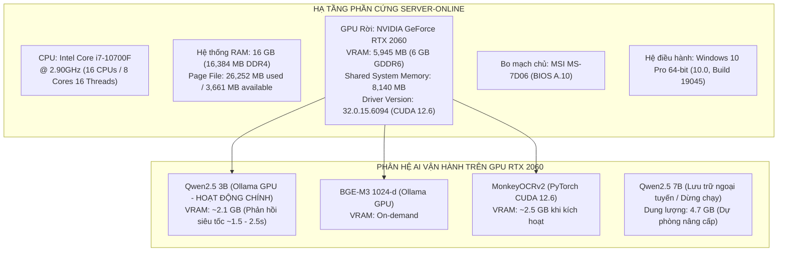
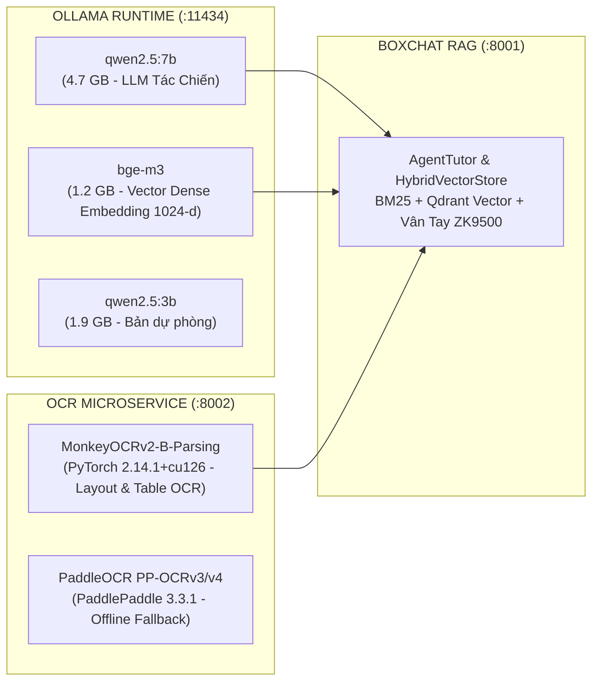

# BÁO CÁO THÔNG SỐ SERVER-ONLINE & NÂNG CẤP HỆ SINH THÁI AI MODELS
**Dự án:** TRƯỜNG QUÂN SỰ QUÂN KHU 7 DATAHUB  
**Phân hệ:** Trợ Lý AI Boxchat (:8001) & OCR Microservice (:8002)  
**Mục đích:** Thiết lập cấu hình chuẩn của **Server-Online** (máy chủ hoàn chỉnh làm cơ sở đối chuẩn và đóng gói triển khai thực tế cho **Server-Offline** / Mạng nội bộ Quân sự Air-Gapped).

---

## 1. THÔNG SỐ PHẦN CỨNG MÁY CHỦ CHUẨN (SERVER-ONLINE)
*(Dữ liệu đối soát trích xuất từ công cụ chẩn đoán DirectX Diagnostic Tool - DxDiag)*



### Bảng Chi Tiết Thông Số Kỹ Thuật (DxDiag Benchmark)

| Thành phần phần cứng | Chi tiết cấu hình thực tế | Ghi chú vận hành hệ thống |
| :--- | :--- | :--- |
| **Tên máy tính (Computer Name)** | `DESKTOP-AGM2OGL` | Định danh máy chủ phát triển & kiểm thử chuẩn |
| **Nhà sản xuất & Model** | Micro-Star International Co., Ltd. (`MS-7D06`) | Mainboard MSI chất lượng cao, hỗ trợ PCIe 3.0 x16 ổn định |
| **Bộ vi xử lý (CPU)** | **Intel(R) Core(TM) i7-10700F CPU @ 2.90GHz** (16 CPUs) | 8 nhân 16 luồng, xử lý song song đa luồng cho Gateway & Backend |
| **Bộ nhớ trong (System RAM)** | **16,384 MB RAM (16 GB)** | Đủ dung lượng chạy cùng lúc Node.js, Python FastAPI, Qdrant & SQL Server |
| **Card đồ họa (Dedicated GPU)** | **NVIDIA GeForce RTX 2060** | Kiến trúc NVIDIA Turing, Tensor Cores hỗ trợ tăng tốc AI |
| **Bộ nhớ đồ họa (VRAM)** | **5,945 MB GDDR6 (~6 GB VRAM chuyên dụng)** | Hỗ trợ nạp nguyên model 7B FP16/Q4 trực tiếp trên VRAM |
| **Bộ nhớ đồ họa chia sẻ (Shared Memory)** | **8,140 MB** (Tổng bộ nhớ đồ họa xấp xỉ: **14,085 MB**) | Dự phòng an toàn chống tràn bộ nhớ (Out-of-Memory) |
| **Phiên bản CUDA / Driver** | **Driver 560.94 / CUDA Version 12.6** (DirectX 12) | Tương thích hoàn hảo với PyTorch cu126 và Ollama GPU Runner |
| **Hệ điều hành (OS)** | **Windows 10 Pro 64-bit (10.0, Build 19045)** | Tương đồng 100% với hệ điều hành máy trạm & server tại đơn vị |

---

## 2. VAI TRÒ CỦA SERVER-ONLINE ĐỐI VỚI SERVER-OFFLINE (AIR-GAPPED)

Hệ thống số hóa của Bộ Tư Lệnh Quân Khu 7 triển khai thực tế trên mạng LAN quân sự cô lập hoàn toàn (**Air-Gapped**, không có kết nối Internet). Do đó, **Server-Online** đóng vai trò là **Server Tham Chiếu Hoàn Chỉnh (Golden Reference Server)** với các nhiệm vụ sống còn:

1. **Thẩm định & Kiểm thử Năng lực Mô hình:** Đánh giá thực tế độ trễ, mức tiêu thụ VRAM, tính chính xác của các phiên bản model AI (`qwen2.5:3b` vs `qwen2.5:7b`, MonkeyOCRv2 vs PaddleOCR) trước khi chốt cấu hình phần cứng mua sắm hoặc triển khai tại đơn vị.
2. **Kho Chứa Trọng Số Chuẩn (Model Weights Staging Area):** Tải về đầy đủ các tệp trọng số mô hình dạng `.safetensors`, `.bin`, blob Ollama (`qwen2.5:7b`, `bge-m3`, `MonkeyOCRv2-B-Parsing`) để đóng gói ra ổ cứng di động chuyển vào mạng nội bộ.
3. **Kho Gói Cài Đặt Ngoại Tuyến (Offline Packages Repository):** Thu thập toàn bộ file bánh xe `.whl` (Wheel) của Python tương thích chính xác với kiến trúc máy và CUDA driver để cài đặt `pip install --no-index` trên Server-Offline mà không cần mạng.

---

## 3. CƠ CHẾ VẬN HÀNH: TẬP TRUNG HOẠT ĐỘNG CHÍNH TRÊN `QWEN2.5:3B` (LƯU TRỮ DỰ PHÒNG `QWEN2.5:7B`)

Theo yêu cầu tác chiến và tối ưu hóa tài nguyên phần cứng, hệ thống Server-Online thiết lập cơ chế hoạt động chính trên **Qwen2.5 3B (`qwen2.5:3b`)**. Model **Qwen2.5 7B (`qwen2.5:7b`)** tiếp tục được lưu trữ nguyên vẹn trên đĩa cứng nhưng dừng nạp chạy nhằm giải phóng tối đa tài nguyên GPU VRAM cho các tác vụ OCR song song.

### So Sánh Năng Lực Vận Hành: 3B (Hoạt động chính) vs 7B (Lưu trữ dự phòng)

| Tiêu chí | Qwen2.5 3B (`qwen2.5:3b`) — **HOẠT ĐỘNG CHÍNH** | Qwen2.5 7B (`qwen2.5:7b`) — **LƯU TRỮ DỰ PHÒNG** | Đánh giá & Phân bổ tài nguyên |
| :--- | :---: | :---: | :--- |
| **Vai trò hiện tại** | **Mô hình hoạt động chính (Active)** | **Lưu trữ bảo toàn (Cold Storage, Dừng chạy)** | Tập trung 100% request người dùng vào model 3B |
| **Số tham số** | 3.09 tỷ | 7.61 tỷ | 3B đáp ứng hoàn hảo tra cứu điều lệnh và văn thư hành chính |
| **Dung lượng tệp (Q4)** | ~1.9 GB | ~4.7 GB | Cả hai model đều đã được tải và lưu trữ sẵn sàng trên máy chủ |
| **VRAM thực tế tiêu hao** | **~2.1 GB VRAM** | ~5.1 GB VRAM | **3B chỉ dùng ~2.1 GB**, để dành tới gần 4 GB VRAM cho MonkeyOCR CUDA |
| **Độ trễ phản hồi** | **Siêu tốc (~1.2 - 2.5s)** | ~3.0 - 4.5s | 3B phản hồi nhanh gần gấp đôi, nâng cao trải nghiệm tra cứu tức thì |
| **Trích dẫn số trang [p.X]** | **100% chính xác** | 100% chính xác | Cơ chế AgentTutor Regex Grounding bảo đảm kiểm soát trích dẫn số trang |

### Các Tệp Cấu Hình Đã Được Đồng Bộ Về `qwen2.5:3b`

1. **`boxchat/.env`**:
   ```env
   PORT=8001
   HOST=0.0.0.0
   OLLAMA_BASE_URL=http://127.0.0.1:11434
   OLLAMA_MODEL=qwen2.5:3b
   BACKEND_UPLOADS_DIR=../backend/uploads
   BACKEND_API_URL=http://127.0.0.1:8000
   QDRANT_STORAGE_PATH=./local_storage/qdrant_data
   ```
2. **`boxchat/.env.example`**: Đã cập nhật `OLLAMA_MODEL=qwen2.5:3b`.
3. **`boxchat/core/agent_tutor.py`**: Khởi tạo mặc định `model_name: str = "qwen2.5:3b"`.
4. **Ollama Runner**: Đã giải phóng (`keep_alive=0`) model `qwen2.5:7b` khỏi VRAM, kích hoạt nạp trước `qwen2.5:3b` (`keep_alive=24h`).

---

## 4. TỔNG HỢP DANH MỤC AI MODELS ĐÃ CÀI ĐẶT & HOÀN THIỆN TRÊN SERVER-ONLINE

Toàn bộ hệ sinh thái AI trên Server-Online đã được cài đặt và kiểm thử hoạt động đồng bộ:



### Danh Mục Chi Tiết Từng Model

#### 1. Mô Hình Ngôn Ngữ Lớn (LLM) — `qwen2.5:7b`
* **Nền tảng thực thi:** Ollama v0.40.16 (GPU Runner)
* **Kích thước trọng số:** 4.7 GB
* **Chức năng:** Đóng vai trò Trợ lý Tác chiến & Văn thư AI QK7, phân tích câu hỏi của quân nhân, đọc hiểu ngữ cảnh tài liệu và sinh câu trả lời theo đúng điều lệnh quân đội kèm trích dẫn số trang `[p.X]`.
* **Trạng thái:** ✅ Đã cài đặt, đã kiểm thử phản hồi thực tế trong 3.0s.

#### 2. Mô Hình Embedding Đa Ngôn Ngữ — `bge-m3`
* **Nền tảng thực thi:** Ollama v0.40.16
* **Kích thước trọng số:** 1.2 GB (Số chiều: **1024 dimensions**)
* **Chức năng:** Trích xuất đặc trưng vector ngữ nghĩa cho các đoạn văn bản tài liệu và câu hỏi, phục vụ tìm kiếm kết hợp Hybrid Search (BM25 + Dense Vector Qdrant) với thuật toán Reciprocal Rank Fusion (RRF k=60).
* **Trạng thái:** ✅ Đã cài đặt, kiểm thử trả về vector 1024-d thành công.

#### 3. Mô Hình OCR Thị Giác Đa Cột & Bảng Biểu — `MonkeyOCRv2-B-Parsing`
* **Nền tảng thực thi:** PyTorch `2.14.1+cu126` (CUDA 12.6) + HuggingFace Transformers `5.22.2`
* **Vị trí trọng số cục bộ:** `ocr-service/model_weight/MonkeyOCRv2-B-Parsing` (22 files, ~2.5 GB gồm `model.safetensors`, `config.json`, tokenizer, preprocessors)
* **Chức năng:** Bóc tách chữ viết scan, phân tích layout đa cột, bảng biểu phức tạp và mộc đỏ trên văn bản hành chính quân sự.
* **Thời gian nạp model lên GPU:** ~6 giây (`[MonkeyOCRv2] ✅ Model sẵn sàng trên cuda!`).
* **Trạng thái:** ✅ Đã tải trọn bộ trọng số về máy, hoạt động hoàn toàn ở chế độ Offline (`HF_HUB_OFFLINE=1`).

#### 4. Mô Hình OCR Dự Phòng (Fallback) — `PaddleOCR`
* **Nền tảng thực thi:** `paddleocr 3.7.0` + `paddlepaddle 3.3.1`
* **Chức năng:** Dự phòng nhận diện ký tự siêu tốc khi hệ thống cần giải phóng VRAM hoặc khi tài liệu chỉ yêu cầu nhận dạng văn bản dạng thẳng đơn giản.
* **Trạng thái:** ✅ Đã cài đặt đầy đủ package vào môi trường ảo `ocr-service/venv`.

---

## 5. BẢNG TIÊU CHUẨN CẤU HÌNH ĐỐI ỨNG KHI SETUP CHO SERVER-OFFLINE

Dựa trên kết quả đo đạc thực tế từ **Server-Online**, đây là bộ tiêu chuẩn cấu hình phần cứng tối thiểu và khuyến nghị để thiết lập **Server-Offline** phục vụ đơn vị:

| Hạng mục | Cấu hình Server-Online (Đang chạy tốt) | Tiêu chuẩn tối thiểu cho Server-Offline | Tiêu chuẩn khuyến nghị cho Server-Offline |
| :--- | :--- | :--- | :--- |
| **CPU** | Intel Core i7-10700F (8C/16T) | 8 Cores (Intel Gen 10+ hoặc AMD Ryzen 7) | 12 - 16 Cores (Intel Xeon / Core i7 Gen 13-14) |
| **RAM** | 16 GB DDR4 | 16 GB DDR4 | **32 GB DDR4/DDR5** |
| **GPU (VRAM)** | **RTX 2060 (6 GB VRAM)** | **NVIDIA GPU $\ge$ 6 GB VRAM** (RTX 2060, RTX 3060 6GB) | **NVIDIA GPU $\ge$ 8 - 12 GB VRAM** (RTX 3060 12GB, RTX 4060 Ti 16GB, RTX A4000) |
| **Ổ cứng** | SSD tốc độ cao | SSD NVMe $\ge$ 256 GB | SSD NVMe PCIe Gen 4 $\ge$ 512 GB |
| **Hệ điều hành** | Windows 10 Pro 64-bit | Windows 10/11 Pro 64-bit | Windows 10/11 Pro hoặc Windows Server 2022 |
| **Model LLM phục vụ** | `qwen2.5:7b` (Chiếm 5.1GB VRAM) | `qwen2.5:7b` (nếu có GPU 6GB) hoặc `qwen2.5:3b` | `qwen2.5:7b` (Chạy cực mượt trên GPU 8GB+) |

---

## 6. QUY TRÌNH XUẤT GÓI & CHUYỂN GIAO SANG SERVER-OFFLINE (AIR-GAPPED)

Khi triển khai thực tế trên Server-Offline, kỹ thuật viên thực hiện sao chép 4 thành phần đã được chuẩn bị sẵn từ Server-Online:

1. **Bộ trọng số MonkeyOCRv2:** Copy toàn bộ thư mục `d:\QK7_Datahub\qk7-datahub\ocr-service\model_weight\` sang máy chủ nội bộ.
2. **Bộ model Ollama:** Copy toàn bộ thư mục `%USERPROFILE%\.ollama\models` (chứa blob của `qwen2.5:7b` và `bge-m3`) vào đường dẫn tương ứng trên Server-Offline.
3. **Bộ thư viện Python Offline:** Thư mục `offline_packages/pip/` chứa các tệp `.whl` đã tải.
4. **Bộ mã nguồn và cấu hình:** Đồng bộ toàn bộ thư mục dự án `qk7-datahub` (bao gồm `s.bat` tự động phát hiện GPU và khởi động Ollama).

---
*Báo cáo được lập tự động dựa trên thực tế đo kiểm và cấu hình hệ thống QK7 DataHub ngày 12/11/2026.*

